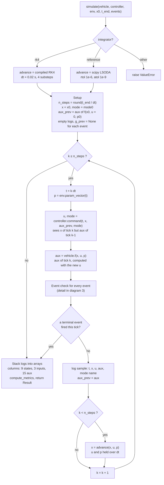
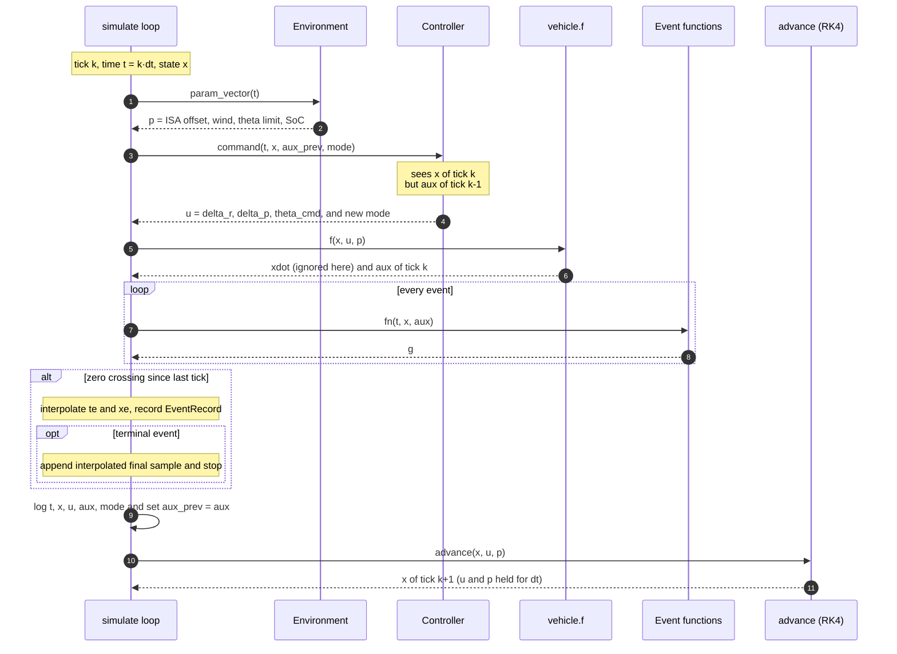
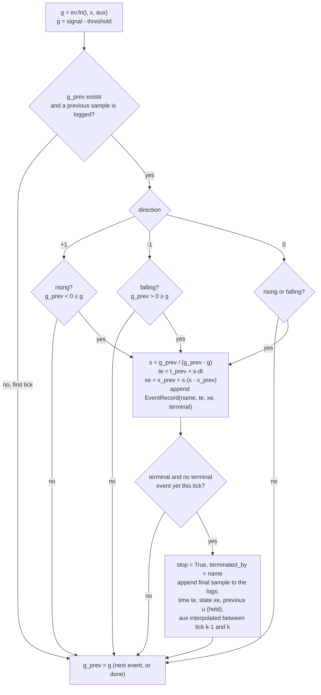
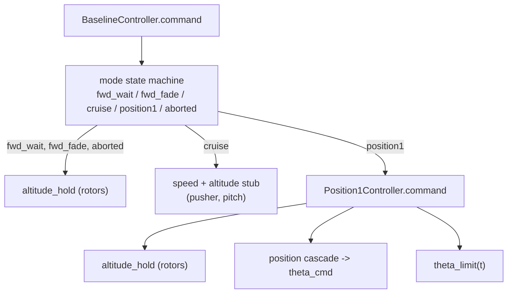
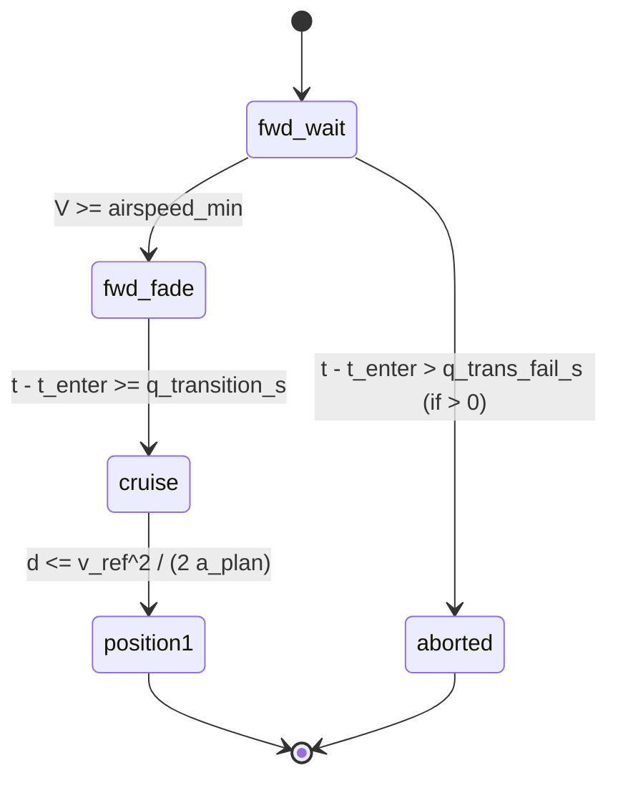

# module.physics
## aero.py

Linear aerodynamics below stall, flat-plate behaviour above, joined by a smooth sigmoid so that gradient-based optimisation works. The flat-plate form follows Cory and Tedrake; the blending form follows Beard and McLain and is to be checked against the book.
$$
\sigma(\alpha_w)=\frac{1+e^{-M(\alpha_w-\alpha_s)}+e^{M(\alpha_w+\alpha_s)}}{\left(1+e^{-M(\alpha_w-\alpha_s)}\right)\left(1+e^{M(\alpha_w+\alpha_s)}\right)}
$$
$$
C_L=(1-\sigma)\,(C_{L0}+C_{L\alpha}\alpha_w)+\sigma\,C_N\sin\alpha_w\cos\alpha_w,\qquad C_D=(1-\sigma)\,(C_{D0}+k\,C_{L,lin}^2)+\sigma\,(C_{D0}+C_N\sin^2\alpha_w)
$$
$$
L=\tfrac12\rho V^2 S\,C_L,\qquad D=\tfrac12\rho V^2 S\,C_D
$$
Used for later analysis B2 (remove later #todo):
$$
V_s=\sqrt{\frac{2W}{\rho S\,C_{L,max}}},\qquad \frac{L}{W}=\left(\frac{V}{V_s}\right)^2\frac{C_L}{C_{L,max}}
$$
## attitude.py

The UAV's plant model is simplified to the following. Few best guesses will be used; but later should be confirmed by logs or SITL. Sensitivity analysis should reveal more about the importance of these parameters. ArduPilot's attitude input time constant (Q_A_INPUT_TC) is the parameter that shapes this response, and a forum report found raising it helped with airbrake pitch oscillations. #todo 
$$
\dot\theta=q,\qquad \dot q=\omega_n^2(\theta_{cmd}-\theta)-2\zeta\omega_n q,\qquad |q|\le q_{max},\ \ |\theta_{cmd}|\le\theta_{max}(t)
$$
This model is used in the equation of motions (tag here #todo) and is used in ardupilot_like.py (tag here #todo); which is then used in time-domain analysis (B1, B2, C, D and E).

## rotor.py

VTOL (`lift_rotor`) and forward (`pusher`) propellers are modelled using:
$$
n=\frac{\omega}{2\pi},\quad J=\frac{V_c}{nD_r},\quad \mu=\frac{V_e}{\omega R}
$$
$$
T_i=C_T(J,\mu)\,\rho n^2D_r^4,\quad Q_i=C_Q(J,\mu)\,\rho n^2D_r^5,\quad H_i=C_H(J,\mu)\,\rho n^2D_r^4,\quad T_r=n_rT_i,\quad H_r=n_rH_i\qquad(6.7)
$$
Coefficients are modelled as:
$$
C_T(J,\mu) = \left(C_{T_0} + J C_{T_1}+J^2C_{T_2}\right) \cdot \left(1+ \mu^2k \right)\quad\quad C_T(J,\mu) = \left(C_{p_0} + J C_{p_1}+J^2C_{p_2}\right) \cdot \left(1+\mu^2k \right)\quad\quad C_H(j,\mu) = \mu C_{H_1}
$$
### State Variable Clipping via Hyperbolic Smoothing

The state variables are limited, and a hyperbolic smoothing function (`_clip`) is applied to eliminate non-differentiable kinks for collocation methods (see `collocation.py` #todo):

$$J_{\min} < J < J_{\max} \quad\quad \mu_{\min} < \mu < \mu_{\max}$$

The mathematical formulations for these smooth operators are defined as:

$$\text{smax}_{\tau }(a,b)=\frac{a+b+\sqrt{(a-b)^{2}+4\tau ^{2}}}{2} \quad\quad \text{smin}_{\tau }(a,b)=\frac{a+b-\sqrt{(a-b)^{2}+4\tau ^{2}}}{2}$$

The Python snippet implements this by chaining a smooth maximum followed by a smooth minimum:

```python
def _clip(x: Num, lo: float, hi: float, eps: float = 0.0) -> Num:
    """clip(x, lo, hi); with eps > 0 a smooth (hyperbolic) version for collocation."""
    if eps == 0.0:
        return ca.fmin(ca.fmax(x, lo), hi)
    
    # 1. Smooth Maximum: smax(x, lo)
    d = x - lo
    y = lo + 0.5 * (d + ca.sqrt(d * d + eps * eps))  
    
    # 2. Smooth Minimum: smin(y, hi)
    e = hi - y
    return hi - 0.5 * (e + ca.sqrt(e * e + eps * eps))  
```

## motor.py

The motor is modelled using a simple *motor constant* ($K_e$); and the current is limited to be within the limits $[0,I_{lim}]$. The limiting id done using the above `_clip` function. The ESC dead-zone is modelled as a simple scaled throttle factor and similar `_clip` limiting is done with $[0,1]$. The torque is modelled as $\tanh$ smoothing function. The following equations are applied to both vtol and pusher motors.
$$
V_m=\delta\,V_{bus},\qquad \delta = \mathrm{\_clip}\!\left(\frac{th-th_{dead}}{1-th_{dead}},\,0,\,1,\,\tau\right),\qquad I_m=\mathrm{\_clip}\!\left(\frac{V_m-K_e\omega}{R_m},\,0,\,I_{lim},\,\tau\right),\qquad Q_m=K_t\,\left(I_m-I_0\tanh\!\left(\frac{I_m}{\tau}\right)\right)\ \ (I_m>0)
$$
$$
I_{rot}\,\dot\omega = Q_m - Q_i(J,\mu,\rho,\omega)
$$
The issue with $\tanh$ smoothing function is when $I_m \lt I_0$ which results in a negative torque. Although, the current would be higher everywhere this `torque` function quirk does not happen; using a better function can be useful with:
$$
Q_{m}=I_{m}K_t \cdot\mathrm{smax}_0 (I_{m}-I_{0})\qquad\text{given ($I_m\gt 0$)}
$$
![[torque_vs_current_limts_crt_impl.png]]

Here the assumption of $I_m \gt 0$ is valid as the $I_m$ is already clipped before it is used in the torque equations. The code would change as following:

```python 
def torque_fixed(I_m: Num, p: MotorParams, smooth: float = 0.0) -> Num: 
	"""Computes Q_m smoothly without unphysical zero-crossing dips.""" 

	if smooth == 0.0: # Standard hard clipping 
		mag = ca.fmax(ca.fabs(I_m) - p.I0, 0.0) 
		return p.Kt * ca.sign(I_m) * mag 
	
	# 1. Evaluate smooth magnitude excess over I0 
	mag_smooth, _ = _smax0(I_m - p.I0, smooth)     # clipped_current gives I_m > 0 
	
	return p.Kt * mag_smooth
```

## battery.py
$$
V_{bus}=V_{oc}(SoC)-R_0I_{bus}-v_1,\qquad \dot v_1=-\frac{v_1}{R_1C_1}+\frac{I_{bus}}{C_1},\qquad I_{bus}=n_r\delta_rI_{m,r}+\delta_pI_{m,p}+I_{av}
$$
The above equations are circular - $I_{bus}$ ($I_{m,p}$ and $I_{m,r}$) require $V_{bus}$; and $V_{bus}$ requires $I_{bus}$. Newton iterative approach will be used where the root equation is defined as:
$$
g(V_{bus}) = V_{bus}-\left(V_{hi}-R_{b,0}I_{bus}(V_{bus})\right),\qquad \text{where }V_{hi}=V_{oc}-v_1 \text{ (treated as constants for a given $t$)}
$$
Taking a derivative of each motor current demand with respect to $V_{bus}$ gives $\mathrm{d}I_{bus}/\mathrm{d}{V_{bus}} = n_r\delta_r^2/R_{m,r}+\delta_p^2/R_{m,p}\ge 0$; which then gives $g'(V_{bus})=1+R_{b,0}\times \mathrm{d}I_{m}/\mathrm{d}{V_{bus}}\ge1$. This means this equations are strictly increasing and have unique roots. Starting the iterations at a know *high* point also helps with Netwons iterations - for example, starting with $V_{bus_i}=V_{hi}$ as $g(V_{bus_i})=R_{b,0}I_{bus}(V_{hi})\ge0$. In battery.py, the iterations are kept constant (file constant `NEWTON_ITERATIONS` to 12) to allow CasADi graph mapping. A closed-form equation:
$$
V_{bus}=\frac{V_{oc}-v_1+R_0\left(\dfrac{n_r\delta_rK_e\omega_r}{R_m}+\dfrac{\delta_pK_{e,p}\omega_p}{R_p}-I_{av}\right)}{1+R_0\left(\dfrac{n_r\delta_r^2}{R_m}+\dfrac{\delta_p^2}{R_p}\right)}
$$
The denominator is the voltage-sag contribution and the $\omega$ terms are the back-EMF contributions.
As of now, avionics are modelled using a constant amperage - a much better approach is to have a constant power. #todo (constant-power avionics breaks $g'\ge1$ and uniqueness below $\sqrt{(R_0P)}\approx 1 V$; add a V floor and the $-P/V^2$ slope)
## vehicle.py
$$
\dot x=v_x,\qquad \dot h=v_h
$$
$$
m\dot v_x = T_p\cos\theta - T_r\sin\theta - H_r\cos\theta - L\sin\gamma - D\cos\gamma
$$
$$
m\dot v_h = T_p\sin\theta + T_r\cos\theta - H_r\sin\theta + L\cos\gamma - D\sin\gamma - mg
$$
$$
V_c = v_h\cos\theta - v_a\sin\theta,\qquad V_e = v_a\cos\theta + v_h\sin\theta,\qquad \alpha=\theta-\gamma
$$
$$
v_a = v_x+w_h.\qquad V=\sqrt{v_a^2+v_h^2}, \qquad \gamma = \arctan\left(\frac{v_h}{v_a}\right)
$$
The above set are used in the returned function of `CasadiVehicle._build(self) -> ca.Funtion` method. Intentionally, there is no pitch moment balancing equations involved (including $I_{YY}$ or similarly bounded contributions). Additionally, the above physics including the aero, attitude, rotor, motor and battery are internally applied. The above states are organised as the following variables in the code:
$$
X=
\begin{bmatrix}
x\\h\\v_x\\v_h\\\theta\\q\\\omega_r\\\omega_p\\v_1
\end{bmatrix}
\qquad
U=
\begin{bmatrix}
\delta_r\\\delta_p\\\theta_{cmd}
\end{bmatrix}
\qquad
P=\begin{bmatrix}
\Delta T_{ISA}\\w_h\\\theta_{lim}\\SoC
\end{bmatrix}
$$

$X$ is current state; $U$ is control inputs; $P$ is parameters; $w_h$ is headwind; $\theta_{lim}$ is allowed maximum tilt angle; $\Delta T_{ISA}$ is temperature offset at current $h$; $SoC$ is battery state of charge. The vehicle implements CasADi implementation of the above equation of motion and returns:
$$
f:(X, U, P) \to (\dot{X}, AUX)
$$
$$
\dot{X}=
\begin{bmatrix}
\dot{x}\\\dot{h}\\\dot{v}_x\\\dot{v}_h\\\dot{\theta}\\\dot{q}\\\dot{\omega}_r\\\dot{\omega}_p\\\dot{v}_1
\end{bmatrix}
\qquad
AUX=
\begin{bmatrix}
L\\D\\T_r\\T_p\\H_r\\I_{bus}\\V_{bus}\\\alpha\\V\\\gamma\\v_{rs}\\I_{m,r}\\I_{m,p}\\\rho\\C_L
\end{bmatrix}
$$
Here $U$ is provided by the (any) controller which in instantiated in the `simulate`.

# module.dynamics

## simulate.py

`simulate` steps the vehicle forward in fixed ticks of $\Delta t = 0.02$ s. In each tick the controller reads the state and chooses commands, `vehicle.f` computes the diagnostics (`aux`), the event functions are checked, the tick is logged, and RK4 advances the state to the next tick with the command held constant (zero-order hold).






| Quantity | Tick it belongs to | Used by |
| --- | --- | --- |
| `x` | k (current, exact) | controller, events, log |
| `aux` for the controller (`aux_prev`) | k-1 (one tick, 20 ms, old) | controller only |
| `aux` for events and the log | k (computed with the new `u`) | events, log |
## events.py



An event is a **zero crossing of a scalar signal**, $g = \text{signal} - \text{threshold}$, checked once per tick.

```python
@dataclass(frozen=True)
class Event:
    name: str
    fn: EventFn           # (t, x, aux) -> g
    direction: int = 0    # +1 rising, -1 falling, 0 either
    terminal: bool = False
```

Crossing tests between consecutive ticks:

$$\text{rising: } g_{k-1}<0\le g_k \qquad \text{falling: } g_{k-1}>0\ge g_k$$

Assuming $g$ is linear within one step:

$$s=\frac{g_{k-1}}{g_{k-1}-g_k},\qquad t_e=t_{k-1}+s\,\Delta t,\qquad x_e=x_{k-1}+s\,(x_k-x_{k-1})$$

A **terminal** event truncates the run at $(t_e, x_e)$. That final sample holds the previous command, and its aux is interpolated.

Subtleties:

1. If $g$ is already past zero at the first sample, the event **never fires**, because there is no earlier sample on the other side.
2. Only the samples are checked. A signal that crosses and comes back within 20 ms is missed.
3. Several events can fire in one tick and all of them are recorded. Only the **first terminal one in list order** stops the run. A second terminal event in the same tick still gets an `EventRecord`, so its time can be later than where the run was cut.
4. Event signals use the **current** tick's `aux` (`aux_k`). The controller uses `aux_prev`. So an event timestamp can be up to one tick earlier than the controller's reaction to the same condition.
5. The interpolated final aux blends $aux_{k-1}$ and $aux_k$, but $aux_k$ was computed with the new command while the logged `u` is the previous one. This only touches the electrical aux (`V_bus`, `I_bus`, ...) at the last sample.
6. A non-terminal event can fire repeatedly. `Result.event(name)` returns only the first record.

### `airspeed_reached(v_min, terminal=False)`

```python
Event("airspeed_reached", lambda t, x, a: a["V"] - v_min, +1, terminal)
```

- **Signal:** $g = V - V_{min}$, where $V=\sqrt{v_a^2+v_h^2}$ and $v_a=v_x+w_h$ (airspeed, including headwind and the vertical component).
- **Direction and terminal:** rising only. It is the only factory with a configurable `terminal`, and the default is non-terminal.
- **Meaning:** the forward-transition speed (AIRSPEED_MIN) has been reached.
- **Where it is used:** **in no analysis.** Only `test_dynamics.py` uses it. `BaselineController` makes the same test itself in `fwd_wait` (`aux["V"] >= airspeed_min`), using the one-tick-old `aux_prev`.
- **Gotcha:** if the run starts above `v_min`, it never fires.

### `battery_cutoff(v_min)`

```python
Event("battery_cutoff", lambda t, x, a: a["V_bus"] - v_min, -1, True)
```

- **Signal:** $g = V_{bus} - V_{min}$, with $V_{min}=33$ V by default (`BatteryParams.V_min`).
- **Direction and terminal:** falling, terminal.
- **Meaning:** the pack can no longer hold the bus voltage. The run is a failure and is cut there.
- **Subtlety:** `V_bus` comes from the Newton solve and depends on the current command, so a high throttle can trigger it through sag.
- **Where it is used:**
  - `runs.end_events` includes it, so analyses B2 and C and the B1 baseline run and replay all see it.
  - `runs.failure_flags` turns `terminated_by == "battery_cutoff"` into a failure flag.
  - `braking.py` (analysis D) does **not** include it.
  - In B1 the same limit is a path constraint ($V_{bus}\ge V_{min}$ at every node), and the replay passes only the first event (`[:1]`).

### `touchdown(ground_amsl_m=0.0)`

```python
Event("touchdown", lambda t, x, a: float(x[1]) - ground_amsl_m, -1, True)
```

- **Signal:** $g = h - h_{ground}$, with $h$ = `x[1]`, the altitude AMSL state.
- **Direction and terminal:** falling, terminal.
- **Meaning:** the aircraft has reached the ground, or a crash floor.
- **Where it is used:** the analyses pass `scen.altitude_amsl_m - agl0`, with `agl0 = 100` m by default. That is a floor 100 m **below the starting altitude**, which assumes the segment starts 100 m above ground. `Scenario.ground_amsl_m` is not used here.
- **Failure mapping:** `failure_flags` maps it to a `touchdown` flag.
- **Gotcha:** it only checks height, not vertical speed, so it can't tell a soft landing from a crash.

### `ground_speed_below(v_f)`

```python
Event("ground_speed_reached", lambda t, x, a: float(x[2]) - v_f, -1, True)
```

- **Signal:** $g = v_x - v_f$. The state `vx` is already a ground-frame speed, and airspeed is $v_x + w_h$.
- **Direction and terminal:** falling, terminal.
- **Meaning:** end of the back-transition (the aircraft has essentially stopped). The analyses use $v_f = 1$ m/s.
- **Name gotcha:** the factory is called `ground_speed_below`, but the event's name is **`"ground_speed_reached"`**. That string is what `braking.py`, `energy.py` and `runs.py` compare against `terminated_by`.
- **Use:** `braking.py` decides `stopped` from it, and the stopping distance $x_{actual}$ is read at the interpolated sample. B1's end condition $v_x(T_f)=v_f$ is the same criterion.
- **Gotcha:** it fires on the first downward crossing only, and if the run starts below `v_f` it never fires.

### `vrs_entry(limit)`

```python
Event("vrs_entry", lambda t, x, a: a["vrs_ratio"] - limit, -1, False)
```

- **Signal:** $g = V_c/v_h - \text{limit}$, using the aux `vrs_ratio`.
- **Direction and terminal:** falling, non-terminal. It marks entry only.
- **Meaning:** the ratio of axial descent speed to hover induced velocity has dropped below the chosen boundary.
- **Where it is used:** **in no analysis.** It is not in `end_events`. The boundary has to be a sourced value, and the repo has no default.
- **Gotchas:**
  - With the rotors off, `T_r` sits at its floor, so $v_h$ is tiny and the ratio is hugely negative. If $V_c<0$, $g$ starts below zero and the first crossing is rising, which this event ignores.
  - A falling-only event records the entry time but not the time spent inside. For that you would use direction 0 and pair the crossings.

### Where each event in the proposal actually lives

| Proposal event                    | Implementation                                                                                   |
| --------------------------------- | ------------------------------------------------------------------------------------------------ |
| Transition speed reached          | `BaselineController` `fwd_wait` check. `airspeed_reached` exists but is unused                   |
| Transition timeout (Q_TRANS_FAIL) | `BaselineController` goes to mode `aborted`                                                      |
| Position1 entry                   | `BaselineController` cruise to position1 test                                                    |
| Battery cut-off                   | `battery_cutoff`, terminal, in `end_events`                                                      |
| Stall                             | After the run, in `runs.failure_flags`: $\alpha_w>\alpha_s$ while $V\ge V_s$ for more than 0.3 s |
| VRS entry                         | `vrs_entry` exists but is unused                                                                 |
| Touchdown                         | `touchdown`, terminal, in `end_events`                                                           |
| End of transition                 | `ground_speed_below(v_f)`, terminal                                                              |
## control/ardupilot_like.py

> [!abstract] What this file is The **baseline controller**?
>  A hand-written imitation of how ArduPilot's QuadPlane flies a VTOL landing approach. It is the thing every analysis compares the optimised trajectories against (A, B1, B2 are "best possible", this is "what ArduPilot-style logic would do"). It is a _policy_: a function `(t, x, aux, mode) -> (u, mode')`. It has no physics in it. The only physics call is `trim.hover_throttle` (see [[trim.py]]) to get a hover feed-forward.

Contract (from `control/base.py`):

```python
def command(t, x, aux, mode) -> (u, mode_new)
# x    : state [x, h, vx, vh, theta, q, omega_r, omega_p, v1]
# aux  : dict of last tick's outputs (V, L, D, ...)  -> see [[simulate.py]], this is aux_{k-1}
# mode : ModeState | None   (None on the very first call)
# u    : [delta_r, delta_p, theta_cmd]   rotor throttle, pusher throttle, pitch command [rad]
```

`ModeState` is **frozen** (immutable). Controller memory is carried by `simulate()` and handed back each tick:

| field     | meaning                                                                        |
| --------- | ------------------------------------------------------------------------------ |
| `name`    | current mode string (`fwd_wait`, `fwd_fade`, `cruise`, `position1`, `aborted`) |
| `t_enter` | time this mode was entered (drives ramps and fades)                            |
| `t_last`  | time of the previous command, so `dt = t - t_last` is the integrator step      |
| `memory`  | dict of floats: `integ` (integrator), `p_cmd` (pusher command)                 |

> [!note] Why `dt = t - t_last` and not a stored step The controller does not know the tick length. It measures it from the clock, so the same code works if `simulate()` changes `dt_ctrl`. On the first call `t_last = t`, so `dt = 0` and the integrator does not move.

---

Two classes of "thing":
1. **Pure functions / parameter containers**: `BackTransitionParams`, `altitude_hold`, `theta_limit`.
2. **Controllers (stateful through `ModeState`)**:
    - `Position1Controller`: the back-transition itself (rotors hold altitude, pitch brakes).
    - `BaselineController`: a state machine wrapping it: forward transition, cruise stub, then hand-off to `Position1Controller`.

### BackTransitionParams

Frozen dataclass. Numbers are the code defaults. Gains are **ASSUMED placeholders**, not ArduPilot values.

|group|field|default|ArduPilot analogue|
|---|---|---|---|
|pitch envelope|`theta_A`|20°|`Q_A_ANGLE_MAX`|
||`theta_P`|25°|`PTCH_LIM_MAX_DEG`|
||`theta_B`|`None` (no cap)|`Q_BCK_PIT_LIM`|
||`T_bt`|3 s|`Q_BACKTRANS_MS`|
|altitude hold|`h_tgt`|0|altitude to hold (set by caller)|
||`delta_hover`|0.3|feed-forward; overwritten by `for_vehicle`|
||`delta_min`, `delta_max`|0.1, 0.95|`Q_M_SPIN_MIN` (ArduPilot default 0.15), max throttle|
||`K_h`|0.5|position P: height error → climb-rate demand|
||`K_vh`|0.02|velocity P: climb-rate error → throttle|
||`K_i`|0.01|velocity I|
||`v_dem_max`|3 m/s|climb-rate limit|
||`i_max`|20|integrator clamp|
|position cascade|`x_tgt`|0|stop point (x is negative while approaching)|
||`K_p`|0.5|position gain|
||`K_v`|1.0|velocity gain|
||`a_lim`|3 m/s²|cascade deceleration limit (a tuning value, **not** `Q_TRANS_DECEL`)|
||`brake_at_limit`|False|worst-case switch for analysis D|
#### `for_vehicle(vp, rho, soc, h_tgt, **kw)`

Builds the params with `delta_hover = trim.hover_throttle(vp, rho, soc)`, then applies overrides with `dataclasses.replace`. So the hover feed-forward is the throttle that gives $T = mg$ at the _given_ $\rho$ and $SoC$ (zero inflow, still air).
#### `theta_limit(t_rel)`
$$ \theta_{lim}(t) = \min\!\Big(\theta_{cap}\cdot \min\big(1,t/T_{bt}\big),\ \theta_B\Big),\qquad \theta_{cap}=\min(\theta_A,\theta_P) $$
- The allowed nose-up pitch ramps **linearly from 0 to 20° over `T_bt`** (3 s), measured from `t_enter` of the current mode.
- If `theta_B` is set, it is a flat extra cap.
- At $t = 1s$, the limit is $6.7^\circ$, which can give at most $a \approx g\cdot \tan(6.7^{\circ}) \approx 1.15 m/s^2$ of deceleration.

> [!warning] Differences from ArduPilot (from `ardupilot_open_questions.md` in repo)
> 
> - ArduPilot's ramp starts at `max(last_fw_nav_pitch, 0)`, not at 0, and has a nose-down envelope too.
> - `Q_BCK_PIT_LIM` is not a constant: it is `θ_B0·(V_min/V)²` and only applies with the NEW forward-throttle scheme.
> - In the trajectory traces, the ramp did **not** bind in cascade mode (same result with no ramp); the 20° cap binds late. Don't attribute early-braking behaviour to the ramp.

---
### `altitude_hold`

```python
v_dem = clip(K_h * (h_tgt - h), -v_dem_max, +v_dem_max)   # outer loop (P)
err   = v_dem - vh                                         # climb-rate error
integ = clip(integ + err*dt, -i_max, +i_max)               # I state
delta = delta_hover + K_vh*err + K_i*integ                 # feed-forward + PI
return clip(delta, delta_min, delta_max), integ
```

Cascade: **height error → climb-rate demand → throttle**.
$$ v_{dem}=\mathrm{sat}\big(K_h(h_{tgt}-h)\big),\qquad \delta = \delta_{hover} + K_{vh}(v_{dem}-v_h) + K_i\!\int (v_{dem}-v_h)\,dt$$
Notes:
- The **integral is clamped**, not the output. If the output saturates at `delta_min`/`delta_max` while `|K_i·integ| < K_i·i_max = 0.2`, the integrator can still wind up inside its clamp.
- `delta_hover` is a _pre-dead-zone command_. The dead zone (0.05) and $V_{bus}$ sag are handled by `trim.required_rotor_command`, which inverted them.
- The same function is reused in `fwd_wait`, `fwd_fade`, `aborted` and `position1`.
---
### Position1Controller: back-transition

State: `memory = {"integ": ...}` (altitude integrator only). The pusher is **always 0** here.

```python
if mode is None: mode = ModeState("position1", t, t, {"integ": 0.0})
dt = t - mode.t_last
delta, integ = altitude_hold(p, h, vh, mode.memory["integ"], dt)
lim = p.theta_limit(t - mode.t_enter)
if p.brake_at_limit:
    theta_cmd = lim                      # analysis D worst case
else:
    d     = x_tgt - x                    # distance still to go (>0 approaching)
    d_lin = 2*a_lim / K_p**2
    v_des = sqrt(2*a_lim*d) if d > d_lin else K_p*d
    a_cmd = K_v * (vx - v_des)           # wanted deceleration
    theta_cmd = clip(atan(a_cmd/g), 0, lim)
return [delta, 0.0, theta_cmd]
```
#### Position cascade

**Desired speed profile**, a function of distance-to-go:
$$ v_{des}(d)= 
\begin{cases} \sqrt{2a_{lim}d} & d > d_{lin}\\[2pt] K_pd & d \le d_{lin} \end{cases} \qquad d_{lin}=\frac{2a_{lim}}{K_p^2} $$
- The square-root segment is the speed from which you can still stop in `d` at constant deceleration `a_lim` (from $v^2 = 2ad$).
- Near the target a pure sqrt has infinite slope, so it is replaced by a linear segment $v = K_p d$. The two segments meet at $d_{lin}$ (value $2a_{lim}/K_p$ on both sides; the slope is not continuous, it halves; #todo check if the $d_{lin}$ can be used with a $0.5$ factor to smooth this; what are the implications?).
- With defaults: $d_{lin} = 2\cdot3/0.25 = 24$ m.

**Velocity loop → acceleration → pitch:**
$$ a_{cmd}=K_v(v_x - v_{des}),\qquad \theta_{cmd}=\mathrm{clip}\big(\arctan(a_{cmd}/g),\ 0,\ \theta_{lim}\big) $$
- $a = g\tan\theta$ is the horizontal acceleration the rotor thrust vector gives at pitch θ, if the rotors carry the whole weight (vertical force balance $T\cos\theta = mg$).
- A positive `a_cmd` means "going faster than the profile allows", so brake, i.e. pitch nose-up. In this model positive θ points rotor thrust backwards (the `−T_r sinθ` term in `vx_dot`).
- The lower clip at 0 means the controller can **only brake**. If it overshoots the target ($d \lt 0,\, v_x \lt 0$) it never pitches to come back.

> [!example] Why the cascade "commands nothing" at the start?
> Take the default switch point: V = 22 m/s, `a_plan` = 2.5 → switch at $d = V^2/(2a_{plan}) = 96.8$ m. (with current default values)
> 
> At that distance $v_{des} = \sqrt{2\cdot3\cdot96.8} = 24.1$ m/s, which is **above** the actual 22 m/s. So $a_{cmd} = 1\cdot(22-24.1) < 0$ → clipped to θ = 0. The cascade only starts to brake once $v_{des}$ falls below the current speed. That happens because `a_plan` (2.5, used for the _switch decision_) is gentler than `a_lim` (3.0, used for the _profile_). The two are separate numbers; ArduPilot uses a single `Q_TRANS_DECEL` for both, plus a feed-forward acceleration. This is a repo-side placeholder, which is why the idealised overshoot results should not be read as ArduPilot's behaviour. #todo remove this

#todo why are we using $a_{lim}$ as a proper dependency variable? where does this variable comes from? Nothing in ArduPilot has similar.
#### `brake_at_limit`

`theta_cmd = lim`: pitch straight to the envelope limit and hold. It is not a controller; analysis D uses it to find the _shortest possible_ braking distance for a given entry speed, to compare against the cascade.

#### What the rotors are doing

Altitude hold runs independently of the pitch law. As the aircraft pitches nose-up, rotor thrust $T_r$ must carry the weight _and_ push backwards, so the vertical balance needs more thrust; the PI sees a sinking aircraft and raises δ. There is no explicit $1/\cos\theta$ feed-forward in the code.
### BaselineController



| field              | default    | meaning                                                             |
| ------------------ | ---------- | ------------------------------------------------------------------- |
| `back`             | (required) | the `BackTransitionParams`                                          |
| `airspeed_min`     | 14 m/s     | `AIRSPEED_MIN`: wait for this before fading rotors                  |
| `q_transition_s`   | 5 s        | `Q_TRANSITION_MS`: rotor fade length                                |
| `tkoff_thr_max`    | 0.7        | pusher command during the forward transition                        |
| `q_trans_fail_s`   | 0 (off)    | `Q_TRANS_FAIL`: abort if airspeed not reached in time               |
| `a_plan`           | 2.5 m/s²   | `Q_TRANS_DECEL`: used **only in the switch test**                   |
| `speed_test`       | `"ground"` | speed in the switch test; `"air"` is not ArduPilot behaviour (O-02) |
| `v_cruise`         | 22 m/s     | cruise speed target                                                 |
| `delta_p_trim`     | 0.5        | cruise pusher guess (feed-forward)                                  |
| `theta_trim`       | 0          | cruise pitch trim                                                   |
| `r_tecs`           | 0.5 /s     | pusher command rate limit                                           |
| `tau_h`            | 1 s        | time constant of the pusher command lag                             |
| `K_s`, `K_si`      | 0.05, 0.01 | pusher P and I per m/s speed error                                  |
| `K_hp`, `K_hd`     | 0.02, 0.03 | cruise pitch per metre / per m/s climb rate                         |
| `theta_cruise_max` | 0.15 rad   | cruise pitch clamp (≈ 8.6°)                                         |

| mode        | $\delta_r$ (rotors)                  | $\delta_p$ (pusher)    | $\theta_{cmd}$      |
| ----------- | ------------------------------------ | ---------------------- | ------------------- |
| `fwd_wait`  | `altitude_hold`                      | `tkoff_thr_max` (0.7)  | 0                   |
| `fwd_fade`  | `altitude_hold × (1 − t_rel/T_fade)` | 0.7                    | 0                   |
| `cruise`    | 0                                    | rate-limited TECS stub | altitude-hold pitch |
| `position1` | `altitude_hold`                      | 0                      | cascade             |
| `aborted`   | `altitude_hold`                      | 0                      | 0                   |

- **fwd_wait**: rotors hold altitude (aircraft is still hovering-ish), pusher at 0.7, wait for airspeed.
- **fwd_fade**, eq. (8.7): the _closed-loop_ altitude-hold output is scaled by a linear factor going 1 → 0 over `q_transition_s`. The PI still runs on the unscaled output, so the integrator can wind up as the scale shrinks.
- **cruise**: rotors off. The rest is the "stub".
- **aborted**: pusher off, rotors still hold altitude, pitch 0.

#### 6.2 Transition mechanics

```python
def switch(new):
    name, t_enter = new, t
    mem["integ"] = 0.0          # integrator reset on every switch
```

- The checks are sequential `if`s (not `elif`), so one tick can pass through more than one transition.
- `new_mem = mem` is an alias of a **copy** of the old memory (`mem = dict(mode.memory)`), so the old frozen `ModeState` is never mutated.
- `aux["V"]` is the airspeed from the _previous_ tick's evaluation (see [[simulate.py]]): the controller sees $x_k$ and $aux_{k-1}$, so `fwd_wait → fwd_fade` triggers up to one tick late.
- `t_enter` is set to the switch time, so the pitch ramp in `Position1Controller` starts at 0 at the hand-off.

#### 6.3 Cruise stub

```python
integ += (v_cruise - V) * dt                                   # speed error integral (no clamp)
d_tecs = clip(delta_p_trim + K_s*(v_cruise - V) + K_si*integ, 0, 1)
rate   = clip((d_tecs - p_cmd)/tau_h, -r_tecs, +r_tecs)
p_cmd  = clip(p_cmd + rate*dt, 0, 1)                           # pusher command
theta  = clip(theta_trim + K_hp*(h_tgt - h) - K_hd*vh, ±theta_cruise_max)
```

- Pusher = feed-forward + PI on airspeed, through a first-order lag whose rate is capped at `r_tecs`. On entry `p_cmd` starts at `tkoff_thr_max`, so the pusher _ramps down_ from 0.7 to the cruise value instead of stepping.
- Pitch holds altitude with a PD law (height error, climb rate), clamped to ±0.15 rad.
- The integral here is the speed error integral, a different quantity from the rotor altitude integral. `switch()` resets `integ` on entry, so there is no confusion, but the same dict key does two jobs.
- Not modelled: TECS energy blending, `BATT_WATT_MAX`.

#### 6.4 Switch test, eq. (8.11)

```python
v_ref = x[2] if speed_test == "ground" else V
if x_tgt - x[0] <= v_ref**2 / (2*a_plan):  switch("position1")
```
$$ d \le \frac{V_{ref}^2}{2,a_{plan}} $$
"Start braking when the remaining distance equals the stopping distance at `a_plan`."

> [!warning] Differs from ArduPilot (O-02) ArduPilot's APPROACH → AIRBRAKE 
> test is `wp_distance < stopping_distance + 2·closing_speed`, a 2 s margin, ≈ +50 m at 25 m/s. The repo test omits it, and so it switches later than ArduPilot would.

#### 6.5 Position1 hand-off

```python
inner = ModeState("position1", t_enter, mode.t_last, {"integ": mem["integ"]})
u, inner_new = self._p1.command(t, x, aux, inner)
```

The outer machine builds a throw-away `ModeState` for the inner controller (so its `dt` and ramp clock are right) and copies `integ` back afterwards. Because `switch()` zeroed the integrator, entry is **not bumpless**: the cruise-mode rotor command is 0, and the first `position1` tick jumps to ≈ `delta_hover`. From rest that spool-up is only limited by the rotor-inertia equation ($I_{rot}\dot\omega = Q_m - Q_i$) in the vehicle; ArduPilot's `MOT_SPOOL_TIME` = 0.5 s lag is not modelled in the controller (O-06). This is the "ramp" vs "pre-spun" distinction: analysis D can start with rotors already at hover ω (`trim.hover_omega`) or at rest.

---
### 7. Where it is used

|caller|what for|
|---|---|
|`analysis/braking.py` (D)|`Position1Controller` from a given entry state; `brake_at_limit=True` for the shortest-distance bound, `False` for the cascade; `delta_hover` from `trim.hover_throttle`|
|`analysis/collocation.py` (B1)|`Position1Controller` as the reference policy the optimiser is compared against|
|`analysis/restricted.py` (C)|`Position1Controller` (line 118) and the full `BaselineController` (line 156); entry state from `trim.steady_trim`|
|`analysis/runs.py`|builds cruise entry states|

---
### 8. Gap list vs ArduPilot

Source: [[ardupilot_open_questions]] (read from `master`, to be re-read at the pinned tag).

|#|ArduPilot|repo|
|---|---|---|
|1|Switch test uses ground speed with `+2·V_closing` margin|no margin|
|2|AIRBRAKE stage (≥ 1 s, TECS pusher, rotors hold hover) before Position1|direct cruise → position1; pusher cut instantly|
|3|Pitch ramp from `max(last_fw_pitch, 0)` + nose-down envelope|ramp from 0, no nose-down|
|4|`Q_BCK_PIT_LIM·(V_min/V)²`, NEW scheme only|constant `theta_B`, default None|
|5|Fade: frozen `last_throttle`, linear, open-loop, floor 0.01|closed-loop altitude hold × linear factor|
|6|0.5 s spool, `SPIN_MIN` 0.15|no spool lag, `delta_min` 0.1|
|7|One `Q_TRANS_DECEL` + feed-forward accel|separate `a_plan` / `a_lim`, no feed-forward|

## 9. Things to watch when reading results

- Cascade overshoot or late braking is partly a property of this placeholder cascade (item 7), not of ArduPilot.
- Brake-only clip at 0: after overshoot the controller does not recover.
- The cruise integrator has no anti-windup.
- Altitude-hold integral windup inside the `i_max` clamp when the output saturates.