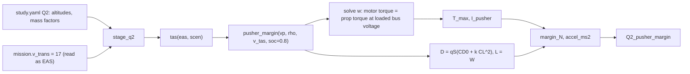

## Analysis Q2: pusher thrust margin at AIRSPEED_MIN (`pusher_margin` in `io/stages.py`)

> [!abstract] What this is Q2 asks whether the pusher can **accelerate the aircraft through the transition speed** with the wing carrying the weight, and how that changes with altitude and mass. It is a closed-form, steady-state check: full-throttle pusher thrust against wing drag at one speed. It is the evidence behind the forward-transition acceleration `a_fwd` that [[analysis_E]] assumes (1.5 m/s²). There is no module for it; the function and its driver live in `io/stages.py` (`pusher_margin`, `stage_q2`).

> [!note] Where the numbers in this note come from Section 3 is the repo's own `task_basics` run with the real configs (draft mode). Section 4 (SoC and airspeed convention) is my own set of calls to `pusher_margin`; the repo is unchanged.

> [!warning] Fix implemented on branch `feat/q2-pusher-accel` (26 Oct 2026)
> The redesign is written in [`Q2_fix_spec.md`](Q2_fix_spec.md) and has been implemented. Sections 1 to 6 below describe the legacy `pusher_margin` (single speed, full throttle), which is kept; the new run is `pusher.forward_accel`. The repo run on the real configs reproduces the numbers below. Settled by the owner:
>
> - **Pusher at `TKOFF_THR_MAX` (0.8), not full throttle** (effective 0.789 after the ESC dead zone). New register item **Q2-6**: "full throttle" in section 1 is not what the autopilot commands.
> - **A speed run replaces the single-speed margin.** New `analysis/pusher.py` (`forward_accel`) integrates from 0 to the transition speed: the wing carries `(V/V_lw)^2` of the weight (E's lift rule, `V_lw = stall_speed_1g / sqrt(0.8)`), the rotors carry the rest on the same bus, net acceleration is `(T_p - D - H_r)/m`. It reports `a_min` at `AIRSPEED_MIN` and `a_equiv` (the constant acceleration with the same time and distance).
> - **Both speed conventions are reported** (`conventions: [tas, eas]`, `feed_convention` `eas` since 2026-10-27, `tas` before, so E reads `AIRSPEED_MIN` as an equivalent airspeed like D, C, B1 and FT), so the 5000 m "17 TAS is below the stall speed" case (section 4) shows up as a result, not a `nan`. DEC-1 stays open.
> - **SoC is an axis**, and Q2 hands E its `a_fwd` (`E.a_fwd_mode`: case, worst or mission; `E.a_fwd_metric`: min or equiv). Q2 runs **before** E. Tables `Q2_pusher_margin` (new columns), `Q2_worst`, optional `Q2_profile`; the legacy `pusher_margin` is kept.
>
> Values (TAS): E case (30 m, SoC 0.6, nominal) `a_min` 1.24, `a_equiv` 1.86, 7.9 s, 78 m, against E's fixed 1.5; global worst `a_min` 0.48 (5000 m, mass x1.15, SoC 0.3; `a_equiv` 0.89, 16.1 s, 163 m). Under EAS that worst case is unreachable (speed reached about 20.3 of 21.9 m/s). E reads its `a_fwd` from this ([`E_fix_spec.md`](E_fix_spec.md)).

---

## 1. Method

At speed $V$ (true) and density $\rho$:

1. **Pusher speed at full throttle**: solve motor torque = propeller torque for $\omega_p$ (Brent's method), with the bus voltage loaded by the pusher current (`battery.solve_bus_voltage`), at a **fixed SoC of 0.8**.
2. **Maximum thrust** $T_{max}$ from the pusher model at $(\omega_p, V, \rho)$.
3. **Drag at the transition speed**, assuming the wing carries the whole weight ($L = W$):

$$ C_L=\frac{mg}{\tfrac12\rho V^2 S},\qquad D=\tfrac12\rho V^2 S,(C_{D0}+k,C_L^2) $$

valid only for $C_L\le C_{L,max}$ (1.444). Above that the function returns `nan`: below the 1g stall speed the rotors still carry part of the weight and the margin is not defined. 4. **Margin and acceleration**: $T_{max}-D$ and $(T_{max}-D)/m$.

Outputs per case: `T_max_N`, `omega_p_rad_s`, `I_pusher_A`, `current_limited` (against the motor's 107.9 A), `CL_required`, `CL_max`, `D_N`, `margin_N`, `accel_ms2`.

**Study inputs** (`study.yaml` → `Q2`): altitudes 0, 1500, 2500, 5000 m; mass factors 0.80, 1.0, 1.15. The speed is `mission.v_trans` = 17 m/s (the AIRSPEED_MIN value), **read here as equivalent airspeed** and converted to true airspeed at each altitude.

---

## 2. Reading the physics

- **Thrust falls with density**: the pusher is a fixed-pitch propeller; at altitude the same motor spins faster (1145 → 1235 rad/s) while moving less air, so thrust drops from 110 N at sea level to 71 N at 5000 m. The current falls too (96 → 64 A).
- **Drag at the transition does not depend on altitude when the speed is fixed as EAS** (dynamic pressure is the same, so $C_L$ and $D$ are the same). The margin therefore shrinks only because the thrust shrinks. That is why EAS is the natural convention here, and why the convention matters (section 4).
- **Mass enters through $C_L$**: $D$ rises from 25.3 N (×0.80) to 32.2 N (×1.15).
- The pusher is **never current-limited** (the 107.9 A limit is not reached in any case).

---

## 3. What the run shows (SoC 0.8, 17 m/s EAS)

|altitude|$\rho$|$V_{TAS}$|$T_{max}$|$\omega_p$|$I_p$|$D$ (×0.80 / 1.0 / ×1.15)|margin, nominal|accel ×0.80 / 1.0 / ×1.15|
|---|---|---|---|---|---|---|---|---|
|0 m|1.225|17.0|110.0 N|1145|95.7 A|25.3 / 28.9 / 32.2 N|81.0 N|3.97 / 3.04 / 2.54 m/s²|
|1500 m|1.058|18.3|97.7 N|1173|85.7 A|25.3 / 28.9 / 32.2|68.8 N|3.39 / 2.58 / 2.14|
|2500 m|0.957|19.2|89.7 N|1191|79.1 A|25.3 / 28.9 / 32.2|60.8 N|3.02 / 2.28 / 1.88|
|5000 m|0.736|21.9|70.6 N|1235|63.5 A|25.3 / 28.9 / 32.2|41.7 N|2.12 / 1.56 / 1.25|

- Margin is positive in every case. The worst is **1.25 m/s²** (5000 m, ×1.15).
- [[analysis_E]] assumes `a_fwd` = 1.5 m/s² from the mission file. That is met at 5000 m only for the nominal mass (1.56); at ×1.15 the pusher gives 1.25. The margin is for the thrust _at_ the transition speed; thrust is higher at lower speed, so the average over the run is a little better, but the check is not made.

---

## 4. Two things the table hides (my calls to `pusher_margin`)

**State of charge.** Q2 fixes SoC at 0.8. At lower SoC the bus sags and the pusher gives less:

|case|SoC 0.8|SoC 0.5|SoC 0.3|
|---|---|---|---|
|sea level, nominal: $T_{max}$, accel|110.0 N, 3.04|95.9 N, 2.51|86.9 N, 2.17|
|5000 m, nominal|70.6 N, 1.56|60.4 N, 1.18|53.9 N, 0.94|
|5000 m, ×1.15|70.6 N, 1.25|60.4 N, 0.92|53.9 N, 0.71|

At 5000 m the acceleration falls below E's 1.5 m/s² at SoC 0.5 for the nominal mass, and it is under 1 m/s² for the heavy aircraft. The forward transition happens at the **start** of the mission, at high SoC, so SoC 0.8 is reasonable for a fresh pack; the S-03 and S-06 scenarios (SoC 0.5 and 0.3) are landing cases and are not transition cases. The point is that the table is _not_ a statement about every day.

**What "17" means.** `controller.yaml` states AIRSPEED_MIN = 17 as **true** airspeed; Q2 reads it as **equivalent**. The two differ at altitude:

|altitude, mass|17 EAS: $V_{TAS}$, accel|17 TAS: accel|1g stall speed (TAS)|
|---|---|---|---|
|0 m, ×1.0|17.0, 3.04|3.04|13.5|
|1500 m, ×1.0|18.3, 2.58|2.70|14.5|
|1500 m, ×1.15|18.3, 2.14|2.23|15.6|
|5000 m, ×1.0|21.9, 1.56|not defined ($C_L$ = 1.52 > 1.444)|17.4|
|5000 m, ×1.15|21.9, 1.25|not defined ($C_L$ = 1.75)|18.7|

If AIRSPEED_MIN is a true-airspeed threshold in the simulated controller (as `controller.yaml` says), then at 5000 m **17 m/s TAS is below the 1g stall speed**: the wing cannot carry the weight there, so the forward transition would end with the rotors still carrying load. Q2's EAS reading (21.9 TAS at 5000 m) gives a defined margin, but it is a different threshold from the one the simulated controller compares. This is the same conversion question as O-02 for the Position1 switch test.

---

## 5. What is missing, and what to add

1. **Convention (EAS vs TAS) for AIRSPEED_MIN**, applied the same way in Q2, E, the controller and the study file. The real autopilot compares a (calibrated or true) airspeed measured by the pitot sensor; this needs deciding once.
2. **SoC axis.** Report the margin at a start-of-mission SoC and at a low-SoC case; or, as an alternative, make SoC a study input.
3. **Speed axis.** The margin is evaluated at one speed. The thrust curve from rest to AIRSPEED_MIN, integrated against drag with the rotors sharing weight, would give the actual forward-transition time, distance and energy and test `a_fwd` directly. That is what analysis C's `full` scope simulates ([[analysis_C]]).
4. **Flagging.** Mark cases where $C_L$ exceeds $C_{L,max}$ (now `nan` in `D_N` and the margin) as "wing cannot carry the weight" rather than leaving a missing value.
5. **Link to E.** Pass the worst margin (or the worst case in the E altitude set) to E so that `a_fwd` cannot exceed what Q2 shows is available.

---

## 6. Quick reference

|item|where|
|---|---|
|function|`pusher_margin(vp, rho, v_tas, soc)` in `io/stages.py`|
|driver|`stage_q2` (altitudes × mass factors; speed = `mission.v_trans` as EAS)|
|output table|`Q2_pusher_margin`|
|inputs|`study.yaml` (`Q2`), `mission.yaml` (`v_trans`), `vehicle.yaml` (pusher, motor, battery, wing)|
|related|[[analysis_E]] (`a_fwd`), [[analysis_C]] (`full` scope, AIRSPEED_MIN), proposal Q2 and output table (pusher margin against density and mass)|