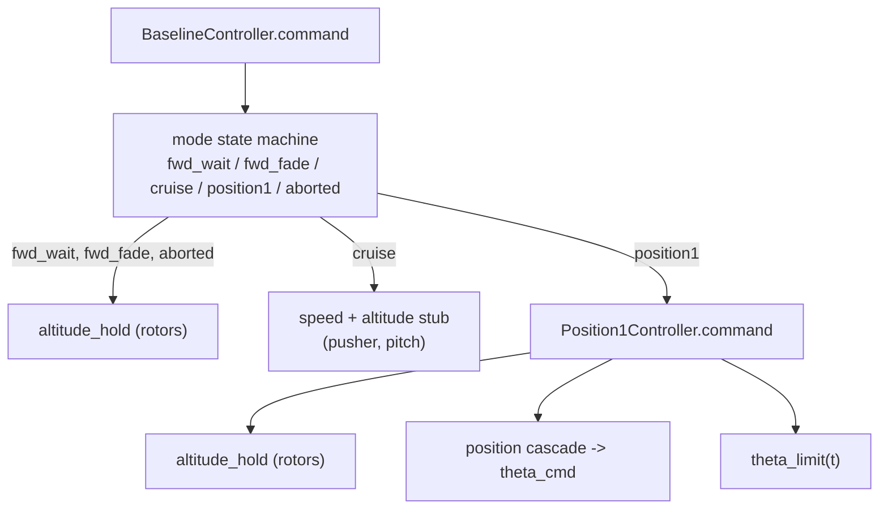
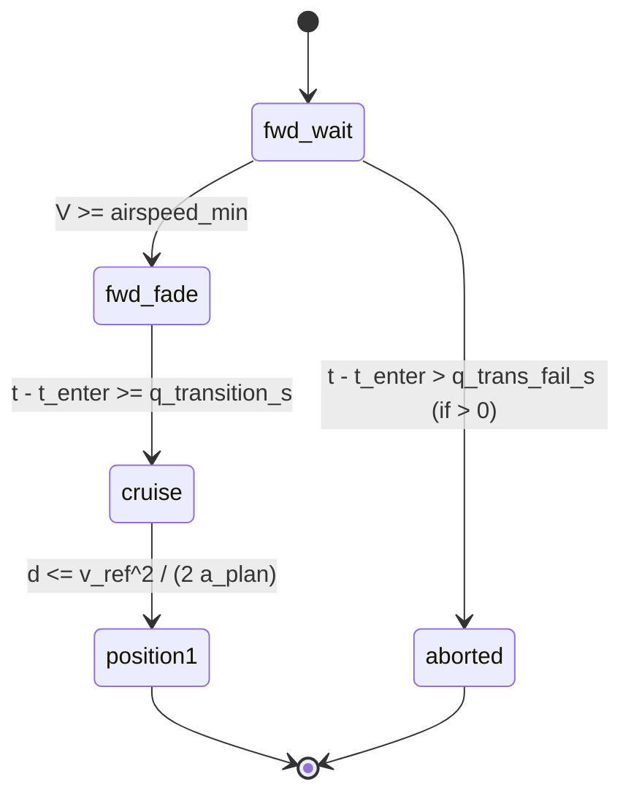

> B2 was removed from the code on 2026-10-27. Mentions of B2 below describe the code at the time of writing.

> [!abstract] What this file is
> The **baseline controller**: a hand-written imitation of how ArduPilot's QuadPlane flies a VTOL landing approach. It is the thing every analysis compares the optimised trajectories against (A, B1, B2 are "best possible", this is "what ArduPilot-style logic would do").
> It is a *policy*: a function `(t, x, aux, mode) -> (u, mode')`. It has no physics in it. The only physics call is `trim.hover_throttle` (see [[trim.py]]) to get a hover feed-forward.

Contract (from `control/base.py`):

```python
def command(t, x, aux, mode) -> (u, mode_new)
# x    : state [x, h, vx, vh, theta, q, omega_r, omega_p, v1]
# aux  : dict of last tick's outputs (V, L, D, ...)  -> see [[simulate.py]], this is aux_{k-1}
# mode : ModeState | None   (None on the very first call)
# u    : [delta_r, delta_p, theta_cmd]   rotor throttle, pusher throttle, pitch command [rad]
```

`ModeState` is **frozen** (immutable). Controller memory is carried by `simulate()` and handed back each tick:

| field | meaning |
| --- | --- |
| `name` | current mode string (`fwd_wait`, `fwd_fade`, `cruise`, `position1`, `aborted`) |
| `t_enter` | time this mode was entered (drives ramps and fades) |
| `t_last` | time of the previous command, so `dt = t - t_last` is the integrator step |
| `memory` | dict of floats: `integ` (integrator), `p_cmd` (pusher command) |

> [!note] Why `dt = t - t_last` and not a stored step
> The controller does not know the tick length. It measures it from the clock, so the same code works if `simulate()` changes `dt_ctrl`. On the first call `t_last = t`, so `dt = 0` and the integrator does not move.

---

## 1. Structure at a glance

Two classes of "thing":

1. **Pure functions / parameter containers**: `BackTransitionParams`, `altitude_hold`, `theta_limit`.
2. **Controllers (stateful through `ModeState`)**:
   - `Position1Controller`: the back-transition itself (rotors hold altitude, pitch brakes).
   - `BaselineController`: a state machine wrapping it: forward transition, cruise stub, then hand-off to `Position1Controller`.



---

## 2. BackTransitionParams (the tuning knobs)

Frozen dataclass. Numbers are the code defaults. Gains are **ASSUMED placeholders** (the file says so), not ArduPilot values.

| group | field | code default | register (`controller.yaml`) | ArduPilot analogue |
| --- | --- | --- | --- | --- |
| pitch envelope | `theta_A` | 20° | **30°** | `Q_A_ANGLE_MAX` |
| | `theta_P` | 25° | **35°** | `PTCH_LIM_MAX_DEG` |
| | `theta_B` | `None` (no cap) | none (entry omitted) | `Q_BCK_PIT_LIM` |
| | `T_bt` | 3 s | 3 s (3000 ms) | `Q_BACKTRANS_MS` |
| altitude hold | `h_tgt` | 0 | set by caller | altitude to hold |
| | `delta_hover` | 0.3 | overwritten by `for_vehicle` | feed-forward |
| | `delta_min`, `delta_max` | 0.1, 0.95 | 0.1, 0.95 | `Q_M_SPIN_MIN` (ArduPilot default 0.15), `Q_M_SPIN_MAX` |
| | `K_h` | 0.5 | 0.5 | position P: height error → climb-rate demand |
| | `K_vh` | 0.02 | 0.02 | velocity P: climb-rate error → throttle |
| | `K_i` | 0.01 | 0.01 | velocity I |
| | `v_dem_max` | 3 m/s | 3 m/s | climb-rate limit |
| | `i_max` | 20 | 20 | integrator clamp |
| position cascade | `x_tgt` | 0 | set by caller | stop point (x is negative while approaching) |
| | `K_p` | 0.5 | 0.5 | position gain |
| | `K_v` | 1.0 | 1.0 | velocity gain |
| | `a_lim` | 3 m/s² | 3 m/s² | cascade deceleration limit (a tuning value, **not** `Q_TRANS_DECEL`) |
| | `brake_at_limit` | False | False | worst-case switch for analysis D |

> [!warning] Two sets of pitch caps
> The register (`controller.yaml`) sets `Q_A_ANGLE_MAX` = 30° and `PTCH_LIM_MAX_DEG` = 35°; the code defaults are 20° and 25°. Analyses that go through `load_inputs` (D, C, B) use the register values, so the binding cap `min(θ_A, θ_P)` is **30°**. Code that builds `BackTransitionParams.for_vehicle(...)` without them gets **20°/25°, so a 20° cap**. Analysis E's back-transition segment does this (see [[analysis_E]], E-1). Numbers in this note that quote 20° are the code default.

### `for_vehicle(vp, rho, soc, h_tgt, **kw)`

Builds the params with `delta_hover = trim.hover_throttle(vp, rho, soc)`, then applies overrides with `dataclasses.replace`. So the hover feed-forward is the throttle that gives T = m·g at the *given* density and SoC (zero inflow, still air). See [[trim.py]].

### `theta_limit(t_rel)`: the pitch envelope, eq. (8.3)

$$
\theta_{lim}(t) = \min\!\Big(\theta_{cap}\cdot \min\big(1,\tfrac{t}{T_{bt}}\big),\ \theta_B\Big),\qquad \theta_{cap}=\min(\theta_A,\theta_P)
$$

- The allowed nose-up pitch ramps **linearly from 0 to $\theta_{cap}$ over `T_bt`** (3 s), measured from `t_enter` of the current mode. $\theta_{cap}$ is 20° with the code defaults and **30° with the register**.
- If `theta_B` is set it is a flat extra cap.
- At t = 1 s the limit is 6.7° with the 20° default (10° with the register's 30°), which can give at most a ≈ g·tan(6.7°) ≈ 1.15 m/s² (1.73 m/s² at 10°) of deceleration.

> [!warning] Differences from ArduPilot (from [[ardupilot_open_questions]])
> - ArduPilot's ramp starts at `max(last_fw_nav_pitch, 0)`, not at 0, and has a nose-down envelope too.
> - `Q_BCK_PIT_LIM` is not a constant: it is `θ_B0·(V_min/V)²` and only applies with the NEW forward-throttle scheme.
> - In the trajectory traces, the ramp did **not** bind in cascade mode (same result with no ramp); the cap (θ_A) binds late. Don't attribute early-braking behaviour to the ramp.

---

## 3. altitude_hold: the rotor throttle law, eq. (8.5)

```python
v_dem = clip(K_h * (h_tgt - h), -v_dem_max, +v_dem_max)   # outer loop (P)
err   = v_dem - vh                                         # climb-rate error
integ = clip(integ + err*dt, -i_max, +i_max)               # I state
delta = delta_hover + K_vh*err + K_i*integ                 # feed-forward + PI
return clip(delta, delta_min, delta_max), integ
```

Cascade: **height error → climb-rate demand → throttle**.

$$
v_{dem}=\mathrm{sat}\big(K_h(h_{tgt}-h)\big),\qquad
\delta = \delta_{hover} + K_{vh}(v_{dem}-v_h) + K_i\!\int (v_{dem}-v_h)\,dt
$$

> [!question] "Shouldn't it add to the previous delta?"
> No. This is the **positional** form of a PI: the output is recomputed from scratch each tick as *feed-forward + P + I*. The integral state remembers the history, so there is no need to remember the previous output. Adding increments to the previous delta would be the *velocity* form, where the integral is implicit in the output. Positional form makes clamping the integral easy and keeps the hover feed-forward explicit: with zero error the output is exactly `delta_hover`.

Notes:
- The **integral is clamped**, not the output. If the output saturates at `delta_min`/`delta_max` while `|K_i·integ| < K_i·i_max = 0.2`, the integrator can still wind up inside its clamp.
- `delta_hover` is a *pre-dead-zone command*. The dead zone (0.05) and V_bus sag are handled by `trim.required_rotor_command`, which inverted them.
- The same function is reused in `fwd_wait`, `fwd_fade`, `aborted` and `position1`.

---

## 4. Position1Controller: the back-transition core

State: `memory = {"integ": ...}` (altitude integrator only). The pusher is **always 0** here.

```python
if mode is None: mode = ModeState("position1", t, t, {"integ": 0.0})
dt = t - mode.t_last
delta, integ = altitude_hold(p, h, vh, mode.memory["integ"], dt)
lim = p.theta_limit(t - mode.t_enter)
if p.brake_at_limit:
    theta_cmd = lim                      # analysis D worst case
else:
    d     = x_tgt - x                    # distance still to go (>0 approaching)
    d_lin = 2*a_lim / K_p**2
    v_des = sqrt(2*a_lim*d) if d > d_lin else K_p*d
    a_cmd = K_v * (vx - v_des)           # wanted deceleration
    theta_cmd = clip(atan(a_cmd/g), 0, lim)
return [delta, 0.0, theta_cmd]
```

### 4.1 Position cascade, eq. (8.9)–(8.10)

**Desired speed profile**, a function of distance-to-go:

$$
v_{des}(d)=
\begin{cases}
\sqrt{2\,a_{lim}\,d} & d > d_{lin}\\[2pt]
K_p\,d & d \le d_{lin}
\end{cases}
\qquad d_{lin}=\frac{2a_{lim}}{K_p^2}
$$

- The square-root segment is the speed from which you can still stop in `d` at constant deceleration `a_lim` (from $v^2 = 2ad$).
- Near the target a pure sqrt has infinite slope, so it is replaced by a linear segment $v = K_p d$. The two segments meet at $d_{lin}$ (value $2a_{lim}/K_p$ on both sides; the slope is not continuous, it halves).
- With defaults: $d_{lin} = 2\cdot3/0.25 = 24$ m.

**Velocity loop → acceleration → pitch:**

$$
a_{cmd}=K_v\,(v_x - v_{des}),\qquad \theta_{cmd}=\mathrm{clip}\!\big(\arctan(a_{cmd}/g),\ 0,\ \theta_{lim}\big)
$$

- $a = g\tan\theta$ is the horizontal acceleration the rotor thrust vector gives at pitch θ, if the rotors carry the whole weight (vertical force balance $T\cos\theta = mg$).
- A positive `a_cmd` means "going faster than the profile allows", so brake, i.e. pitch nose-up. In this model positive θ points rotor thrust backwards (the `−T_r sinθ` term in `vx_dot`).
- The lower clip at 0 means the controller can **only brake**. If it overshoots the target (d < 0, vx < 0) it never pitches forward to come back.

> [!example] Why the cascade "commands nothing" at the start
> Take the default switch point: V = 22 m/s, `a_plan` = 2.5 → switch at $d = V^2/(2a_{plan}) = 96.8$ m.
> At that distance $v_{des} = \sqrt{2\cdot3\cdot96.8} = 24.1$ m/s, which is **above** the actual 22 m/s. So $a_{cmd} = 1\cdot(22-24.1) < 0$ → clipped to θ = 0.
> The cascade only starts to brake once $v_{des}$ falls below the current speed. That happens because `a_plan` (2.5, used for the *switch decision*) is gentler than `a_lim` (3.0, used for the *profile*). The two are separate numbers; ArduPilot uses a single `Q_TRANS_DECEL` for both, plus a feed-forward acceleration. This is a repo-side placeholder, which is why the idealised overshoot results should not be read as ArduPilot's behaviour.

### 4.2 `brake_at_limit`

`theta_cmd = lim`: pitch straight to the envelope limit and hold. It is not a controller; analysis D uses it to find the *shortest possible* braking distance for a given entry speed, to compare against the cascade.

### 4.3 What the rotors are doing

Altitude hold runs independently of the pitch law, and its feed-forward is the **hover throttle** `delta_hover` (the throttle for $T = mg$ in still air), a constant for the whole run. Two things follow:

- **It ignores the wing.** At the switch point the aircraft is at cruise speed and the wing carries nearly the whole weight, but the rotors are commanded as if they had to carry all of it. The surplus thrust makes the aircraft climb until the feedback pulls the throttle down, and as the speed falls and the lift collapses the throttle has to rise again. This is the "ballooning" that analysis D shows, and it is a property of the feed-forward, not of the PI gains ([[analysis_D]] §6.3, §7.3).
- **It has no $1/\cos\theta$ term.** When the aircraft pitches nose-up to brake, the rotor thrust must carry the weight (less the lift) *and* push backwards, so the vertical balance needs more thrust. The PI sees a sinking aircraft and raises δ; nothing anticipates it.

There is also **no rotor spool lag** in the model (ArduPilot has a 0.5 s spool, `MOT_SPOOL_TIME`); a first-order lag of that size reduces what a better feed-forward can achieve ([[analysis_D]] §7.2). A lift-aware feed-forward (thrust $=(W-L)/\cos\theta$ from the measured lift) cuts the 95th-percentile excursion in analysis C from 18.5 m to 12.4 m with instant actuators ([[analysis_C]] §5.6); that was an experiment in a script, not a change to the repo.

---

## 5. BaselineParams

| field | default | meaning |
| --- | --- | --- |
| `back` | (required) | the `BackTransitionParams` |
| `airspeed_min` | 14 m/s | `AIRSPEED_MIN`: wait for this before fading rotors |
| `q_transition_s` | 5 s | `Q_TRANSITION_MS`: rotor fade length |
| `tkoff_thr_max` | 0.7 | pusher command during the forward transition |
| `q_trans_fail_s` | 0 (off) | `Q_TRANS_FAIL`: abort if airspeed not reached in time |
| `a_plan` | 2.5 m/s² | `Q_TRANS_DECEL`: used **only in the switch test** |
| `speed_test` | `"ground"` | speed in the switch test; `"air"` is not ArduPilot behaviour (O-02) |
| `v_cruise` | 22 m/s | cruise speed target |
| `delta_p_trim` | 0.5 | cruise pusher guess (feed-forward) |
| `theta_trim` | 0 | cruise pitch trim |
| `r_tecs` | 0.5 /s | pusher command rate limit |
| `tau_h` | 1 s | time constant of the pusher command lag |
| `K_s`, `K_si` | 0.05, 0.01 | pusher P and I per m/s speed error |
| `K_hp`, `K_hd` | 0.02, 0.03 | cruise pitch per metre / per m/s climb rate |
| `theta_cruise_max` | 0.15 rad | cruise pitch clamp (≈ 8.6°) |

---

## 6. BaselineController: the state machine



### 6.1 Per-mode outputs

| mode | δ_r (rotors) | δ_p (pusher) | θ_cmd |
| --- | --- | --- | --- |
| `fwd_wait` | `altitude_hold` | `tkoff_thr_max` (0.7) | 0 |
| `fwd_fade` | `altitude_hold × (1 − t_rel/T_fade)` | 0.7 | 0 |
| `cruise` | 0 | rate-limited TECS stub | altitude-hold pitch |
| `position1` | `altitude_hold` | 0 | cascade |
| `aborted` | `altitude_hold` | 0 | 0 |

- **fwd_wait**: rotors hold altitude (aircraft is still hovering-ish), pusher at 0.7, wait for airspeed.
- **fwd_fade**, eq. (8.7): the *closed-loop* altitude-hold output is scaled by a linear factor going 1 → 0 over `q_transition_s`. The PI still runs on the unscaled output, so the integrator can wind up as the scale shrinks.
- **cruise**: rotors off. The rest is the "stub" (§6.3).
- **aborted**: pusher off, rotors still hold altitude, pitch 0.

### 6.2 Transition mechanics

```python
def switch(new):
    name, t_enter = new, t
    mem["integ"] = 0.0          # integrator reset on every switch
```

- The checks are sequential `if`s (not `elif`), so one tick can pass through more than one transition.
- `new_mem = mem` is an alias of a **copy** of the old memory (`mem = dict(mode.memory)`), so the old frozen `ModeState` is never mutated.
- `aux["V"]` is the airspeed from the *previous* tick's evaluation (see [[simulate.py]]): the controller sees $x_k$ and $aux_{k-1}$, so `fwd_wait → fwd_fade` triggers up to one tick late.
- `t_enter` is set to the switch time, so the pitch ramp in `Position1Controller` starts at 0 at the hand-off.

### 6.3 Cruise stub

```python
integ += (v_cruise - V) * dt                                   # speed error integral (no clamp)
d_tecs = clip(delta_p_trim + K_s*(v_cruise - V) + K_si*integ, 0, 1)
rate   = clip((d_tecs - p_cmd)/tau_h, -r_tecs, +r_tecs)
p_cmd  = clip(p_cmd + rate*dt, 0, 1)                           # pusher command
theta  = clip(theta_trim + K_hp*(h_tgt - h) - K_hd*vh, ±theta_cruise_max)
```

- Pusher = feed-forward + PI on airspeed, through a first-order lag whose rate is capped at `r_tecs`. On entry `p_cmd` starts at `tkoff_thr_max`, so the pusher *ramps down* from 0.7 to the cruise value instead of stepping.
- Pitch holds altitude with a PD law (height error, climb rate), clamped to ±0.15 rad.
- The integral here is the speed error integral, a different quantity from the rotor altitude integral. `switch()` resets `integ` on entry, so there is no confusion, but the same dict key does two jobs.
- Not modelled: TECS energy blending, `BATT_WATT_MAX`.

### 6.4 Switch test, eq. (8.11)

```python
v_ref = x[2] if speed_test == "ground" else V
if x_tgt - x[0] <= v_ref**2 / (2*a_plan):  switch("position1")
```

$$
d \le \frac{V_{ref}^2}{2\,a_{plan}}
$$

"Start braking when the remaining distance equals the stopping distance at `a_plan`."

> [!warning] Differs from ArduPilot (O-02)
> ArduPilot's APPROACH → AIRBRAKE test is `wp_distance < stopping_distance + 2·closing_speed`, a 2 s margin, ≈ +50 m at 25 m/s. The repo test omits it, and so it switches later than ArduPilot would.

### 6.5 Position1 hand-off

```python
inner = ModeState("position1", t_enter, mode.t_last, {"integ": mem["integ"]})
u, inner_new = self._p1.command(t, x, aux, inner)
```

The outer machine builds a throw-away `ModeState` for the inner controller (so its `dt` and ramp clock are right) and copies `integ` back afterwards. Because `switch()` zeroed the integrator, entry is **not bumpless**: the cruise-mode rotor command is 0, and the first `position1` tick jumps to ≈ `delta_hover`. From rest that spool-up is only limited by the rotor-inertia equation ($I_{rot}\dot\omega = Q_m - Q_i$) in the vehicle; ArduPilot's `MOT_SPOOL_TIME` = 0.5 s lag is not modelled in the controller (O-06). This is the "ramp" vs "pre-spun" distinction: analysis D can start with rotors already at hover ω (`trim.hover_omega`) or at rest.

---

## 7. Where it is used

| caller | what for |
| --- | --- |
| `analysis/braking.py` (D) | `Position1Controller` from a given entry state; `brake_at_limit=True` for the shortest-distance bound, `False` for the cascade; `delta_hover` from `trim.hover_throttle` |
| `analysis/collocation.py` (B1) | `Position1Controller` as the reference policy the optimiser is compared against |
| `analysis/restricted.py` (C) | `Position1Controller` (line 118) and the full `BaselineController` (line 156); entry state from `trim.steady_trim` |
| `analysis/runs.py` | builds cruise entry states |

---

## 8. Gap list vs ArduPilot

Source: [[ardupilot_open_questions]] (read from `master`, to be re-read at the pinned tag).

| # | ArduPilot | repo |
| --- | --- | --- |
| 1 | Switch test uses ground speed with `+2·V_closing` margin | no margin |
| 2 | AIRBRAKE stage (≥ 1 s, TECS pusher, rotors hold hover) before Position1 | direct cruise → position1; pusher cut instantly |
| 3 | Pitch ramp from `max(last_fw_pitch, 0)` + nose-down envelope | ramp from 0, no nose-down |
| 4 | `Q_BCK_PIT_LIM·(V_min/V)²`, NEW scheme only | constant `theta_B`, default None |
| 5 | Fade: frozen `last_throttle`, linear, open-loop, floor 0.01 | closed-loop altitude hold × linear factor |
| 6 | 0.5 s spool, `SPIN_MIN` 0.15 | no spool lag, `delta_min` 0.1 (see [[analysis_D]] §7.2) |
| 7 | One `Q_TRANS_DECEL` + feed-forward accel | separate `a_plan` / `a_lim`, no feed-forward |

## 9. Things to watch when reading results

- Cascade overshoot or late braking is partly a property of this placeholder cascade (item 7), not of ArduPilot.
- Brake-only clip at 0: after overshoot the controller does not recover.
- The cruise integrator has no anti-windup.
- Altitude-hold integral windup inside the `i_max` clamp when the output saturates.
- The altitude-hold feed-forward ignores wing lift (4.3); excursion and energy numbers in D and C inherit that.
- With the register values `Q_M_SPIN_MIN` has no effect while that feed-forward holds the throttle near hover ([[analysis_C]] §5.3).