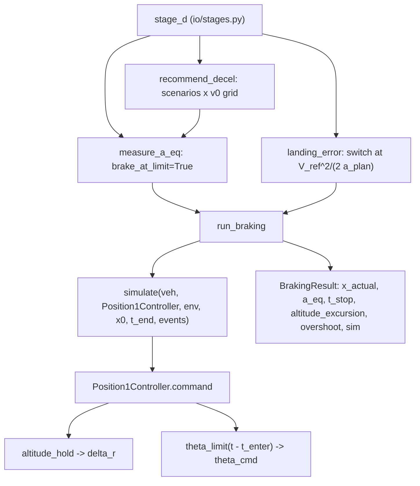

> B2 was removed from the code on 2026-10-27. Mentions of B2 below describe the code at the time of writing.

> B1 was removed (docs/B1_removal.md); mentions of B1 below are history.

## analysis/braking.py (Analysis D)

> [!abstract] What this file is Analysis D: **Position1 braking and the `Q_TRANS_DECEL` calibration**. It flies the ArduPilot-structured back-transition controller ([[ardupilot_like.py]]) from the switch point to a ground speed of 1 m/s, measures the deceleration the controller actually achieves when pitch is held at its envelope limit, and recommends the smallest of those as the planning value `a_rec`. Section 10D of the proposal; equation (10.5). Unlike A it **is a simulation**: `simulate()` integrates the full vehicle ([[vehicle.py]]) with the controller in the loop. The controller is what is being judged, not the hardware.

> [!note] Where the numbers in this note come from Two sources, labelled in the text:
> 
> 1. **The repo's own `stage_d` run** with the real `study.yaml`, `scenarios.yaml`, `vehicle.yaml`, `controller.yaml` and `mission.yaml`, loaded with `io.inputs.load_inputs` in draft mode (one draft reason, no register fallbacks). Used in 4.3, 5.3 and 6.0. Ensemble: $n = 32$, seed 8, entry ground speeds 16 and 20.9 m/s, 5th percentile. Not edited, not tuned.
> 2. **My single-case experiments** (section 6.1 onwards): one worked case, $\rho = 1.058$ kg/m³ (1500 m ISA, scenario S-07), SoC 0.8, nominal mass 26.664 kg, rotors spun at hover, pusher at zero, $\theta_A = 30°$, $\theta_P = 35°$ (effective cap 30°), $T_{bt} = 3$ s, entry **17 m/s** ground speed. Running this case through the repo loader gives the same numbers as my hand-copied setup (54.3 m, $a_{eq}$ = 2.65, gain 6.88 m, final $v_h$ −5.07 m/s). The ramp variants (6.2), the lift-aware controller and the gain sweeps (6.3, 7.2) are **experiments, not repo changes**. _Refreshed after the real configs became available. An earlier version of this note used my own assumed ensemble axes and a 17 m/s ground-speed entry; where that changed a conclusion it is stated in 4.3._

> [!warning] Fix implemented on branch `feat/analysis-d-ardupilot-braking` (26 Oct 2026)
> The redesign is written in [`D_fix_spec.md`](D_fix_spec.md) and has been implemented. Every result below describes the controller and ensemble before the fix; the new D tables read differently. The repo run on the real configs gives `a_rec_pct` 2.09 (TAS), `a_rec_min` 1.99 and 17 of 32 samples below their stall speed. Settled by the owner:
>
> - **Entry at AIRBRAKE exit** (rotors already spun and carrying what the wing does not, pusher off). The entry speed comes only from the airspeed exit rule `max(AIRSPEED_MIN - 2, Q_ASSIST_SPEED)`; no free entry-speed axis in the headline results.
> - **Pitch limit as ArduPilot** (7.1, D-1): ramp from `max(last FW pitch, 0)` to the cap over `Q_BACKTRANS_MS`, clock from AIRBRAKE exit, default start pitch `theta_fw0 = 0` (placeholder, about 0.05 m/s^2 of `a_eq` per degree). `Q_BCK_PIT_LIM` stays a constant cap with a flag for the airspeed-scaled form.
> - **Feed-forward** (7.3): `ff_mode: repo | lift_aware`, weak altitude gains left alone. At 17 m/s lift-aware gives altitude gain 0.65 m and end sink -0.5 m/s, against 6.9 m and -5.1 m/s today, with `a_eq` about unchanged (2.65). No spool dynamics or actuator lag by default.
> - **Alpha**: reporting and rotor-load checks always on; enforcement is a flag, off by default. The default numbers describe a **stalled wing** (alpha up to 57 deg for 2.5 to 3.5 s); holding alpha to 9.1 deg gives `a_eq` about 1.3.
> - **New ensemble** (Sobol plus corners, headwind carried through ground speed), `E.a_plan_fallback_ms2` and `a_plan_source` for E's interface. Expected with `"tas"`: `a_rec_pct` about 2.10 and 17 of 32 samples below their 1g stall speed; with `"eas"` about 2.19 and none.
>
> Open: DEC-3, DEC-1 (the entry convention moves the ensemble), where the real `theta_fw0` comes from (SITL or flight log), and whether AIRBRAKE really holds altitude without the wing term (O-03). Sections 7.1, 7.3 to 7.5 of this note are the problem statement the spec answers.

---

## 1. What question D answers, and where it sits

$$\text{D: if the aircraft brakes as hard as the controller allows, what constant deceleration does it really achieve?}$$

- The back-transition planner needs a number for `Q_TRANS_DECEL`: the planned deceleration $a_{plan}$ that fixes the switch distance $d_{sw} = V_{ref}^2/(2 a_{plan})$. If $a_{plan}$ is bigger than what the aircraft can deliver, it overshoots the target.
- D measures the **achieved** equivalent deceleration $a_{eq}$ at the limit, over scenarios and entry speeds, and takes the minimum (or a low percentile) as the recommendation `a_rec`.
- It also measures the **cost** of using it: overshoot, altitude excursion, energy, bus current (the trade curve, section 5.3).

> [!tip] How to read `a_rec`: an upper bound on the planned deceleration, not the setting itself
> 
> - `a_rec` is what the aircraft can **always** deliver when pitch is held at the envelope limit (worst case over the sampled scenarios and speeds). So `Q_TRANS_DECEL` must be **no larger** than `a_rec`; planning with more promises braking the aircraft cannot supply. It is an upper limit, yes.
> - It is **not** sufficient to hit the target. `a_rec` comes from `brake_at_limit=True`, where the pitch goes straight to the limit. The real Position1 cascade does not brake at the limit all the way (it follows $\sqrt{2a_{lim}d}$ and a pitch ramp), so at $a_{plan} = a_{rec}$ it still overshoots: **4.6 m** at $a_{plan}$ = 2.5 (real config, section 5.3). Zero overshoot needs $a_{plan}$ about 1.5 or lower.
> - D does **not** try to minimise altitude excursion. It measures the stopping distance with the controller as given; the excursion is a side effect it reports, and largely a controller-structure artefact (6.3). Minimising excursion is the job of B1/B2/C.
> - Lower $a_{plan}$ means switching earlier, which costs VTOL distance and energy (the trade curve). Choosing the value is a trade between overshoot risk and that cost, inside the ceiling `a_rec`.

|role|how D is used|
|---|---|
|calibration|`a_rec` is the proposed ceiling for `Q_TRANS_DECEL`|
|planning input|`stage_e` takes `a_plan = out.get("a_rec", 2.5)` for the energy budget; `restricted.plan_decel` (analysis C) calls `measure_a_eq`|
|trade-off|overshoot, energy and altitude excursion against $a_{plan}$ and headwind|
|baseline for B/C|what the unoptimised, ArduPilot-structured controller does; B/C are judged against it|

**How D differs from A**

||A ([[analysis_A]])|D|
|---|---|---|
|nature|algebra on samples|closed-loop simulation|
|deceleration|prescribed, constant|**result** (what the controller delivers)|
|pitch|solved (zero altitude loss)|commanded by the controller: ramp to the cap|
|altitude|held exactly by construction|produced by the altitude hold, **measured**|
|answers|can the hardware do it?|what does the controller do?|
|weakness|no control, no spool|controller model is simplified (section 7)|

The two are meant to be read together: A gives the hardware ceiling (about 1 m/s² of zero-loss braking here), D gives the deceleration the controller delivers (about 2.6) **at the price of altitude and sink rate**. The gap between the two is why altitude excursion exists at all.

D runs in the quick **basics** task with A, F, E and Q2 (`io/stages.py`, `task_basics` → `stage_d`).

---

## 2. The method and the formulas

Every run starts at the **switch point** (the cruise phase belongs to M5). The target is $x_{tgt}$ ahead.

**Equivalent deceleration (eq. 10.5, generalised to $V_f \ne 0$):**

$$ a_{eq} = \frac{V_0^2 - V_f^2}{2,x_{actual}} $$

with $V_f = 1$ m/s (the run ends at ground speed 1 m/s, not 0, because the sqrt cascade and the stall are ill-conditioned near rest). It equals (10.5) when $V_f = 0$. $x_{actual}$ is the ground distance covered from the switch to the stopping event.

**Planned switch distance:**

$$ d_{sw} = \frac{V_{ref}^2}{2,a_{plan}} $$

with $V_{ref}$ the ground speed or the air speed (open question O-02, `speed_test`).

**Recommendation:**

$$ a_{rec} = \min_{s \in \text{scenarios},, V_0 \in \text{grid}} a_{eq}(s, V_0) \quad\text{or}\quad a_{rec}^{(p)} = \text{percentile}_p; a_{eq} $$

Using the minimum makes $a_{rec}$ the deceleration the aircraft can do in the **worst** sampled case, so planning with it never over-promises on the sampled set.

**Ideal reference (`ideal_stopping`).** The planner's worked example: ideal pitch, lift and drag neglected, $a = g\tan(\theta_{max}\cdot f(t))$ with $f = \min(1, t/T_{bt})$. It reproduces the proposal's examples exactly:

|$V_0$|cap|ramp|distance|$a_{eq}$|distance during ramp|
|---|---|---|---|---|---|
|25|20°|0 s|87.55 m|3.57|0|
|25|20°|3 s|124.5 m|2.51|69.8 m|
|25|20°|5 s|147.6 m|2.12|110.6 m|

For this note's case (17 m/s, 30°, 3 s, $V_f = 1$) the ideal model gives **50.0 m, $a_{eq}$ = 2.88**; the simulation gives 54.3 m, 2.65. So the full vehicle is about 8% worse than ideal pitch braking. I did not separate the causes (wing drag helps, attitude lag and the lift/thrust-vector geometry hurt). **Most of the structure is the ramp**: the same ideal model with no ramp stops in 25.4 m.

---

## 3. Code map



### 3.1 `run_braking(vp, scen, v0, bp, v_f=1, rotors="hover", t_end=60, agl0=100, ...)`

1. Apply the scenario: `scen.vehicle_for(vp)` sets the mass; `runs.vehicle_for` builds the CasADi vehicle.
2. `bp = replace(bp, h_tgt=scen.altitude_amsl_m)`; if `refresh_hover` (default True), `delta_hover = trim.hover_throttle(vps, rho, soc)` is recomputed for the scenario's mass and density.
3. Initial state `[x, h, v, vh, θ, q, ω_r, ω_p, v1]` = `[0, h0, v0, 0, 0, 0, ω, 0, 0]`. Two choices of `rotors`:
    - `"hover"`: $\omega_r$ = hover speed (`trim.hover_omega`; about 280 rad/s at this weight and density, from the A-note rotor map);
    - otherwise: $\omega_r = 0$ (spin-up from rest during braking). Pitch starts at **0**, not at cruise trim.
4. `simulate(...)` with **two events**: `ground_speed_below(v_f)` and `touchdown(h0 - agl0)` (100 m below the start).
5. Stopped only if the event was `ground_speed_reached`; otherwise `x_actual = a_eq = NaN`.

`BrakingResult` carries `x_actual`, `a_eq`, `t_stop`, `altitude_excursion` (from `res.metrics`), `overshoot` (= `x_actual − bp.x_tgt`, or None), the full `sim` and a `record`.

### 3.2 `measure_a_eq`

`run_braking` with `brake_at_limit=True`: the controller outputs $\theta_{cmd} = \theta_{lim}(t)$ at every step. The position cascade, $a_{lim}$ and $x_{tgt}$ are bypassed. This is the **worst-case braking** measurement of method step 1.

### 3.3 `recommend_decel`

Loops scenarios × `v0_grid`, calls `measure_a_eq`, drops NaN rows, returns `(a_rec, rows)`. The same entry-speed grid is used for **every** scenario (section 4).

### 3.4 `landing_error`

Switch distance from the planner: `x_tgt = V_ref²/(2 a_plan)` with $V_{ref}$ = `v0` for `"ground"`, `v0 + headwind` for `"air"`, then `brake_at_limit=False`: the full cascade runs, bounded by $a_{lim}$.

### 3.5 `Position1Controller` (as D uses it)

```text
delta_r  = altitude_hold(h, vh, integ, dt)        # throttle, rotors only
lim      = cap * min(1, (t - t_enter)/T_bt)       # theta_limit; cap = min(theta_A, theta_P)
if brake_at_limit: theta_cmd = lim
else:
    d      = x_tgt - x
    v_des  = sqrt(2 a_lim d)  if d > 2 a_lim / K_p^2  else K_p d
    a_cmd  = K_v (vx - v_des)
    theta_cmd = clip(atan(a_cmd/g), 0, lim)
pusher = 0
```

`altitude_hold`: $v_{dem} = \mathrm{clip}(K_h(h_{tgt} - h), \pm 3)$, error $e = v_{dem} - v_h$, integral clamped to $\pm i_{max}$, then

$$ \delta_r = \delta_{hover} + K_{vh},e + K_i!\int e,dt,\qquad \text{clipped to } [\delta_{min},\ \delta_{max}] $$

with $K_h = 0.5$, $K_{vh} = 0.02$, $K_i = 0.01$. **$\delta_{hover}$ is the throttle for $T_r = mg$**: it ignores the wing (section 6.3).

`theta_limit(t_rel)` = `cap · min(1, t_rel/T_bt)`, optionally `min(ramp, θ_B)` when `theta_B` is set (`Q_BCK_PIT_LIM`). `t_rel` is the time since the controller entered Position1, which in D is the start of the run.

---

## 4. The V0 grid, the scenarios and the ensemble

D uses three different structures. They are easy to confuse.

|table|scenarios|entry speed|aggregation|
|---|---|---|---|
|`D_a_eq`|named scenarios S-01, S-02, S-03, S-05, S-06, S-07 × `mass_factors` (0.80, 1.0, 1.15): 54 rows, **deterministic grid**|`v0_eas_ms` = 16, 17.1, 20.9 (EAS), each converted with `tas()` and used as the initial **ground** speed|none, just rows|
|`D_recommendation_ensemble`, `a_rec`, `a_rec_pct`|**Latin-hypercube ensemble**, $n$ = 32, seed 8 (the same ensemble as B2 and C)|`v0_ground_ms` = 16 and 20.9, the same for every sample: 64 runs|min and 5th percentile|
|`D_trade_curve`|the **first** named scenario only (S-01)|`AIRSPEED_MIN - 2` EAS (the AIRBRAKE exit)|none|

The `study.yaml` comment explains the grid: 16 and 17.1 EAS are 1.2 × the stall speed at nominal and at 1.15× mass; 20.9 EAS is cruise (22.5 TAS at 1500 m).

### 4.1 Is the ensemble a Latin hypercube?

Yes, for the recommendation only: `ensemble.latin_hypercube(n, vp, seed, axes)`, with the axes from `scenarios.yaml`:

- Five axes, **independent uniform**: altitude 0–5000 m, ISA offset −10 to +20 K, mass ×0.80–1.15, headwind −5 to +5 m/s, SoC 0.2–1.0.
- Each axis has one sample per stratum ($n$ strata), shuffled independently, so there are no correlations between axes and the projection on each axis is evenly covered.
- The ranges are placeholders (O-14), pending the mission set.
- `ensemble_cost` / `CostWeights` (proposal 10.1) exist for the optimisation side; D does not use them.

### 4.2 Do the scenarios compete or interfere?

No. Every run is independent: no shared state, no weighting between runs. They interact **only through the aggregation**:

- `a_rec` is the **minimum**: winner-takes-all. "Equal priority" is not the right picture. The single worst run sets the number, and the other 63 are irrelevant to it.
- `a_rec_pct` gives every run weight $1/64$ and reads off the 5th percentile. This is the robust alternative.

### 4.3 What the ensemble actually does (real config: $n$ = 32, seed 8, 64 runs)

|quantity|value|
|---|---|
|**`a_rec`** (minimum)|**2.508 m/s²**|
|**`a_rec_pct`** (5th percentile)|**2.521 m/s²**|
|range of $a_{eq}$|2.51 to 3.55, median 2.81|
|entry 16 m/s|2.51–2.92 (median 2.56)|
|entry 20.9 m/s|2.79–3.55 (median 2.92)|

Spearman rank correlation of $a_{eq}$ with each recorded column (ISA and SoC are not written to the table):

|column|correlation|
|---|---|
|entry ground speed|**+0.81**|
|headwind|+0.49|
|altitude|−0.31|
|mass|−0.09|

> [!warning] A conclusion from the earlier version of this note changed The earlier version said the ensemble is "effectively one-dimensional in headwind" (Spearman +0.94). That came from my own assumed axes and a single 17 m/s entry. With the real config and two entry speeds, **entry speed dominates**, then headwind, then altitude. Mass has little effect.

Why these signs:

- **Entry speed (+):** the pitch ramp has a fixed duration ($T_{bt}$ = 3 s), so its slow-braking start is a smaller share of the stopping distance at higher speed. Even the ideal model shows this: 30° / 3 s gives $a_{eq}$ = 2.88 at 17 m/s and 3.38 at 25 m/s.
- **Headwind (+):** the initial speed is a ground speed, so a headwind raises the air speed and the drag helps braking.
- **Altitude (−):** lower density means less drag at the same TAS.
- **Mass (≈0):** braking is set by the pitch angle, $a \approx g\tan\theta$, not by mass.

Other facts:

- The minimum comes from the **16 m/s entry**. The lowest runs (2.51–2.52) are all at 16 m/s, spread over headwinds from −5 to +0.1 and altitudes from 1700 to 4900 m. So `a_rec` is the slowest-entry result, and the 20.9 m/s runs never matter to it.
- The minimum and the 5th percentile differ by only 0.013, so for this ensemble the choice between them does not matter. The min still depends on $n$ and the seed in principle.
- **16 of 64 runs (25%) enter below their own 1g stall speed** (air speed $V_0 + w$ against $V_s$ at the sample's mass and density, $C_{L,max}$ = 1.444). In those runs the wing cannot carry the weight and the rotors do. They are not transition cases.
- `D_a_eq` result summary (54 rows, no NaN): $a_{eq}$ 2.58 (S-01, mass ×1.15, 16 EAS) to 3.75 (S-05, mass ×0.8, 20.9 EAS).

> [!warning] Two input inconsistencies
> 
> - `D_a_eq` passes `tas(ve, sc)` as the **initial ground speed**. With a headwind the air speed is $V_0 + w$, not the TAS the grid names, although the column is labelled `V0_ground_ms`. (Among D's scenarios only S-05 has a headwind, so this affects S-05 only.)
> - The ensemble uses a ground-speed grid for all scenarios. A consistent definition is a per-scenario entry speed in **EAS**, converted to TAS at the scenario density, then to ground speed with the headwind (A note §7.9: $V_0 = \max(\text{AIRSPEED_MIN},, V_{0.8}(m,\rho))$).

---

## 5. `stage_d`: outputs and how to read them

### 5.1 `D_a_eq`

One row per scenario × mass factor × entry speed. Each row is a **worst-case braking run** (pitch at the envelope limit throughout).

|column|meaning|
|---|---|
|`V0_eas_ms`, `V0_ground_ms`|grid speed and its TAS conversion used as ground speed|
|`a_eq_ms2`|$(V_0^2 - V_f^2)/(2x)$; **higher = stops sooner**|
|`x_actual_m`, `t_stop_s`|distance and time to ground speed 1 m/s; NaN if the run did not stop|
|`alt_gain_m`, `alt_loss_m`, `altitude_excursion_m`|relative to the starting altitude|
|`peak_bus_current_A`, `min_bus_voltage_V`|reported, **never compared** to a limit|

### 5.2 `a_rec`, `a_rec_pct`, `D_recommendation_ensemble`

`a_rec` is the minimum of $a_{eq}$ over the ensemble and speed grid; `a_rec_pct` the chosen lower percentile (`rec.percentile`, may be None). `D_recommendation_ensemble` lists every sample: altitude, mass, headwind, ground speed, $a_{eq}$.

### 5.3 `D_trade_curve`

Rows over $a_{plan}$ × headwind × speed test × $a_{lim}$ $\in {bp.a_{lim},, a_{plan}}$, all for the first scenario at the AIRBRAKE exit speed (`AIRSPEED_MIN - 2`). Each row uses the **real cascade** from the planned switch point.

|column|meaning|
|---|---|
|`x_plan_m`|$V_{ref}^2/(2a_{plan})$|
|`x_actual_m`, `overshoot_m`|where it stopped; $x_{actual} - x_{tgt}$|
|`energy_J`, `altitude_excursion_m`|the cost|

**Real-config result** (S-01, sea level, nominal mass, entry 20.9 m/s; headwind 0, ground-speed test, $a_{lim} = a_{plan}$; `bp.a_lim` in the controller is 3.0):

|$a_{plan}$|switch distance|overshoot|energy|altitude excursion|
|---|---|---|---|---|
|1.5|145.6 m|+0.3 m|24.1 kJ|7.2 m|
|2.0|109.2 m|+2.5 m|15.7 kJ|8.2 m|
|**2.5** (about $a_{rec}$)|87.4 m|**+4.6 m**|12.6 kJ|9.2 m|
|3.0|72.8 m|+7.5 m|10.8 kJ|10.5 m|
|3.5|62.4 m|+10.4 m|9.7 kJ|11.8 m|

- **Overshoot grows with $a_{plan}$** because the cascade never brakes at the limit all the way. Zero overshoot needs $a_{plan}$ of about 1.5 or lower; going from 2.5 to 1.5 costs 58 m of extra VTOL distance and about 11.5 kJ.
- **Which $a_{lim}$ is used matters.** With the controller's $a_{lim}$ = 3.0 instead of $a_{lim} = a_{plan}$, the overshoot at $a_{plan}$ = 2.5 is 7.3 m, against 4.6 m. At $a_{plan}$ = 1.5 it is 5.5 m against 0.3 m. Keep $a_{lim}$ tied to $a_{plan}$.
- **Headwind** (+5 m/s, ground-speed test, $a_{plan}$ = 2.5): overshoot 4.0 m, energy 10.2 kJ, **altitude excursion 15.4 m** against 9.2 m with no wind (more lift at higher air speed, 6.3). Tailwind −5: overshoot 3.2 m, energy 17.9 kJ, excursion 5.7 m.
- **Test speed** (headwind +5, $a_{plan}$ = 2.5): the air-speed test switches at 134.2 m against 87.4 m for the ground-speed test, **46.8 m earlier**, with an overshoot of 3.8 m (against 4.0 m) and 16.8 kJ against 10.2 kJ. The air-speed test costs 47 m of VTOL distance and about 6.6 kJ more energy, and gives a smaller altitude excursion (10.2 m against 15.4 m); the overshoot is about the same. This is the "safe, at an energy cost" behaviour the proposal expects with a headwind; with a tailwind the air-speed test would switch late (not run here).

### 5.4 How to read it

1. `a_eq` and `x_actual` are the **primary outputs**. `a_rec` is "what the controller can do at the limit under the assumed pitch model" (section 7.1).
2. **Altitude columns measure the controller structure**, not the hardware (section 6.3). Do not use `altitude_excursion` to rank hardware options.
3. **Peak current / min voltage are unflagged.** Real-config `D_a_eq`: peak bus current 60 to **140 A**, min bus voltage 41.8 to 47.9 V. The motor limit is 75 A per motor (300 A for four) and the cut-off 33 V, so there is no violation, but D does not compare them; the 140 A case is S-03 / S-06 at 20.9 EAS and mass ×1.15.
4. **Even at $a_{plan} = a_{rec}$ the cascade overshoots**: 4.6 m at $a_{plan}$ = 2.5 (real config). Use the trade curve, not `a_rec`, to see where the aircraft lands.
5. A NaN row means the aircraft did not stop (touchdown first, or the 60 s limit). It is **dropped** from `recommend_decel`, so a failing case can disappear from the minimum. Count the NaNs.

---

## 6. What the run shows

### 6.0 The repo's own `D_a_eq` (real config, worst-case braking, hover-spun rotors)

$a_{eq}$ (m/s²) by entry EAS, over the scenario × mass grid:

|entry EAS|min|median|max|
|---|---|---|---|
|16.0|2.58|2.83|3.05|
|17.1|2.67|2.93|3.20|
|20.9|2.97|3.31|3.75|

By scenario (nominal mass): S-01 2.60 / 2.70 / 3.02, S-02 2.82 / 2.91 / 3.31, S-05 2.92 / 3.05 / 3.54, S-07 2.67 / 2.76 / 3.10 at 16 / 17.1 / 20.9 EAS. **Heavier is slightly worse; higher altitude is better** (more TAS at the same EAS, and the larger ground speed makes the ramp a smaller share of the distance).

Altitude gain (m), nominal mass, same three entry speeds:

|scenario|16 EAS|17.1 EAS|20.9 EAS|
|---|---|---|---|
|S-01 (0 m)|6.3|7.3|11.8|
|S-07 (1500 m)|7.1|8.3|13.7|
|S-02 (5000 m)|9.7|11.7|20.3|
|S-03 (5000 m, hot, heavy, low pack)|10.5|12.7|21.7|
|S-05 (500 m, 5 m/s headwind)|12.3|13.9|20.1|

- **No row has an altitude loss** (maximum 0.0 m), and the gain rises with speed and altitude: 6 to 22 m. That is the signature of the feed-forward problem (6.3): lift at the start scales with $\rho V^2 S C_L$, and at a fixed EAS the true airspeed is higher at altitude, so the same lift buys more climb.
- No NaN: every run reached 1 m/s ground speed.
- Peak bus current 60–140 A, min bus voltage 41.8–47.9 V.

### 6.1 Worked example (S-07, 17 m/s ground speed, 1500 m, hover-spun, 30° cap, 3 s ramp)

|quantity|value|
|---|---|
|stopping distance|**54.3 m**|
|$a_{eq}$|**2.65 m/s²**|
|$t_{stop}$|5.2 s|
|altitude gain / loss|6.88 m / 0 m|
|final vertical speed|**−5.07 m/s** (not reported by D)|
|peak bus current / min voltage|87 A / 47.6 V|
|energy|12.5 kJ|
|ideal pitch braking (section 2)|50.0 m, 2.88|

### 6.2 Sensitivity to the pitch-limiting model

D is **not** the ArduPilot model (section 7.1). How much that matters:

|change|distance|$a_{eq}$|
|---|---|---|
|baseline: 30° cap, 3 s ramp from 0°|54.3 m|2.65|
|ramp 0 s|32.5 m|4.44|
|ramp 5 s|65.7 m|2.19|
|ramp starts at 4°|51.0 m|2.83|
|ramp starts at 8° (about trim pitch)|47.7 m|3.02|
|cap 20° (code default)|67.1 m|2.14|
|constant 6.8° cap (`Q_BCK_PIT_LIM`-style at 17 m/s)|117.9 m|1.22|
|flat-plate $C_N$ 0.8 → 2.0|54.8 → 54.0 m|negligible|

- **Ramp duration is the dominant lever:** 0 to 5 s doubles the distance. The pitch cap itself matters less than how fast it is reached, because the aircraft spends most of its braking time still on the ramp (67 of the ideal 92 m at 30°/3 s in the 25 m/s example).
- **Ramp start value:** a start at about trim pitch moves $a_{eq}$ by roughly 14%. The 8° is my illustration, not the actual forward-flight nav pitch.
- **`Q_BCK_PIT_LIM`**, if active, would dwarf everything. My constant 6.8° cap is pessimistic: the real limit is $\theta_{B0}(V_{min}/V)^2$, rising as the speed falls (about 19.6° at 10 m/s).
- Post-stall drag is irrelevant to $a_{eq}$: braking is set by the pitch angle and the thrust vector, not the wing's post-stall coefficient.

### 6.3 Why the altitude gain (about 7 m) says more about the controller than the hardware

**The structure.** The rotor altitude hold is $\delta_{hover}$ (throttle for $T_r = W$) plus small PI terms. $\delta_{hover}$ is correct only if the rotors carry the entire weight. At 17 m/s the wing carries a large share: $L \approx 99$ N at $t = 0$, so the rotors command $T_r = 261.5$ N while only 162 N is needed.

**At $t = 0$:** $m\dot v_h = T_r\cos\theta + L - W = 261.5 + 99 - 261.5 \approx +99$ N, i.e. **+3.7 m/s² upward**. The feedback gain is small ($K_{vh}$ = 0.02 throttle per m/s), and it only reacts after a climb has begun.

|t (s)|$h - h_0$ (m)|$v_h$ (m/s)|$T_r$ (N)|$L$ (N)|net vertical force (N)|
|---|---|---|---|---|---|
|0.0|0.0|0.0|261.5|99|+96|
|0.8|0.7|1.7|224|88|+47|
|1.6|2.6|2.7|176|115|+20|
|2.0|3.7|2.9|154|125|+3|
|2.8|5.9|2.5|118|129|−34|
|3.2|6.7|1.3|117|35|**−128**|
|4.4|5.2|−3.5|171|15|−79|
|5.2|1.7|**−5.1**|236|−11|−27|

**Two phases:**

1. **0 to 2 s, over-thrust.** The rotors push the aircraft up to +2.9 m/s because the feed-forward ignored the wing.
2. **After about 3 s, the wing stalls.** Speed has fallen below about 10 m/s, $\alpha$ passes the stall, lift drops from 130 N to 35 N in about 0.4 s, the net force turns to −128 N, and the aircraft sinks. The run ends at 1 m/s ground speed with the vehicle **still descending at 5 m/s**.

**The experiment (not a repo change).** Replace the fixed $\delta_{hover}$ with one that follows the lift each tick: throttle for $T_r = (W - L)/\cos\theta$, with $L$ taken from the previous tick's `aux`.

||gain|loss|final $v_h$|$x_{actual}$|$a_{eq}$|
|---|---|---|---|---|---|
|repo controller|6.88 m|0|−5.07 m/s|54.3 m|2.65|
|lift-aware feed-forward|0.65 m|0.16 m|−0.52 m/s|54.4 m|2.65|

- The roughly 7 m gain is about 90% feed-forward. With the wing accounted for, the gain falls to 0.65 m and the end sink to −0.5 m/s.
- **The distance and $a_{eq}$ do not change.** Braking is set by the pitch ramp, so the altitude question and the $a_{rec}$ question separate cleanly.
- With a 5 m/s headwind the gain is 12 m: the lift scales with $V^2$ (22 against 17 m/s is 1.7× the lift).
- **Caveat (#spool):** these runs have instant actuators. With a 0.5 s throttle lag the lift-aware fix leaves about 2 m gain and 3 m loss at the repo gains; see 7.2.
- So D's "altitude excursion" mostly measures a controller structure issue. The real ArduPilot loop lowers $\delta_r$ until $T_r$ settles at $W - L$ (proposal), and the simulation shows the same, **but too slowly** for a 3–5 s event. I have **not** verified how ArduPilot's AIRBRAKE hover-hold handles lift in detail.

### 6.4 Where this connects to the controller note

[[ardupilot_like.py]] §4.3 says what the rotors do in pitch-up. The correction I offered but have not applied: that picture is true at **low speed**, where the wing carries nothing. At 17 m/s the hover feed-forward is too high, and the rotors over-thrust until the PI trims them down. This is the same effect as above.

### 6.5 Stall, the 1g stall speed, and the checks D lacks

**Is $\alpha$ going past stall with nothing flagging it?** Yes.

- $\alpha$ first exceeds $\alpha_s$ (15.7°) at $t$ = 3.04 s, when $V$ = 9.5 m/s. It stays above for 2.2 s. The final $\alpha$ is about 109°, which is not meaningful: at 5 m/s with reversed flow the model is extrapolating.
- D's events are only `ground_speed_below` and `touchdown`. There is **no stall event, no battery cut-off event, no use of `failure_flags`**.

**What the 1g stall speed is.** The lowest speed at which the wing, at $C_{L,max}$, can carry the weight:

$$ V_s = \sqrt{\frac{2W}{\rho S C_{L,max}}} = 14.55\ \text{m/s TAS (1500 m, nominal)} $$

Below $V_s$ no attitude lets the wing hold the weight, so the rotors have to supply the rest.

**What `failure_flags` does with it.** In `analysis/runs.py`, B and C count a stall only if $|\alpha| > \alpha_s$ **and** $V \ge V_s$ for more than `STALL_TIME_LIMIT` = 0.3 s. Below $V_s$ a stalled wing is "expected".

**Applied to this D trace:** $\alpha > \alpha_s$ for 2.2 s, but **0.0 s of that with $V \ge V_s$**, so `failure_flags` would not flag it even if D called it. The 0.8 $C_{L,max}$ limit (A note §7.9) is exceeded at 2.52 s ($V$ = 11.4 m/s), also below $V_s$.

**Why the waiver is less harmless than it sounds.** It assumes the rotors cover the lost lift. In the trace they do not: the stall removes about 95 N in 0.4 s and the PI is too slow. The result is the −5 m/s sink at the end of the run.

**Battery.** Min bus voltage 47.6 V against the 33 V cut-off, peak current 87 A bus: well inside. But D checks neither, and at low SoC or high altitude this changes. The VRS ratio in this run was **−0.80** (descent-like inflow); the project's VRS limit is unsourced and unchecked.

---

## 7. What D is and is not telling you, and what is missing

**Take from it**

1. The **controller-limited** deceleration at the pitch envelope: about 2.6 at 17 m/s with a 3 s ramp to 30°, an $a_{eq}$ well above the A ceiling (about 1.0–1.1). Braking is bought with altitude, which is expected.
2. The **ramp** dominates: $T_{bt}$, the ramp start and any `Q_BCK_PIT_LIM` matter more than the cap, the mass or the density.
3. The cascade overshoots by several metres even at $a_{plan} = a_{rec}$: plan the margin from the trade curve.

**Do not take from it**

- `a_rec` as the ArduPilot value (the pitch model is simplified; see 7.1).
- Altitude gain/loss as a hardware property (6.3).
- The minimum over the ensemble as a stable number (depends on $n$, seed, and the headwind-to-entry-speed coupling).
- A "pass" as meaning no stall, VRS or battery problem: none is checked.

### 7.1 Pitch limiting is not what ArduPilot does

From `docs/ardupilot_open_questions.md` (O-03, O-04, O-05):

|item|repo (D)|ArduPilot|
|---|---|---|
|ramp start|0|$\max(\text{last FW nav pitch}, 0)$|
|ramp duration|$T_{bt}$ = 3 s from Position1 entry|`Q_BACKTRANS_MS`, clock starts at AIRBRAKE exit|
|nose-down|none|nose-down envelope|
|`Q_BCK_PIT_LIM`|constant optional $\theta_B$|$\theta_{B0}(V_{min}/V)^2$, **only with the NEW forward-throttle scheme**|
|entry|cruise-like, $\theta$ = 0, rotors at hover|follows AIRBRAKE; rotors already spooled, exit at $\approx \max(\text{AIRSPEED_MIN} - 2,\ \text{Q_ASSIST_SPEED})$|

Config values (from `controller.yaml`): `Q_A_ANGLE_MAX` 30°, `PTCH_LIM_MAX_DEG` 20° (effective 20°; 35° and 30° before 2026-10-28), `Q_BACKTRANS_MS` 3000, `AIRSPEED_MIN` 17 TAS, `Q_M_SPIN_MIN` 0.1, `Q_M_SPIN_MAX` 0.95. The code defaults of `BackTransitionParams` are 20°/25°; a `BackTransitionParams()` with no overrides is **not** the project's configuration.

Effect on D (6.2): ramp start is second-order (about 12–14% at 8°); duration is first-order; `Q_BCK_PIT_LIM` could be dominant. Because the ramp covers the bulk of the stopping distance, D's `a_rec` is a statement about this ramp model.

### 7.2 No spool dynamics (`MOT_SPOOL_TIME`) — and how it interacts with the feed-forward issue

> [!info] Tags #feed-forward (the wing-lift term missing from $\delta_{hover}$: sections 3.5, 6.3, 7.3) · #spool (this section). The two effects add; read them together.

**What is missing.** The rotors start at hover speed (default) and follow the throttle through the motor and rotor model only. `MOT_SPOOL_TIME` = 0.5 s and `MOT_SPIN_MIN` = 0.15 (O-06, [[ardupilot_open_questions]]) are not modelled. The `rotors != "hover"` branch starts at $\omega$ = 0 but has the same fast dynamics ($I_{rot}$ = 1.5e-3 kg·m², TBD). The same gap is described for A in [[analysis_A]] §7.1.

**Why it matters for D specifically: it changes how much of the altitude excursion a fix can remove.** In D the altitude excursion has two causes (#feed-forward, 6.3):

1. a **disturbance**: $\delta_{hover}$ ignores the wing lift, so the rotors over-thrust by about 99 N at $t=0$ and then, after the PI has cut the throttle, under-thrust when the wing stalls;
2. a **weak, instantaneous rejection**: $K_{vh} = 0.02$ gives a heave time constant of about 1.65 s, and the actuators respond with no lag.

With instant actuators the feed-forward fix alone looks sufficient. With spool lag it is not, because the corrected feed-forward also has to pass through the lag, and the lift it is cancelling disappears in about 0.4 s.

**Experiment (mine, not a repo change):** a first-order lag, $\tau$ = 0.5 s, on $\delta_r$ only, as a crude stand-in for `MOT_SPOOL_TIME`. Rows: altitude gain / altitude loss / final $v_h$. Same case as 6.1 (17 m/s, 30° cap, 3 s ramp).

||instant actuator|with 0.5 s lag|
|---|---|---|
|repo feed-forward, repo gains|6.9 m / 0 / −5.1 m/s|7.7 m / 0 / −6.3 m/s|
|repo feed-forward, $K_{vh}$ ×5|3.2 m / 0 / −1.4 m/s|3.8 m / 0.3 m / −1.3 m/s|
|repo feed-forward, $K_{vh}$ ×10|1.9 m / 0 / −0.6 m/s|2.4 m / 0 / −0.6 m/s|
|**lift-aware feed-forward**, repo gains|0.65 m / 0.16 m / −0.5 m/s|**2.1 m / 3.0 m / −2.3 m/s**|
|lift-aware feed-forward, $K_{vh}$ ×5|n/a|1.3 m / 1.2 m / +0.6 m/s|
|lift-aware feed-forward, $K_{vh}$ ×10|not run|1.0 m / 0.4 m / −0.1 m/s|
|lift-aware feed-forward, $K_{vh}$ and $K_i$ ×10|0.39 m / 0.10 m / 0 m/s|1.0 m / 0.8 m / −0.1 m/s|

Reading it:

- **Without lag**, the feed-forward is the dominant lever: 6.9 m → 0.65 m with the repo gains, and gains add little on top.
- **With lag**, the same fix leaves 2–3 m of excursion at the repo gains, and gains matter again. The earlier 0.65 m was therefore optimistic.
- A **realistic floor for a non-anticipating controller is about 1–3 m**. Going below needs a feed-forward that **leads**: command the rotors from the speed history (the lift loss is predictable from $V$ and $\alpha$) before the wing lets go.
- The stiff-gain rows are not free either: with a real 0.5 s spool, a heave loop with a 0.17 s time constant (the ×10 case) probably oscillates; the lag here is first-order and applied to $\delta_r$ only, so those rows are optimistic.
- Lift information also matters: a feed-forward using lift filtered at $\tau$ = 0.5 s gives 1.9 m gain and −1.6 m/s end sink (without lag); a 20% lift error gives 2.8 m and −1.9 m/s. The real aircraft has no lift sensor.
- None of this changes $x_{actual}$ or $a_{eq}$ (53.3–56.1 m, 2.56–2.70 across all runs): the spool and the feed-forward affect the altitude, not the recommendation.

**What to add**

- A spool model on $\delta_r$: $\dot\delta_{eff} = \mathrm{clip}!\left((\delta_{cmd} - \delta_{eff})/T_{spool},\ \pm r\right)$, with the ArduPilot spool law (`MOT_SPIN_MIN` → `MOT_SPIN_MAX`, linear in $dt/T_{spool}$) rather than my first-order stand-in.
- A rotor-start lead time as an output (same as A §7.1), and `rotors="hover"` vs `"rest"` reported separately.
- Re-run the gain sweep and the feed-forward comparison **with** the spool model before drawing any conclusion on the altitude excursion.
- Do not tune $K_{vh}$ in the simulation without the spool in place.

### 7.3 Altitude hold feed-forward ignores the wing (#feed-forward)

- Add a lift-aware $\delta_{hover}$ (6.3 experiment: gain 6.9 → 0.65 m, end sink −5.1 → −0.5 m/s, $a_{eq}$ unchanged). **That figure assumes instant actuators**; with spool lag the result is 2.1 m gain, 3.0 m loss (7.2, #spool). Judge the fix only with the spool model in place.
- Or decide D should report the excursion **with** the real ArduPilot AIRBRAKE behaviour, which means modelling it.
- The real loop is probably stiffer than the repo's single PI with assumed gains (ArduPilot's multicopter vertical loop is a cascade with an acceleration PID and a hover-throttle estimate). I have not verified its gains or what AIRBRAKE does with wing lift.

### 7.4 Missing flags and outputs

Not implemented; suggested for `stage_d` / `BrakingResult`:

- final vertical speed ($v_h$ at the stop) and the vertical speed at touchdown if reached;
- minimum `vrs_ratio` and its time;
- first time $\alpha > \alpha_{0.8}$ (A §7.9) and $V$ at that time, plus time with $V \ge V_s$ and $|\alpha| > \alpha_s$ (what `failure_flags` would say);
- peak current against $I_{lim}$ and min voltage against $V_{min}$, as flags;
- an event or a status for stall, battery, VRS (so the run stops, or at least labels the row);
- count of NaN (non-stopping) rows in `recommend_decel`.

### 7.5 Ensemble design

- Define the entry speed **per scenario in EAS** (section 4.3 box), including the 0.8 rule and mass/altitude dependence, then convert to ground speed.
- Report $a_{eq}$ against **entry speed and air-speed** rather than treating the five axes as independent drivers: entry speed is the dominant driver in the real ensemble (4.3). Consider an entry grid that includes `AIRSPEED_MIN`-based speeds only, since `a_rec` is set by the slowest entry.
- Drop or flag samples entering below $V_s$ (25% here: 16 of 64), or report them separately.
- Use `a_rec_pct` (or a bootstrap interval) as the headline; keep the minimum as a diagnostic; include $n$ and seed in the report.
- Include the corner points explicitly (mass ×1.15, headwind −5, 5000 m) next to the LHS so the extremes are not left to chance.

### 7.6 Other gaps

- **Entry state:** pitch 0, no pusher, rotors at hover. The real Position1 entry follows AIRBRAKE, with the pusher TECS-driven and the pitch from forward flight (O-03). See A §7.12.
- **Wind:** a constant headwind only; no gusts.
- **Stopping condition:** ground speed 1 m/s; the last approach to rest is untested.
- **Touchdown event** at 100 m below the start is a runaway guard, not an operational altitude floor.
- **Tests:** I found no `braking` test in the uploaded `tests/unit/`. `ideal_stopping` matching the proposal's examples (124.5 m / 2.51 and 87.55 m / 3.57) is a ready-made unit test.
- **Link to A:** no comparison between `a_rec` and the A ceiling at the same speeds; that would show how much of the braking is purchased with altitude.

---

## 8. Quick reference

|item|where|
|---|---|
|ideal stopping reference|`ideal_stopping`|
|single braking run|`run_braking`|
|worst-case braking|`measure_a_eq` (`brake_at_limit=True`)|
|recommendation|`recommend_decel`|
|landing error / trade curve|`landing_error`; `stage_d` trade loop|
|controller|`Position1Controller`, `altitude_hold`, `BackTransitionParams.theta_limit` ([[ardupilot_like.py]])|
|scenario ensemble|`analysis/ensemble.py`: `latin_hypercube`, `EnsembleAxes`|
|driver|`io/stages.py`: `stage_d`, `_ensemble`|
|stall flag definition|`analysis/runs.py`: `failure_flags`, `STALL_TIME_LIMIT`|
|consumers of `a_rec`|`stage_e` (`a_plan`), `restricted.plan_decel`|
|open questions|O-02 (speed test), O-03 (AIRBRAKE exit), O-04, O-05 (pitch limits), O-06 (spool), O-14 (ensemble ranges) ([[ardupilot_open_questions]])|