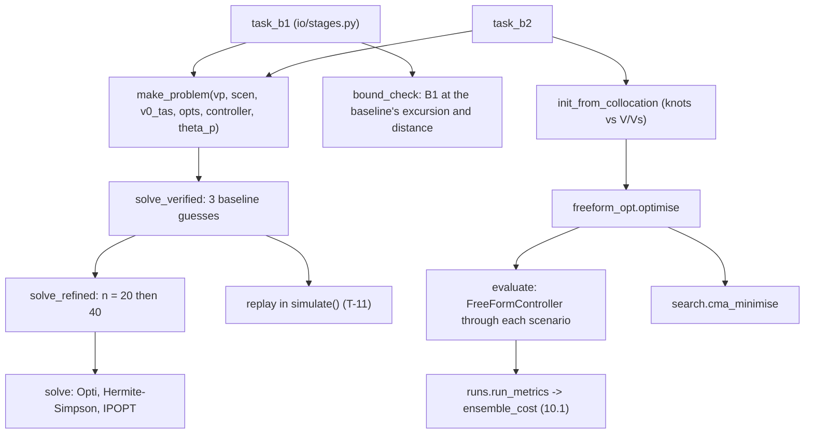

> B2 was removed from the code on 2026-10-27. Mentions of B2 below describe the code at the time of writing.

> [!abstract] What these files are
> Analysis B: **how good can the back transition be if the controller is not restricted to ArduPilot's structure?** It has two stages.
> - **B1 (`collocation.py`)** is the open-loop optimum for one known scenario, by direct collocation (Hermite-Simpson) and IPOPT. Unknowns: rotor-throttle and pitch-command histories and the final time. It gives the smallest energy for a given altitude band, and so the shape of the best schedule and a bound for the other analyses.
> - **B2 (`freeform_opt.py` with `control/freeform.py`)** turns that answer into a **law of speed**: rotor throttle and pitch command as piecewise-linear functions of $V/V_s$ (eq. 8.1), 13 numbers tuned over the whole scenario ensemble with CMA-ES and the same cost (10.1) as analysis C. It has no altitude feedback.
> Section 10B of the proposal; equation (10.4).

> [!note] Where the numbers in this note come from
> Everything in sections 3–5 is my own set of runs with the repo's functions (`stages.task_b1`, `collocation.*`, `freeform_opt.*`) on the real configs in draft mode: the register's vehicle, `controller.yaml`, `scenarios.yaml`, `study.yaml` (B1: scenarios S-01…S-06, $\varepsilon_h$ = 20, 10, 6, 3 m, $\varepsilon_x$ = 300 m, 40 intervals refined from 20, 800 iterations; B2: the 32-scenario ensemble with seed 8, started from a B1 solution). I ran B1 for **S-01, S-02 and S-03 only** (about five minutes per scenario) and B2 **reduced to 2 seeds and 8 generations** (the shipped setting is 8 seeds and 20 generations, which takes hours here). The repo is unchanged.

---

## 1. What question B answers, and where it sits

$$\text{B: what is the best the hardware and physics allow, and how far is the autopilot from it?}$$

| analysis | what it varies | role |
| --- | --- | --- |
| **B1** | open-loop throttle and pitch histories, final time | physical bound for one scenario (under its own limits) |
| **B2** | 13 knots of a speed-scheduled law | best robust law over the ensemble, no altitude feedback |
| C | ArduPilot parameters | what is configurable ([[analysis_C]]) |
| A | zero-altitude-loss feasibility | where the schedule starts when B2 is not started from B1 ([[analysis_A]]) |

| input | where it comes from |
| --- | --- |
| B1 scenarios | `study.yaml` → `B1.scenarios` (S-01…S-06); entry at `mission.speeds.entry_eas_ms` = 20.9 m/s **equivalent**, converted to TAS (20.9 at sea level, 27.0 at 5000 m) |
| B1 sweep | $\varepsilon_h$ ∈ {20, 10, 6, 3} m, $\varepsilon_x$ = 300 m, `intervals` 40, `refine_from` [20], `max_iter` 800 |
| B2 ensemble | the same 32 scenarios, seed and weights as C, so costs are comparable |
| B2 start | a B1 solution for ensemble member 0 (4789 m, ISA +4.6 K, SoC 0.78, 24.9 kg) at $\varepsilon_h$ = 10, $\varepsilon_x$ = 300, replotted against $V/V_s$ |
| vehicle, controller gains | register; the baseline used for guesses and for the bound check takes its gains from `controller.yaml` |

---

## 2. Method

### 2.1 B1: the optimal control problem

State: $x = [x,\ h,\ v_x,\ v_h,\ \theta,\ q,\ \omega_r,\ \omega_p,\ v_1]$ (9 states); controls: effective rotor throttle $\delta_r$ and pitch command $\theta_{cmd}$; **the pusher stays at zero**.

$$
\min\ \tfrac{1}{1000}\!\int V_{bus}I_{bus}\,dt\ +\ \mathrm{reg}\!\int\!\dot u^2dt
\quad\text{s.t.}\quad \dot x=f(x,u),\ \ |h-h_{ref}|\le\varepsilon_h,\ \ x_{tr}\le\varepsilon_x
$$

| item | how it is set |
| --- | --- |
| discretisation | Hermite-Simpson on $n$ intervals (40 here, refined from 20; the proposal suggests 100–200), free final time $t_f$ ≤ 60 s, **mesh graded** so steps are finer at both ends |
| start | the cruise entry state (rotors at rest, pusher windmilling) |
| end | ground speed = 1 m/s, $|v_h|\le 0.5$ m/s |
| altitude band | $|h-h_{ref}|\le\varepsilon_h$ at the nodes **and at the collocation points** |
| rotor throttle | $0\le\delta_r\le 0.95$, slew ≤ 5 s⁻¹ (effective throttle: the ESC dead zone is removed from the NLP and put back in the replay) |
| pitch command | $|\theta_{cmd}|\le 0.6$ rad (34.4°), slew ≤ 1 rad/s |
| battery | $V_{bus}\ge V_{min}$ at the nodes |
| wing | $|\alpha_w|\le 0.85\,\alpha_s$ **while the wing carries load** ($V$ at or above the 1g stall speed; smooth switch) |
| operational | $|v_h|\le 3$ m/s at the nodes |
| regulariser | weight 0.01 on the squared control rate, relative to energy in kJ, to condition a flat optimum |
| solver | CasADi `Opti`, IPOPT with exact Hessian, tolerance 10⁻⁵, `acceptable` level 10⁻⁴, SX expansion |
| model | the single CasADi vehicle with smoothing 0.02 A in the current clip; replay uses the near-exact model |

**Robustness and verification.**
- **Multi-start:** each point is solved from three baseline-controller guesses ($\theta_A$/$T_{bt}$ = 20°/3 s, 12°/5 s, 25°/2 s); non-convergence is recorded in `attempts`.
- **Mesh refinement:** solve at $n$ = 20, warm-start $n$ = 40.
- **Replay (T-11):** every result is flown in `simulate()` with the near-exact vehicle; it is `verified` only if energy, distance and duration agree within 2% and the excursion within 2% or 0.3 m.
- **Bound check:** B1 is solved at the baseline's own excursion and distance, to see whether B1 is cheaper.

### 2.2 B2: the speed-scheduled law (eq. 8.1)

$$
\delta_r(s)=\begin{cases}\mathrm{interp}(s;\,s_k,\ d_k) & s\le s_{on}\\ 0 & s>s_{on}\end{cases},\qquad
\theta_{cmd}(s)=\mathrm{interp}(s;\,s_k,\ t_k),\qquad s=\frac{V}{V_s},\ \ s_k=(0.1,\,0.4,\,0.8,\,1.2,\,1.6,\,2.4)
$$

13 parameters: six rotor-throttle knots $d_k\in[0,0.9]$, six pitch knots $t_k\in[-0.1,0.5]$ rad, and $s_{on}\in[0.3,2.4]$. **No altitude feedback**: the law reacts only to the speed actually flown, so a disturbance passes through. Evaluation: fly it through every ensemble scenario in `simulate()`, score with (10.1), search with CMA-ES (initial step 0.1 on the unit cube when started from B1; serial; cached).

The start is either analysis A's pre-spun schedule replotted against $V/V_s$ (`init_from_zero_loss`, the default of `optimise`) or a B1 solution replotted the same way (`init_from_collocation`, the proposal's step 2, used by `task_b2`). The B1 rotor throttle is converted from effective to ESC command, the knots are read off by interpolating over airspeed, and $s_{on}$ is where B1 first switches the rotors on.

---

## 3. Code map

| item | what it does |
| --- | --- |
| `CollocationOptions` | mesh, limits, smoothing, solver settings (defaults are the values above) |
| `solve` | one NLP; returns `B1Solution` (`ok`, `t`, `x`, `u`, `t_f`, `energy`, `excursion`, `distance`, `status`) |
| `solve_refined`, `solve_verified` | mesh refinement; multi-start with replay |
| `replay`, `ReplayCheck.passes` | T-11 |
| `min_excursion` | the objective "smallest excursion under a distance cap" ($\varepsilon_h^*$); **not run by the stage** |
| `bound_check`, `compare` | B1 against the baseline; B1, C and B2 side by side |
| `FreeFormParams`, `FreeFormController` | the law (8.1) |
| `freeform_opt.optimise` | B2's search; `FreeFormResult.search.spread` for T-12 |

---

## 4. B1: what the run shows

### 4.1 The trade between excursion, energy and distance

All 12 points converged and **replay-verified** (replay differences: energy ≤ 0.8%, distance ≤ 0.3%, duration ≤ 0.4%; the excursion differs by ≤ 0.17 m).

| scenario (entry TAS) | $\varepsilon_h$ | excursion | energy | distance | duration |
| --- | --- | --- | --- | --- | --- |
| **S-01** sea level (20.9 m/s) | 20 m | 13.0 m | 5.94 kJ | 64 m | 5.1 s |
| | 10 | 10.0 | 6.08 | 83 | 6.1 |
| | 6 | 6.0 | 6.29 | 112 | 7.5 |
| | 3 | 3.0 | 7.09 | 133 | 9.0 |
| **S-02** 5000 m (27.0 m/s) | 20 | 19.9 | 10.22 | 122 | 7.5 |
| | 10 | 10.0 | 10.60 | 188 | 10.0 |
| | 6 | 6.0 | 10.80 | 216 | 11.4 |
| | 3 | 3.0 | 12.73 | 241 | 13.2 |
| **S-03** 5000 m, hot, heavy, SoC 0.5 (27.5 m/s) | 20 | 20.0 | 13.78 | 130 | 7.8 |
| | 10 | 10.0 | 14.16 | 204 | 10.6 |
| | 6 | 6.0 | 14.69 | 230 | 11.8 |
| | 3 | 3.0 | 17.20 | 257 | 13.6 |

- The altitude band is **active** at every point (excursion = $\varepsilon_h$), so the sweep traces the front: from 20 m to 3 m of excursion costs 20% more energy at sea level (5.94 → 7.09 kJ) and 24% more at 5000 m heavy (13.8 → 17.2 kJ), and **roughly doubles the distance** (64 → 133 m).
- Even the tightest band (3 m) is feasible in all three scenarios, so the smallest achievable excursion $\varepsilon_h^*$ is **below 3 m** and the sweep does not locate it. The stage never runs `min_excursion`.
- The distance cap $\varepsilon_x$ = 300 m never binds (the largest distance is 257 m). The sweep over $\varepsilon_x$ that the proposal also asks for is not run.

### 4.2 What the optimal schedule looks like (S-01, from the replay)

| | $\varepsilon_h$ = 20 m | $\varepsilon_h$ = 10 m | $\varepsilon_h$ = 3 m |
| --- | --- | --- | --- |
| rotors off until | 2.5 s, $V/V_s$ = 1.03 | 3.5 s, $V/V_s$ = 1.03 | 6.1 s, $V/V_s$ = 1.07 |
| peak pitch | 34.4° (the command limit) | 34.4° | 34.4° |
| peak angle of attack | 13.8° | 13.3° | 13.3° |
| peak rotor throttle | 0.53 | 0.51 | 0.47 |

Three things are the same in every solution:
1. **The rotors stay off** (at the ESC dead-zone edge, 0.05) **until the speed has fallen to the 1g stall speed**, about $V/V_s$ = 1.03–1.07. They start from rest and spin up over 1–2 s to about 0.4 throttle, then to 0.5. Spinning the rotors early is what costs energy.
2. **The wing does the braking.** The aircraft pitches up to the command limit (34°) while the angle of attack sits at the stall margin ($0.85\,\alpha_s$ = 13.3°), so lift, not rotor thrust, carries the weight and the wing's drag decelerates it. The pitch angle is much larger than the angle of attack because the aircraft is climbing then sinking.
3. **Altitude is held by pitch while the rotors are off.** The tight bands show pitch reversals in the first seconds (a dip to −3° to −6°, then nose-up), which trim the lift and keep $|h-h_{ref}|$ inside 3 m. Only after the rotors come on does the rotor throttle take over the vertical balance.

The peak sink and climb rates reach the 3 m/s operational limit. In the last second the pitch stays near 33° and the throttle falls to about 0.26–0.31 as the speed reaches 1 m/s; the vertical speed ends inside ±0.5 m/s because B1 requires it.

### 4.3 B1 against the baseline controller

Same scenarios, same excursion band, bus energy over the whole run.

| scenario | B1, $\varepsilon_h$ = 10 m | C, register values | C, $T_{bt}$ = 1 s (the search result) | B1, $\varepsilon_h$ = 20 m |
| --- | --- | --- | --- | --- |
| S-01 | 6.08 kJ, exc 10.0, 83 m | 11.06 kJ, exc 10.5, 80 m | 8.70 kJ, exc 11.9, 64 m | 5.94 kJ, exc 13.0, 64 m |
| S-02 | 10.60 kJ, exc 10.0, 188 m | 16.35 kJ, exc 17.0, 121 m | 13.80 kJ, exc 18.3, 100 m | 10.22 kJ, exc 19.9, 122 m |
| S-03 | 14.16 kJ, exc 10.0, 204 m | 22.66 kJ, exc 18.4, 125 m | 19.26 kJ, exc 19.4, 103 m | 13.78 kJ, exc 20.0, 130 m |

- **At about the same excursion**, B1 uses about 45% less energy at sea level (6.08 against 11.06 kJ, both at ≈10 m) and, at 5000 m, 38–39% less than the register controller at a similar distance and 3 m more excursion (S-02: 10.22 kJ at 19.9 m and 122 m against 16.35 kJ at 17.0 m and 121 m; S-03: 13.78 against 22.66 kJ).
- **At 10 m of excursion in 5000 m air** the controller reaches 17–18 m; B1 holds 10 m at the price of 55–63% more distance.
- The stage's own `bound_check` compares against a different baseline (section 6, B-1): 16.9 kJ, 9.9 m, 108 m for S-01, which gives a 64% margin (58% for S-02 and S-03). Those figures overstate the headroom against the register controller.

> [!warning] The comparison is not like for like
> B1 ends each run in a controlled hover (ground speed 1 m/s **and** $|v_h|\le 0.5$ m/s). The runs of C and B2 end when the **ground speed** reaches 1 m/s, and at that instant the aircraft is **sinking**: in the 32-scenario ensemble the final vertical speed is −6.8 m/s (median) and −7.8 m/s (worst) for the register controller, and for the tuned B2 law it is −4.2 m/s (median) and −16 m/s (worst, 11 of 32 runs below −5 m/s). The energy, the distance and the altitude needed to arrest that sink are in none of C's or B2's numbers, so the energy gap to B1 is **larger** than quoted and C's and B2's excursions are **understated**. The flags do not see it either (see B-12).

> [!tip] What B1 teaches
> The best schedule is not "the baseline with better gains". It keeps the rotors **off** and lets the wing do the work until the stall speed, then brings the rotors in fast. The ArduPilot-structured controller holds altitude with the rotors from the first instant, so its rotors run (and burn energy) for the whole manoeuvre. That is a difference of structure, not of tuning, and it is why tuning C cannot reach B1.

### 4.4 Cost and reliability

About 60–100 s per point on this machine, about five minutes per scenario for the four points plus the bound check. Of the 36 solves (12 points × 3 starts), 31 converged; every point had at least one converged start. In 1 of 12 points only 1 of 3 starts converged (S-03, 3 m).

---

## 5. B2: what the run shows

*(Reduced run: 2 seeds, population 12, 8 generations, step size 0.1, started from the B1 solution for the 4789 m ensemble member.)*

### 5.1 The start

B1's schedule for a single high-altitude scenario, replotted against $V/V_s$, is **a poor start for the ensemble**: cost **6.11**, p95 excursion 40.3 m, p95 distance 454 m, mean energy 9.4 kJ, no failures. The knots do not transfer across scenarios (the rotors come on at $s_{on}$ = 1.01 and the pitch schedule is tuned to one scenario's speed history).

### 5.2 The result

| | cost | p95 excursion | median | worst | mean energy | p95 distance | failures |
| --- | --- | --- | --- | --- | --- | --- | --- |
| C, register values | 3.127 | 18.5 m | 13.8 m | 19.8 m | 13.4 kJ | 143 m | 0 |
| C, searched ($T_{bt}$ = 1 s) | 3.016 | 19.6 | 15.4 | — | 11.0 | 119 | 0 |
| B2 start (from B1) | 6.107 | 40.3 | — | — | 9.4 | 454 | 0 |
| **B2, tuned** | **2.341** | **12.5** | **8.8** | 33.8 | **8.3** | 177 | 0 |
| C, lift-aware feed-forward, register values (my patch) | 2.256 | 12.4 | 8.3 | — | 8.4 | 154 | 0 |

- Tuning takes B2 from 6.11 to 2.34. Two seeds agree to **0.6%** (T-12 asks ≤ 1%); the README's earlier B2 placeholder runs from the A-based start did not (4–9%). Whether the agreement holds with 8 seeds and 20 generations is not shown here.
- Against the register controller, B2 cuts the p95 excursion by a third (18.5 → 12.5 m) and the energy by 38% (13.4 → 8.3 kJ), at 24% more distance (143 → 177 m).
- **B2 is close to C with a lift-aware feed-forward** (cost 2.34 against 2.26). Whatever B2 gains over the register controller, a controller that anticipates the wing's lift gets about the same ([[analysis_C]] §5.6). The ArduPilot structure plus a sensible feed-forward is not far from the speed-scheduled law in this model.
- **The tuned law (knots).** Rotor throttle 0.56, 0.75, 0.31, 0.08, 0, 0.01 and pitch 25°, 28°, 29°, 18°, 1.8°, −5.7° at $V/V_s$ = 0.1, 0.4, 0.8, 1.2, 1.6, 2.4, with the rotors on below $s_{on}$ = 1.44. It keeps the structure B1 found (low throttle above the stall speed, heavy rotor use and high pitch below it), but switches the rotors on earlier (1.44 against B1's 1.03–1.07), probably because it has no feedback to catch a late start.
- **Spread of outcomes.** The excursion ranges from 6.1 to 33.8 m across the ensemble. The p95 over 32 scenarios (12.5 m) cannot see the single worst run; the 33.8 m case is excluded from the cost's excursion term.

### 5.3 Three named scenarios

| scenario | B1, $\varepsilon_h$ = 10 | B2 tuned | C register |
| --- | --- | --- | --- |
| S-01 | 6.08 kJ, 10.0 m, 83 m | 8.80 kJ, 7.2 m, 85 m | 11.06 kJ, 10.5 m, 80 m |
| S-02 | 10.60 kJ, 10.0 m, 188 m | 9.87 kJ, 11.5 m, 145 m | 16.35 kJ, 17.0 m, 121 m |
| S-03 | 14.16 kJ, 10.0 m, 204 m | 5.11 kJ, **25.8 m**, 145 m | 22.66 kJ, 18.4 m, 125 m |

B2 is competitive with B1 at sea level and 5000 m nominal, but its S-03 run (hot, heavy, SoC 0.5) is **not a successful transition**. The speed falls through the stall speed with the rotors still at 0.2–0.4 throttle, the angle of attack runs far past stall (21° at 4.6 s, then the aircraft is falling), and the run ends at 9.1 s with the ground speed at 1 m/s but the aircraft **sinking at 15 m/s, 26 m below its start**. Its 5.1 kJ is the energy of falling, not of landing. No flag marks it: `stall` counts only above the 1g stall speed and nothing checks the final vertical speed (B-12).

---

## 6. Issue register

Status: **bug** = fix needed; **decision** = a choice that belongs to the project, noted for the record; **addition** = analysis to add.

| ID | issue | status |
| --- | --- | --- |
| B-1 | `bound_check` (and `baseline_run`, `baseline_guess`) take $\theta_A$ = 20° and $T_{bt}$ = 3 s by default, **not the register's 30°**, and hard-code `delta_min` 0.1. The "baseline" in the bound check is therefore not the register controller: for S-01 it uses 16.9 kJ where the register controller uses 11.1 kJ, so the margin reads 64% where it is about 45% | **bug** (same pattern as E-1 in [[analysis_E]]) |
| B-2 | B1 is "the best trajectory **under its limits**", not a strict lower bound: it keeps $|v_h|\le 3$ m/s, slew limits and a 0.85 $\alpha_s$ wing margin that the baseline does not respect (the baseline reaches $|v_h|$ of 5.8–6.8 m/s). The module docstring says so; summary tables should too | decision (wording) |
| B-3 | The proposal's (10.4) lists a current limit and a vortex-ring-state exclusion. The NLP clips the current through the motor model but does not constrain the battery current, and has **no VRS exclusion** (no sourced boundary was available when it was written; $\kappa$ = 0.23 exists now, [[analysis_F]]). B1 ends in a controlled hover ($|v_h|\le 0.5$ m/s) but never compares its descent rate with a VRS boundary | addition |
| B-4 | Not run by the stage: the **smallest excursion** $\varepsilon_h^*$ (`min_excursion`; every point down to 3 m is feasible, so $\varepsilon_h^*$ < 3 m), the **$\varepsilon_x$ sweep** (the cap of 300 m never binds), and a free rotor start (`prespin_max`, whose spin-up energy is not counted) | addition |
| B-5 | 40 intervals against the proposal's 100–200. The replay agrees to ≤ 0.8% in energy, so the mesh is adequate for the metrics quoted; the excursion agrees to about 0.1–0.25 m (the replay tolerance allows 0.3 m) | decision (effort) |
| B-6 | B1 is open-loop and knows the scenario exactly. How much of B1's advantage survives a wrong density, mass, wind or entry speed is not shown (that is B2's job, but B2 is trained on one ensemble, not tested on another) | addition |
| B-7 | B2 starts from **one** scenario's B1 solution (ensemble member 0, at 4789 m), which gives a poor start (cost 6.1). A start from the sea-level or median member, or from several B1 solutions averaged against $V/V_s$, is untested | decision |
| B-8 | The cost's 95th-percentile excursion, over 32 scenarios, ignores the single worst run (33.8 m in B2). A worst-case term or a larger ensemble is needed if the worst case matters | decision |
| B-9 | B1 and B2 have **no feed-forward problem**: B1 is open-loop and B2 has no altitude feedback, so their excursions are unaffected by the issue in D and C. The B–C gap is inflated by it: C with a lift-aware feed-forward is within 4% of B2 on the cost ([[analysis_C]] §5.6) | follows from C-6 |
| B-10 | B2 repeatability (T-12): 0.6% in this reduced run (2 seeds); the shipped setting (8 seeds, 20 generations) has not been run. The docstring still says the A-based start failed (4–9%) and that the B1 start is "not yet shown" | addition |
| B-11 | B1 uses the register's vehicle but its own guess controller for starts; the multi-start guesses are fixed pairs (20°/3 s, 12°/5 s, 25°/2 s) and do not include the register's 30° | decision |
| B-12 | **End state not checked in C and B2.** Their runs stop at ground speed 1 m/s with the aircraft sinking at 4–16 m/s (section 4.3), and the failure flags do not catch it (`stall` only above the 1g stall speed; no final-$v_h$ check, [[analysis_D]] §6.5, §7.4). B1 requires $|v_h|\le 0.5$. B2's tuning can exploit this: the S-03 run is a fall | **bug** (missing flag; also affects [[analysis_C]]) |

### 6.1 What to take, and what not

- **Take.** The shape of the optimum (rotors off until the stall speed, wing as the brake, altitude by pitch, rotors in fast), the cost of tightening the band (20% more energy and twice the distance for 3 m against 20 m), and the sign of the gaps: the register controller uses ~40–45% more energy than B1 at the same excursion.
- **Do not take yet.** The 58–64% "energy margin" from `bound_check` (B-1); the B2 and C costs as final numbers (B-12: neither run ends in a hover; B2 used 2 seeds and 8 generations); and the claim that the bound cannot be reached by tuning until C's feed-forward issue is fixed (B-9).
- **Do not read** B1's distance as the landing-distance requirement: its cap never binds.

### 6.2 Smaller things to add

- Print the limits (|v_h|, slew, stall margin) next to every B1 table.
- Report $\varepsilon_h^*$ and the $\varepsilon_x$ front.
- Give B2 a held-out ensemble (another seed) to test generalisation.
- Make `baseline_run` use the register's $\theta_A$, $T_{bt}$ and `delta_min`.

---

## 7. Quick reference

| item | where |
| --- | --- |
| options and limits | `CollocationOptions` |
| problem, solve | `make_problem`, `solve`, `solve_refined`, `solve_verified` |
| T-11 replay | `replay`, `ReplayCheck.passes` |
| baseline comparison | `bound_check`, `compare`, `baseline_run`, `baseline_guess` |
| smallest excursion | `min_excursion` (not run by the stage) |
| free-form law | `control/freeform.py`: `FreeFormParams`, `FreeFormController`, `S_KNOTS` |
| B2 | `freeform_opt.optimise`, `init_from_collocation`, `init_from_zero_loss`, `evaluate`, `BOUNDS` |
| cost | `ensemble.ensemble_cost` (10.1), [[analysis_C]] §2.2 |
| drivers | `io/stages.py`: `task_b1`, `task_b2` |
| inputs | `study.yaml` (`B1`, `B2`), `scenarios.yaml`, `controller.yaml`, `mission.yaml` (`speeds.entry_eas_ms`) |
| related | [[analysis_C]], [[analysis_D]], [[analysis_A]], [[analysis_F]] (VRS), proposal §10B, eq. (10.4), (8.1), (8.2) |