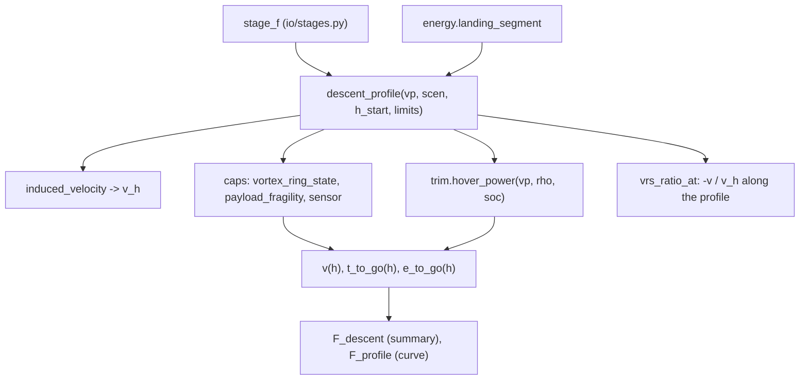

> [!abstract] What this file is Analysis F: the **landing descent profile**. It sets the vertical descent rate from physical limits (vortex ring state, payload fragility, an optional sensor limit), slows the descent near the ground, and returns the time and the hover energy for the landing. Section 10F of the proposal; equation (10.7). The landing energy feeds [[analysis_E]] (`landing_segment`). It is a closed-form profile. No simulation is run, and the profile is not linked to where the back transition ends (section 6).

> [!note] Where the numbers in this note come from Section 4 is the repo's own `task_basics` run with the real configs (draft mode). Section 5 (sensitivity to $\kappa$, start height, $h_{slow}$, $v_{final}$) is my own set of calls to `descent_profile`; the repo is unchanged.

---

## 1. What question F answers

$$\text{F: how fast may the aircraft descend in the landing hover, and what does it cost in time and energy?}$$

|input|where it comes from|
|---|---|
|thrust (= weight), disc area $A_{tot}$ (4 rotors, 1.824 m²)|vehicle, scenario mass|
|air density, SoC|scenario (`scenarios.yaml`)|
|$\kappa$ = $V_{z,max}/v_h$|`mission.yaml` → `descent.kappa` = 0.23 (sourced; no default on purpose)|
|payload fragility limit|`descent.v_fragility` = 3 m/s (assumed)|
|sensor limit|`descent.v_sensor` (none set)|
|slow-down height, final rate|`descent.h_slow` = 6 m, `descent.v_final` = 0.5 m/s|
|**start height**|`mission.yaml` → `profile.h_bt_agl_m` = **30 m** (not in `study.yaml`)|

`study.yaml` → `F` lists only the scenarios (S-01, S-02, S-03, S-05, S-06).

> [!question] Is there a constant landing altitude that F covers? Yes: **30 m above ground**, `profile.h_bt_agl_m`. It is the height at which the back transition ends and the landing hover starts, and it is read by [[analysis_E]] (`landing_segment`) and by the stage-F driver. The descent _rate_ and _time_ are the results; the height is a mission setting. It does not appear in `study.yaml`, so it cannot be swept from the study file. Section 5 shows how strongly it drives the energy.

---

## 2. Method

**Induced velocity in hover** (momentum theory, thrust = weight):

$$ v_h = \sqrt{\frac{T}{2\rho A_{tot}}},\qquad T = m g $$

**Descent-rate cap**: the smallest of the limits,

$$ V_{cap} = \min\left(\kappa,v_h,\ v_{fragility},\ v_{sensor}\right) $$

$\kappa = 0.23$ is the onset of observable vortex ring state in test data (Johnson, NASA/TP-2005-213477, Yeates data) near zero forward speed, the most conservative onset reported. The source text in the register says it was **read from a summary of the report and should be confirmed against the PDF**.

**Profile with height** $h$ (above ground):

$$ v(h)=\min!\Big(V_{cap},\ v_{final}+(V_{cap}-v_{final}),\frac{h}{h_{slow}}\Big) $$

so the aircraft descends at the cap down to $h_{slow}$ and then slows linearly to $v_{final}$ at touchdown. The time to go is $\int dh/v$ (trapezoid over 600 points). **The energy is the hover power at the scenario's density and SoC times the time to go**; nothing else is added.

$$ t_{land}=\int_0^{h_{start}}\frac{dh}{v(h)},\qquad E_{land}=P_{hover}(\rho, SoC),t_{land} $$

---

## 3. Code map

|item|what it does|
|---|---|
|`DescentLimits`|$\kappa$ (and its source string), fragility, sensor, $h_{slow}$, $v_{final}$. `kappa=None` is refused|
|`descent_profile`|returns `DescentProfile`: `h`, `v`, `t_to_go`, `e_to_go`, `v_h`, `v_cap`, `binding`, `hover_power`, `time`, `energy_J`|
|`vrs_ratio_at`|$V_c/v_h$ along the profile, with thrust taken equal to weight|
|`binding`|name of the limit that sets the cap|

---

## 4. What the run shows (start height 30 m)

|scenario|conditions|$v_h$|cap|binding|cap-speed section|time|hover power|energy|
|---|---|---|---|---|---|---|---|---|
|S-01|sea level, nominal|7.65 m/s|1.76 m/s|VRS|13.6 s|19.6 s|3932 W|21.4 Wh (77.2 kJ)|
|S-02|5000 m, nominal|9.87|2.27|VRS|10.6 s|15.7 s|4811 W|21.0 Wh|
|S-03|5000 m, ISA+10, ×1.15, SoC 0.5|10.79|2.48|VRS|9.7 s|14.5 s|5977 W|24.1 Wh|
|S-05|500 m, 5 m/s headwind|7.84|1.80|VRS|13.3 s|19.2 s|4006 W|21.4 Wh|
|S-06|5000 m, payload off, SoC 0.3|8.89|2.05|VRS|11.7 s|17.2 s|3565 W|17.0 Wh|

- **The vortex-ring limit binds in every scenario**; the 3 m/s fragility limit never does (the largest cap is 2.48 m/s).
- Thin air and heavier loads raise $v_h$ and so the allowed rate, which _shortens_ the landing, but the hover power rises more, so the energy in S-03 is the highest (24.1 Wh).
- The landing is about 17–24 Wh, 1–1.4% of the usable pack energy, and the slow-down section near the ground (6 m) is about a quarter of the time.
- The profile is independent of wind: the headwind in S-05 does not enter (a hover descent in a headwind is not modelled).

---

## 5. Sensitivity (my calls to `descent_profile`; start 30 m unless stated)

**The limit that sets the answer ($\kappa$).** Changing $\kappa$ moves the descent rate directly, until fragility takes over:

|$\kappa$|S-01 cap, binding|S-01 time, energy|S-03 cap, binding|S-03 time, energy|
|---|---|---|---|---|
|0.23 (used)|1.76, VRS|19.6 s, 21.4 Wh|2.48, VRS|14.5 s, 24.1 Wh|
|0.30|2.29, VRS|15.6 s, 17.0 Wh|3.00, fragility|12.3 s, 20.4 Wh|
|0.40 and 0.50 (inflow instability range)|3.00, fragility|12.3 s, 13.4 Wh|3.00, fragility|12.3 s, 20.4 Wh|

**Start height** (S-01 / S-03): 15 m → 11.1 s, 12.1 Wh / 8.5 s, 14.1 Wh; 30 m → 19.6 s, 21.4 Wh / 14.5 s, 24.1 Wh; 50 m → 31.0 s, 33.9 Wh / 22.6 s, 37.5 Wh; 100 m → 59.4 s, 64.9 Wh / 42.7 s, 71.0 Wh. Energy scales almost linearly with height.

**Shape near the ground.**

- $h_{slow}$ 3 / 6 / 10 / 15 m → S-01 energy 20.0 / 21.4 / 23.3 / 25.7 Wh.
- $v_{final}$ 0.3 / 0.5 / 1.0 m/s → 22.8 / 21.4 / 19.8 Wh.

> [!tip] How to read this The landing energy is set by three things in this order: the **start height**, the **$\kappa$** you accept, and the shape of the last metres. All three are mission or register inputs, not outputs of the analysis. For Q1 (range) the whole landing is about 1% of usable energy, so these only matter for safety (Q5, Q6) and the reserve.

---

## 6. What is missing, and what to add

1. **No link from D's end state to F's start.** F starts at 30 m with the aircraft stationary and at its design SoC. D ends wherever its end-of-transition test fires (ground speed 1 m/s, with the altitude, sink rate and rotor state that the run produced). In the D ensemble the end sink rate reached $V_c/v_h$ = −0.80 at worst, far beyond F's 0.23 onset. F shows what the landing _should_ look like; it does not check that D's transition hands over a state from which that profile is reachable. A hand-over check (D's end sink rate and height against F's cap at that height) would close this.
2. **Vortex ring state is a single number.** $\kappa$ = 0.23 is the onset at zero forward speed. It ignores forward speed (during the back transition the aircraft is still moving) and treats thrust as equal to weight along the profile (no thrust margin for the hold-altitude controller, ground effect or gusts).
3. **Source status.** The $\kappa$ source is a summary of a report, flagged "confirm against the PDF before quoting". It decides the answer (section 5).
4. **Start height is not a study input** (`profile.h_bt_agl_m` only). A swept `F` setting would make the 30 m a visible choice.
5. **Wind and gusts are not part of F.** S-05's headwind has no effect.
6. **Landing energy uses hover power at the scenario SoC** and ignores the hold-altitude controller's throttle activity; it is a lower bound for a gusty landing.
7. **Rangefinder / sensor limit** is empty (`v_sensor` None), so the near-ground behaviour rests on the assumed $h_{slow}$ and $v_{final}$ (Q_LAND_FINAL_ALT / Q_LAND_FINAL_SPD defaults).

---

## 7. Quick reference

|item|where|
|---|---|
|limits container|`DescentLimits` (`kappa`, `kappa_source`, `v_fragility`, `v_sensor`, `h_slow`, `v_final`)|
|profile|`descent_profile(vp, scen, h_start, limits, n=600)`|
|induced velocity|`induced_velocity(T, rho, A_tot)`|
|VRS ratio|`vrs_ratio_at(profile)`|
|driver|`io/stages.py`: `stage_f` (loop over `study.F.scenarios`)|
|consumer|[[analysis_E]]: `energy.landing_segment`|
|inputs|`mission.yaml` (`descent`, `profile.h_bt_agl_m`), `scenarios.yaml`|
|related|[[analysis_D]] (end state of the back transition), proposal §10F, eq. (10.7)|