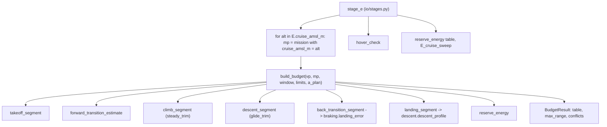

> [!abstract] What this file is Analysis E: the **mission energy budget** (Q1) and **reserve** (Q7). It adds up the energy of take-off, forward transition, climb, cruise, descent, back transition, landing and reserve, and compares the total with the usable pack energy. It returns the **maximum range** and the margin at chosen ranges. Section 10E of the proposal; equation (10.6). It is quasi-steady bookkeeping: each segment is a trim power times a time, except the back transition, which is a simulation (analysis D). It is not a time-stepped mission simulation.

> [!note] Where the numbers in this note come from Section 4 quotes the repo's own `task_basics` run (stages D, F, E, Q2) with the real `study.yaml`, `mission.yaml`, `scenarios.yaml`, `vehicle.yaml` and `controller.yaml`, loaded with `io.inputs.load_inputs` in draft mode (one draft reason, no register fallbacks). The **corrected-altitude** results (4.2) and the **SoC** numbers (6) are **my experiments**, run in scripts; the repo is unchanged. In the corrected-altitude experiment I patched the trim bracket (7.1) in the script only.

> [!warning] Fix implemented on branch `feat/e-mission-budget` (26 Oct 2026)
> The redesign is written in [`E_fix_spec.md`](E_fix_spec.md) (built on [`Q2_fix_spec.md`](Q2_fix_spec.md)) and has been implemented. Sections 4 and 6 below describe the run before the fix, and section 7 is superseded where it differs from the spec. The repo run on the real configs reproduces the numbers below. Settled by the owner:
>
> - **Two missions per site:** `round_trip` (loaded out, empty back, so two take-offs, transitions and landings) and `one_way` (loaded). **Range is an output**: the requirements (100 and 120 km) appear only as comparison columns; what is left after the fixed segments goes to cruise.
> - **Fixed climb height of 200 m (config), same take-off and landing elevation**, with a site-elevation sweep (0, 1500, 2500, 5000 m). Replaces the E-2 proposal in 7.1. **Out of scope:** the E-3 trim bracket (it surfaces as an infeasible segment, not a crash) and the E-5 OCV and battery current limit.
> - **Cruise design speed 22.5 m/s TAS at 1500 m, converted to constant dynamic pressure** (EAS 20.91) at other altitudes; climb and glide default to the cruise speed (optional overrides). This removes the fixed-TAS altitude benefit: Wh/km goes from 18.3 (0 m) to 14.4 (5000 m) at fixed TAS, but only 16.9 to 16.2 at constant EAS.
> - **Throttle check is report-only against `TKOFF_THR_MAX` (0.8)**; a segment fails only when the trim is infeasible (command above 1, current limit, bus voltage under `V_min`). The 200 m climb at 5000 m at cruise speed needs a command above 1.0 at low SoC, and that is reported as a failure, not hidden.
> - **SoC trace** from `soc_start` (default 1.0, full pack) down to `1 - eta_usable` = 0.2, checked at both ends of each segment (worse one reported); `a_fwd` per site, leg and SoC from Q2 (two passes). Reserve counted once (largest of the landings); `n_diversion_transitions` stays at 0.
> - **E-1** (use the configured controller, entry at the AIRBRAKE exit `AIRSPEED_MIN - 2`, converted to TAS; `mission.speeds.entry_eas_ms` was dropped, see below) and **E-4** (visible `a_plan_source`, `a_plan_fallback_ms2`) are fixed; the mission geometry moves from `mission.yaml` to `study.yaml` (`sites_amsl_m`, `missions`, `ranges_km`, `a_fwd_mode`, `a_fwd_metric`), and `cruise_amsl_m` and `ground_amsl_m` leave `mission.yaml`. New `analysis/soc_trace.py`.
> - **Entry speed of the back transition (2026-10-28, one entry speed).** E's back-transition segment IS analysis D's
>   stopping run from the AIRBRAKE exit; there is no separate cruise-to-exit deceleration leg in E. It now starts at
>   `braking.entry_airspeed(AIRSPEED_MIN, rho, D.entry_convention)`, the same speed D, C and B1 use, and the register
>   entry `mission.speeds.entry_eas_ms` (22 / 20.9, a cruise speed) is gone. The kinetic energy between the glide speed
>   and the exit speed is therefore not charged to any segment of E (it was charged, in part, to the back transition).
> - **Recommended case (2026-10-28).** When FT runs with E or Q2, `basics_rec:<AIRSPEED_MIN>:<TKOFF_THR_MAX %>` repeats
>   D, E and Q2 at the FT optimum's snapped values (tables `E_*_recommended`, `Q2_*_recommended`, and `E_cases` side by
>   side with the register case, which stays the headline). The values are in the task id, so a new FT optimum re-runs it.
>   The sensitivity stays at the register values. `E_cases` also prints E's forward-transition energy next to the mean
>   energy of FT's simulated forward transition at the same settings (information only).
>
> Result (repo run, defaults): round-trip radius 45.9 / 46.3 / 46.5 / 46.4 km at 0 / 1500 / 2500 / 5000 m (flown distance about 92 to 93 km); one-way 92.1 / 93.1 / 93.7 / 94.4 km; reserve 150 to 161 Wh. (Since 2026-10-27 E reads `AIRSPEED_MIN` as an equivalent airspeed, `Q2.feed_convention: eas`; with the earlier true-airspeed reading the radii were 45.9 / 46.3 / 46.6 / 47.1 km and the one-way ranges 92.1 / 93.1 / 93.7 / 95.1 km.) **The "100 km fits only at 5000 m" reading in section 4 was an artefact of fixed TAS** and is withdrawn. Open: whether `eta_usable` should read 0.9 (if the battery cut-off is 0.1 rather than 0.2, the same pack gives more usable energy; O-15), DEC-1, DEC-8.

---

## 1. What question E answers, and where it sits

$$\text{E: does the mission fit in the usable pack energy, and with what reserve?}$$

Q1 asks about 100 km and the 95th-percentile mission; Q7 asks what a go-around or diversion needs. E's outputs are the segment energies, the maximum range, the margin by range, the reserve breakdown and a hover-power check.

|input|where it comes from|
|---|---|
|mission profile, usable window, reserve|`mission.yaml` (`profile`, `battery_window`)|
|cruise altitudes, ranges|`study.yaml` → `E` (`cruise_amsl_m` list, `ranges_km`)|
|back-transition energy, time, distance|analysis D (`braking.landing_error`)|
|landing energy|analysis F|
|`a_plan`|**`a_rec` from D** (`out.get("a_rec", 2.5)`)|
|requirements|`mission.yaml` → `requirements` (100 and 120 km)|

E runs in the quick **basics** task after D and F (order A, D, F, E, Q2), so it normally sees D's `a_rec`.

> [!tip] `a_rec` as used in E is the upper limit, and what that means here
> 
> - D's `a_rec` is the highest deceleration the aircraft can **always** deliver at the pitch limit. It is a **ceiling** on `Q_TRANS_DECEL`, not the setting that lands on target ([[analysis_D]] §1).
> - E sets `a_plan = a_rec`, so its back-transition segment describes the **aggressive end** of the trade: the **shortest** switch distance and the **lowest** VTOL energy and time for this controller. Planning with a lower `a_plan` switches earlier and costs more. From D's trade curve (S-01, 20.9 m/s): $a_{plan}$ 2.5 → 1.5 adds 58 m of VTOL distance and about 11.5 kJ (3.2 Wh).
> - For Q1 this does not matter: the back transition is 4.5 Wh, about 0.27 km of range. For anything that depends on **where** the aircraft ends up (fixed distance, landing-point error, altitude excursion) it does matter, and E's value is a lower bound.
> - The link is automatic: if D is not in the run (`--only E`), `a_plan` **silently falls back to 2.5**. The fallback should be visible in the output.
> - E enters the back transition at the AIRBRAKE exit (`AIRSPEED_MIN - 2` EAS), the same speed as D, so `a_rec` is the right one for E's entry.

---

## 2. The budget

$$ E_{total}=E_{to}+E_{ft}+E_{climb}+E_{cruise}+E_{desc}+E_{bt}+E_{land}+E_{reserve}\ \le\ \eta_{usable},SoH,f(T),E_{nom} $$

with $E_{nom}$ = `n_parallel` × `capacity_Ah_pack` × `v_nominal` = 2 × 25 Ah × 44.4 V = 2220 Wh, so usable = 0.8 × 2220 = **1776 Wh** (the `BatteryParams` default of 43.2 V would give 2160 Wh; the yaml value is used).

`BudgetResult` holds the fixed segments (everything except cruise), the cruise energy per metre and the reserve:

$$ E_{total}(R) = E_{fixed} + (R - d_{fixed}),e_{cruise} + E_{reserve},\qquad R_{max} = d_{fixed} + \frac{E_{usable} - E_{fixed} - E_{reserve}}{e_{cruise}} $$

- $R$ is the **flown distance of one leg**, including the horizontal distance of the climb and the descent ($d_{fixed}$ includes them).
- A return leg or a payload drop is a second call with another mass.
- $e_{cruise} = P_{trim}(V_{cruise})/V_{cruise}$, with $V_{cruise}$ from `mission.yaml` or, if None, `best_range_speed` (level-flight sweep from 1.1 $V_s$ to 45 m/s).

---

## 3. Code map

### 3.1 Segments

|segment|how it is computed|evidence label in the code|
|---|---|---|
|`takeoff`|$P_{hover}(\rho_{ground}, SoC)\times(t_{hover,pre} + h_{clear}/v_{z,to})$ plus $m g h_{clear}/\eta_{ideal}$, with $\eta_{ideal}$ = ideal momentum power over actual bus power|hover model (assumed maps)|
|`fwd_transition`|constant acceleration `a_fwd` from 0 to `v_trans`; rotors carry the share $1-(V/V_{lw})^2$ of the weight, $V_{lw} = V_s/\sqrt{0.8}$; pusher supplies $m,a_{fwd} + D$; power integrated over $t = V/a$|quasi-steady estimate, `a_fwd` ASSUMED|
|`climb`|`steady_trim` at `v_climb`, $\gamma = \arcsin(roc/v_{climb})$, density at the mean altitude; $E = P\cdot\Delta h/roc$|steady-climb trim, pusher model|
|cruise (per metre)|`steady_trim` at `v_cruise`, density at cruise altitude; $e = P/V$|not a segment; sets $e_{cruise}$|
|`descent`|`glide_trim` (pusher off) at `v_glide`; $t = \Delta h/(V\sin(-\gamma))$; $E = P,t$, where $P$ is essentially the avionics draw|pusher-off glide trim|
|`back_transition`|`landing_error` from `v_cruise`, with `a_plan` and a **default** `BackTransitionParams.for_vehicle` (6 and 7.1)|simulation (analysis D, placeholder gains)|
|`landing`|F's `descent_profile` from `h_bt_agl_m`|analysis F, kappa source|
|reserve|go-around hover ($t_{go}$ × $P_{hover}$) + hold + diversion cruise ($d_{div},e_{cruise}$) + diversion transitions|Q7|

All powers are evaluated at **one** state of charge, `soc_mean` = 0.6.

### 3.2 `hover_check`

Checks that the hover power can be delivered at end of discharge:

$$ P_{hover,req}\ \le\ V_{bus}(SoC_{eod})\cdot I_{avail},\qquad I_{avail} = n_r\cdot0.95\cdot I_{lim} + I_{av} = 288\ \mathrm{A} $$

Reported: `p_hover_req_W`, `v_bus_eod_V`, `p_available_W`, `margin_pct`, `throttle_cmd`, `ok`. Run for `soc_eod` and `soc_eod + 0.1` at two landing elevations (ground and ground + 2000 m). See 5 and 7.2 for what the margin does and does not mean.

---

## 4. What the run shows

### 4.1 As the code runs now (real config; take-off at 0 m for every case)

`a_plan` = 2.508 (from D). Usable 1776 Wh.

|cruise altitude|$e_{cruise}$|climb|fixed distance|reserve|max range|100 km|120 km|
|---|---|---|---|---|---|---|---|
|0 m|18.26 Wh/km|0|0.2 km|157 Wh|85.2 km|no|no|
|1500 m|16.69 Wh/km|404 Wh|23.8 km|149 Wh|91.6 km|no|no|
|2500 m|15.83 Wh/km|675 Wh|40.4 km|145 Wh|93.9 km|no|no|
|5000 m|14.36 Wh/km|1351 Wh|83.3 km|137 Wh|92.7 km|no|no|

Segment energies at 1500 m: take-off 31.5 Wh (25 s), forward transition 11.2 Wh (96 m, 11.3 s), climb 404 Wh (11.7 km), descent 23.1 Wh (11.9 km), back transition 4.5 Wh (118 m, 8.9 s), landing 21.4 Wh (19.6 s), reserve 149 Wh (go-around 65 + diversion 91 at 5 km, with `cruise_1500m` $e_{cruise}$).

> [!bug] These climb energies are an artefact (section 6, E-2) The 5000 m climb uses 1351 Wh, 76% of the usable energy, because the take-off elevation stays at 0 m. See 4.2.

### 4.2 With the altitude bug corrected (my experiment: take-off elevation = cruise − 200 m)

The 0 m cruise case is floored at ground 0 (a −200 m airfield is not meaningful).

|cruise|take-off elevation|climb|take-off|max range|margin at 100 km|margin at 120 km|
|---|---|---|---|---|---|---|
|0 m|0 m|0 Wh|31.5 Wh|85.2 km|−271 Wh (−15%)|−636 Wh|
|1500 m|1300 m|46 Wh|32.9 Wh|93.1 km|−115 Wh (−6.5%)|−449 Wh|
|2500 m|2300 m|46 Wh|34.0 Wh|98.0 km|−32 Wh (−1.8%)|−348 Wh|
|5000 m|4800 m|47 Wh|37.1 Wh|**107.3 km**|**+105 Wh (+5.9%)**|−183 Wh|

- 100 km now fits at 5000 m cruise only; 120 km fits nowhere.
- With the climb at about 46 Wh, the result is set by $e_{cruise}$, the reserve and the usable fraction, not by the climb.
- Hover at the 4800 m airfield, end of discharge: 4.7 kW needed, throttle 0.78–0.80.

### 4.3 Levers (1500 m, base setup of 4.1; my sensitivity runs)

|change|max range|
|---|---|
|base|91.6 km|
|$\eta_{usable}$ 0.9 / 0.7|104.9 / 78.3 km|
|no reserve|100.5 km|
|best-range speed (17.5 TAS) instead of 22.5|101.1 km|
|mass ×1.15 / ×0.8125|83.3 / 101.4 km|
|`soc_mean` 0.8 / 0.4|91.1 / 92.1 km|
|rate of climb 1.5 m/s|92.9 km|

The transitions, take-off and landing together are about 69 Wh (3.9% of usable). Q1 is decided by the usable fraction, the cruise speed, the reserve, the mass and (until fixed) the climb. D and F fidelity matters for safety (Q3–Q6), not for Q1.

---

## 5. How to read the outputs

- **`E_summary`**: one row per cruise altitude: cruise speed, $P_{cruise}$, $e_{cruise}$ in Wh/km, fixed distance, `max_range_km`, usable and reserve Wh, `conflict_<R>km`, `a_plan_ms2`. A `conflict` of True means the maximum range is below that requirement.
- **`E_budget`**: segment Wh, total, margin Wh and %, `fits`, by range. Ranges shorter than the fixed distance are skipped.
- **`E_segments`**: energy, time, distance and the evidence label per segment.
- **`E_reserve`**: go-around, hold, diversion cruise, diversion transitions.
- **`E_hover_check`**: see 3.2. The `margin_pct` is a **power ratio against a motor-level ceiling**, so +195% means the motors and ESCs could draw about three times hover power, not that the pack can supply it. **Throttle headroom is the more informative number**: hover needs 0.66 (sea level) to 0.80 (4800 m) of a 0.95 ceiling at SoC 0.1.
- **`E_cruise_sweep`**: power and Wh/km against speed (from F's scenarios). The minimum is the best-range speed (17.5 TAS at 1500 m, 16.4 at sea level, 20.9 at 5000 m); the configured 22.5 is above it.
- **Evidence labels** travel with every segment; four of the eight say "estimate", "assumed" or "placeholder".

---

## 6. Issue register

Status: **bug** = fix needed; **decision** = a choice that belongs to the project, noted for the record; **addition** = analysis to add.

|ID|issue|status|
|---|---|---|
|E-1|The back-transition segment builds `BackTransitionParams.for_vehicle(...)` with code defaults (20°/25°, default gains), **not the controller configured in the yaml** (30°/35°). At 22.5 m/s the overshoot is 16.7 m against 7.6 m with the yaml values, and the energy 4.5 against 3.8 Wh. Negligible for Q1, but inconsistent with D|**bug**|
|E-2|**Altitude handling:** `stage_e` takes the cruise altitude from `study.yaml` but leaves `ground_amsl_m` at 0 from `mission.yaml`, so the climb is the whole cruise altitude (1470–4970 m) instead of a fixed height|**bug** (proposal in 7.1)|
|E-3|The glide and climb trims fail at high altitude because the root bracket ends at $\alpha_s$ ($C_L$ = 1.046). Exposed by E-2's fix at the 4800 m airfield. Same defect as [[analysis_A]] §7.11|**bug** (proposal in 7.1)|
|E-4|`a_plan` falls back silently to 2.5 when D is not in the run|**addition** (make visible)|
|E-5|Hover check compares against motor limits; no battery current limit or real OCV curve|**addition** (7.2)|
|E-6|Cruise speed fixed at 22.5 m/s TAS, above the best-range speed (+9.5 km at 1500 m if used)|decision|
|E-7|Forward transition is an estimate with `a_fwd` = 1.5 m/s² from the mission file, until C|decision|
|E-8|Climb runs the pusher at 0.86–0.89 throttle at the mean density; the margin at the top of the climb is smaller (compare [[analysis_Q2]])|decision (watch)|
|E-9|`range_p95_km` is 120 in the yaml while its source text says about 113 km. The conclusion is the same either way|decision (value)|
|E-10|One mean SoC for all segments, one leg, no wind, single mass per call|decision|

---

## 7. Proposed changes

Kept abstract on purpose: they state the intent so the proposal can describe them without fixing an implementation.

### 7.1 Altitude handling (E-2, E-3), config and code

**Intent.** The mission is a take-off from an airfield, a climb of a **fixed height** to the cruise altitude, cruise, a descent of the same height and a landing. The airfield elevation follows from the cruise altitude, so the climb energy no longer scales with the cruise altitude.

- _Config._ Add one setting to the `E` block of `study.yaml` for the climb height above the airfield (default about 200 m). `cruise_amsl_m` stays the swept quantity. The mission file's cruise and ground altitudes are then not needed by E (the mission value is already overridden).
- _Code._ In `stage_e`, derive the take-off and landing elevation from the cruise altitude and the climb height (with a floor for cases where it would fall below sea level), and use it for the density at take-off, the forward transition, the back transition, the landing and the reserve.
- _Hover check._ Evaluate it at each case's airfield elevation instead of the fixed ground and ground + 2000 m.
- _Trims._ Let the trim brackets reach the lift peak rather than $\alpha_s$, so climb and glide trims exist where the wing is working near its limit (shared with A §7.11).
- _Proposal wording._ The energy budget is evaluated for a set of cruise altitudes, each with a take-off and landing field a fixed climb height below the cruise altitude. The climb height is a study parameter.

### 7.2 OCV and current limits (E-5), additions to the analysis

**What the code has.** The open-circuit voltage is a **placeholder line** (`BatteryParams.voc`: 3.3 + 0.9·SoC per cell, 12 cells: 39.6 V at 0, 50.4 V at 1). The bus is solved with an equivalent-circuit pack. The only current limits are the **motor** limits (75 A each); the battery has a cut-off voltage (`V_min` = 33 V, TBD) but no continuous or peak **current** limit, and the usable window is a lump ($\eta_{usable}$ = 0.8).

**What the SoC does to the numbers** (my runs, 22.5 m/s at 1500 m and sea-level hover):

|SoC|cruise power|cruise current|bus voltage|hover power|hover current|hover throttle|
|---|---|---|---|---|---|---|
|1.0|1364 W|27.2 A|50.2 V|3938 W|79 A|0.54|
|0.6|1351 W|29.4 A|45.9 V|3925 W|86 A|0.59|
|0.2|1338 W|32.2 A|41.6 V|3912 W|95 A|0.65|
|0.1|1335 W|33.0 A|40.5 V|3909 W|97 A|0.66|

- **Energy** is almost independent of SoC (power changes by 2% across the range). Per-segment SoC tracking, built as a fixed-point iteration over the segment order, changed the maximum range by −0.05% to +0.47% (at most 0.44 km) in four setups, against ±13 km for the usable fraction. So SoC tracking is not worth a rewrite for the energy.
- **Current and voltage** change materially (+21% current in cruise, +23% in hover; −20% bus voltage). That is what the limit checks need.
- `soc_mean` = 0.6 is the midpoint of the 1.0 to 0.2 window that $\eta_{usable}$ = 0.8 implies; the yaml's `soc_eod` = 0.1 is lower than that implied end of 0.2. The code runs both.

**Proposed additions** (intent only):

- _Register._ A sourced OCV(SoC) curve for the pack, replacing the linear placeholder; battery continuous and peak current limits and the cut-off, with an evidence status. These are the O-15 inputs.
- _Analysis._ Report the SoC at the end of each segment and at the end of the mission as an output (a post-processing trace from the cumulative energy), and use the **end** SoC for the reserve and the hover check.
- _Check._ Make the end-of-discharge power check use the lower of the motor-level and battery-level current limits at the bus voltage under that load, and report throttle headroom alongside the power margin.
- _Scope._ Keep the mean SoC for segment energies unless an OCV curve with a pronounced knee changes the usable window. Then revisit the window, not the segment powers.

### 7.3 Smaller changes (E-1, E-4)

- Pass the configured controller template into the back-transition segment so E and D use the same controller (E-1).
- Record in the run output where `a_plan` came from (D's `a_rec`, or the fallback) (E-4).

---

## 8. Quick reference

|item|where|
|---|---|
|budget container and range solve|`BudgetResult` (`total_J`, `max_range_m`, `table`, `conflicts`)|
|window and profile|`BatteryWindow`, `MissionProfile`|
|segments|`takeoff_segment`, `forward_transition_estimate`, `climb_segment`, `descent_segment`, `back_transition_segment`, `landing_segment`|
|cruise speed|`best_range_speed`, `cruise_sweep`|
|reserve|`reserve_energy`|
|power check|`hover_check`|
|driver|`io/stages.py`: `stage_e` (`for alt in inp.study.E.cruise_amsl_m`)|
|trims and electrical state|`trim.steady_trim`, `trim.glide_trim`, `trim.electrical_state`, `trim.hover_state` ([[trim.py]])|
|inputs|`mission.yaml`, `study.yaml` (`E`), `vehicle.yaml` (`battery`), O-14, O-15 ([[ardupilot_open_questions]])|
|related|[[analysis_D]] (`a_rec`, back transition), [[analysis_F]] (landing), [[analysis_Q2]] (pusher margin), [[analysis_A]] §7.11 (trim bracket)|