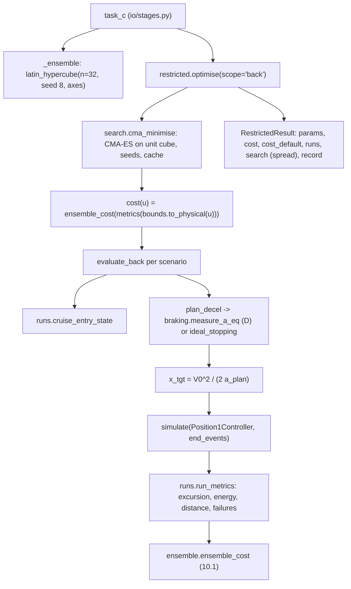

> B2 was removed from the code on 2026-10-27. Mentions of B2 below describe the code at the time of writing.

> [!abstract] What this file is
> Analysis C: **what the autopilot can be configured to do.** It searches over a few ArduPilot parameters (`Q_BACKTRANS_MS`, `Q_A_ANGLE_MAX`, `Q_M_SPIN_MIN`, and in the `full` scope also `AIRSPEED_MIN`, `Q_TRANSITION_MS`, `TKOFF_THR_MAX`) with CMA-ES, flies the ArduPilot-structured baseline controller through an ensemble of scenarios, and scores each parameter set with the ensemble cost (10.1). The result is compared with the free-form bound (B1) and the speed-scheduled law (B2) to say whether a custom transition controller is worth the effort. Section 10C of the proposal.
> The shipped study runs the **`back` scope only**: the back transition from level cruise, with three parameters free.

> [!note] Where the numbers in this note come from
> Everything in sections 4–6 is my own set of runs with the repo's functions (`restricted.evaluate_back`, `restricted.evaluate_full`, `restricted.optimise`) on the real configs (`study.yaml`, `controller.yaml`, `scenarios.yaml`, `mission.yaml`, `vehicle.yaml`) in draft mode: the same 32-scenario ensemble (seed 8) and register start point the shipped study uses. Two things differ from the shipped study: the **optimiser run is reduced** (2 seeds, 10 generations instead of 8 seeds, 20 generations, because the full setting takes hours here), and the experiments marked **(my patch)** change the controller in the script only. The repo is unchanged.

---

## 1. What question C answers, and where it sits

$$\text{C: how good can the transition be with the parameters the autopilot actually exposes?}$$

| analysis | what it varies | role |
| --- | --- | --- |
| B1 | open-loop throttle and pitch histories | physical bound (single scenario) |
| B2 | speed-scheduled free-form law | best robust law over the ensemble |
| **C** | **ArduPilot parameters only**, structure fixed | what is configurable today |
| D | one parameter, `Q_TRANS_DECEL`, evaluated against the controller | feeds C's planner |

C shares the ensemble, the seed, the weights and the search with B2, so their costs are comparable.

| input | where it comes from |
| --- | --- |
| ensemble (n = 32, seed 8) | `study.yaml` → `C`; axes from `scenarios.yaml` (altitude 0–5000 m, ISA −10..+20 K, mass ×0.80–1.15, headwind −5..+5 m/s, SoC 0.2–1.0) |
| entry speed | the AIRBRAKE exit, `AIRSPEED_MIN - 2` (`braking.entry_airspeed`, converted at the scenario density); ground speed = TAS − headwind |
| start point | the register's own values (`Q_BACKTRANS_MS` 3 s, `Q_A_ANGLE_MAX` 30°, `Q_M_SPIN_MIN` 0.1, `AIRSPEED_MIN` 17, `Q_TRANSITION_MS` 5 s, `TKOFF_THR_MAX` 0.8) |
| fixed controller values | altitude-hold and position-cascade gains from `controller.yaml`; `PTCH_LIM_MAX_DEG` 20° (the ArduPilot default; 35° before 2026-10-28) |
| search effort | 8 seeds, population 8, 20 generations, `a_plan_source: simulated` |

---

## 2. Method

### 2.1 One evaluation (`evaluate_back`)

For a parameter set and one scenario:

1. **Entry state.** Level steady cruise at the entry speed, rotors stopped, pusher windmilling (`runs.cruise_entry_state`).
2. **Plan Q_TRANS_DECEL (`plan_decel`).** With `a_plan_source = "simulated"`, run analysis D's worst-case braking (`braking.measure_a_eq`, pitch at the limit throughout) **for this same scenario, entry state and parameter set**, and take its $a_{eq}$ as `a_plan`. If the run does not stop, the ideal-pitch figure is used. With `"ideal"`, use `braking.ideal_stopping` (no simulation, half the cost).
3. **Aim point.** $x_{tgt}=V_{0,ground}^2/(2\,a_{plan})$.
4. **Fly it.** `simulate` the Position1 controller (rotor altitude hold plus the pitch-limited position cascade), pusher at zero, up to 60 s or until ground speed < 1 m/s, battery cut-off, or touchdown (100 m below the start).
5. **Metrics (`runs.run_metrics`).** Over the whole run: altitude excursion (largest departure from the entry altitude), bus energy $\int V_{bus}I_{bus}dt$, ground distance travelled, and failure flags (`stall`, `battery_cutoff`, `touchdown`, `not_stopped`).

### 2.2 The cost, (10.1)

$$
J=w_h\frac{\mathrm{p95}(\Delta h)}{h_{ref}}+w_E\frac{\overline{E}}{E_{ref}}+w_x\frac{\mathrm{p95}(x)}{x_{ref}}+\sum_k P_k\,n_k
$$

| term | weight | normaliser | meaning |
| --- | --- | --- | --- |
| altitude excursion, 95th percentile | $w_h$ = 1 | $h_{ref}$ = 10 m | |
| energy, ensemble mean | $w_E$ = 0.3 | $E_{ref}$ = 5 kJ | |
| distance, 95th percentile | $w_x$ = 0.5 | $x_{ref}$ = 150 m | **distance travelled**, not landing error |
| failures | $P_k$ = 10 each | | per flagged event in any scenario |

The weights are a policy choice; they decide which point of the trade the search returns (section 5.5).

### 2.3 The search

CMA-ES on the unit cube of the bounded parameters, started from the register values, several seeds, cached by rounded parameter vector, evaluations serial (CasADi functions are not picklable across processes). The per-seed best costs give the spread, $(\max-\min)/\text{best}$, the T-12 check (≤ 1%).

| parameter | ArduPilot name | bounds | in the shipped `back` scope |
| --- | --- | --- | --- |
| `T_bt` | `Q_BACKTRANS_MS` | 1–6 s | yes |
| `theta_A` | `Q_A_ANGLE_MAX` | 10°–30° | yes |
| `spin_min` | `Q_M_SPIN_MIN` | 0.06–0.25 | yes |
| `airspeed_min` | `AIRSPEED_MIN` | 11–18 m/s | `full` only |
| `q_transition` | `Q_TRANSITION_MS` | 2–8 s | `full` only |
| `tkoff_thr_max` | `TKOFF_THR_MAX` | 0.5–1.0 | `full` only |

Not decided by the search: `PTCH_LIM_MAX_DEG` (fixed at 20°, the ArduPilot default; it was 35° until 2026-10-28, so `Q_A_ANGLE_MAX` above 20° now changes nothing and is searched only up to 20°), `Q_TRANS_FAIL` (off), `BATT_WATT_MAX` (not modelled), `Q_TRANS_DECEL` (set inside each evaluation, 2.1 step 2).

### 2.4 The `full` scope (`evaluate_full`)

Hover → forward transition → cruise stub → back transition, flown by `BaselineController` with modes `fwd_wait` (pusher at `TKOFF_THR_MAX`, rotor altitude hold, until true airspeed ≥ `AIRSPEED_MIN`), `fwd_fade` (rotors fade linearly over `Q_TRANSITION_MS`), `cruise` (rate-limited pusher, speed and altitude hold), then the switch test and `position1`. The aim point is a fixed 800 m. Metrics: the **worse of the two transitions' excursions**, the summed energy, and the back-transition distance. The stage does not run this scope; I ran it for the check in section 6.

---

## 3. Code map

| item | what it does |
| --- | --- |
| `BACK_BOUNDS`, `FULL_BOUNDS` | the decision vectors and their bounds |
| `DEFAULT_PARAMS` | code defaults (not used in the shipped study; the register values replace them via `start`) |
| `plan_decel` | $Q\_TRANS\_DECEL$ for one evaluation, from D |
| `evaluate_back`, `evaluate_full` | one scenario, one parameter set → `RunMetrics` |
| `optimise` | the search; returns `RestrictedResult` with `search.spread` for the T-12 check |
| `ensemble.CostWeights`, `ensemble_cost` | (10.1) |
| `runs.failure_flags` | `stall` is flagged only while $V \ge$ the 1g stall speed and $|\alpha_w|>\alpha_s$ for more than 0.3 s |

---

## 4. The register start point on the ensemble

All 32 scenarios, `back` scope, `simulated` planner, register values. **Cost 3.127**, with no failures.

| term | value | contribution to $J$ |
| --- | --- | --- |
| p95 altitude excursion | 18.5 m (median 13.8 m, range 11.0–19.8 m) | 1.848 |
| mean energy | 13.4 kJ (3.7 Wh) | 0.804 |
| p95 distance | 142.6 m (range 51–161 m) | 0.475 |
| failures | 0 | 0 |

**What drives each metric** (Spearman rank correlation over the 32 scenarios):

| metric | altitude | headwind | SoC | mass | entry ground speed |
| --- | --- | --- | --- | --- | --- |
| excursion | **+0.91** | 0.00 | −0.09 | +0.09 | +0.43 |
| energy | +0.55 | −0.47 | +0.06 | **+0.68** | +0.63 |
| distance | +0.56 | **−0.88** | +0.15 | −0.04 | **+0.99** |

- **Distance** is almost entirely the entry ground speed ($x\approx V^2/2a$): the ensemble's spread of 51 to 161 m is mostly altitude (the EAS entry speed becomes 27 m/s TAS at 5000 m) and headwind.
- **Excursion** is set by altitude: 11–13 m below 1.5 km, 16–20 m above 4 km. Thin air means a higher entry TAS, lower rotor thrust and a longer manoeuvre.
- The p95 excursion of 18.5 m is 74% of the altitude term and the largest block of the cost.

**What the planner asks for.** In the simulated source `a_plan` is 2.99–3.54 m/s² at the register values, scenario by scenario. D's single recommendation is `a_rec` 2.5 m/s² ([[analysis_D]]), the lowest value that works for *every* case. See 7 (C-4).

**Landing accuracy is not in the cost, and it is poor.** Every one of the 32 runs stops *past* its aim point: overshoot (actual distance − $x_{tgt}$) 3.9–13.5 m, mean 8.8 m, 95th percentile 12.6 m. The cost scores the distance travelled, not this error.

---

## 5. What the three parameters do (one-at-a-time sweeps from the register start)

### 5.1 `Q_BACKTRANS_MS` (`T_bt`)

| $T_{bt}$ | cost | p95 excursion | mean energy | p95 distance |
| --- | --- | --- | --- | --- |
| 1 s | 3.015 | 19.6 m | 11.0 kJ | 119 m |
| 2 s | 3.083 | 19.1 | 12.3 | 131 |
| 3 s (register) | 3.127 | 18.5 | 13.4 | 143 |
| 4 s | 3.169 | 17.9 | 14.5 | 153 |
| 5 s | 3.225 | 17.4 | 15.7 | 163 |
| 6 s | 3.296 | 17.1 | 16.9 | 173 |

A slower ramp trims the excursion (19.6 → 17.1 m over 1 → 6 s) at a clear price in distance and energy. The search prefers the short ramp because the distance and energy terms outweigh 2.5 m of excursion.

### 5.2 `Q_A_ANGLE_MAX` (`theta_A`)

| $\theta_A$ | cost | p95 excursion | mean energy | p95 distance |
| --- | --- | --- | --- | --- |
| 10° | 4.615 | 9.2 m | 42.2 kJ | 348 m |
| 15° | 3.921 | 14.8 | 27.1 | 243 |
| 20° | 3.567 | 17.4 | 19.8 | 191 |
| 25° | 3.250 | 17.7 | 15.7 | 162 |
| **30° (register, upper bound)** | 3.127 | 18.5 | 13.4 | 143 |
| 35° (= the old `PTCH_LIM_MAX_DEG`; since 2026-10-28 the register's `PTCH_LIM_MAX_DEG` is the ArduPilot default, 20° (`PITCH_MAX`, Plane-4.7.2), so rows above 20° are not reachable any more) | 3.066 | 19.2 | 12.0 | 130 |
| 40° (with the pitch limit raised to 45°) | 3.030 | 19.6 | 11.1 | 120 |
| 45° (limit 50°) | 3.007 | 20.0 | 10.5 | 113 |

The strongest lever: it trades excursion directly against distance and energy. **The cost is still falling at the search's upper bound**, so the bound, not the search, decides the answer (7, C-2). Above 35° the pitch limit `PTCH_LIM_MAX_DEG` takes over unless it is also raised (rows 40° and 45° raise it in the script).

### 5.3 `Q_M_SPIN_MIN` (`spin_min`)

| $spin_{min}$ | 0.06 | 0.10 | 0.15 | 0.20 | 0.25 |
| --- | --- | --- | --- | --- | --- |
| cost | 3.127 | 3.127 | 3.127 | 3.127 | 3.127 |

**No effect.** Mean energy differs by 1 J out of 13 398 J across the whole range. The floor never binds because the altitude-hold throttle starts at the hover throttle (about 0.5–0.7 depending on SoC and density, well above the 0.06–0.25 search range) and the feed-forward keeps it there. Under the repo's controller the parameter is a **flat direction**: CMA-ES will move it freely and the result for it is noise. It becomes active once the feed-forward is fixed (5.6).

### 5.4 How `Q_TRANS_DECEL` is set

| source | cost | p95 excursion | mean energy | p95 distance |
| --- | --- | --- | --- | --- |
| simulated, per scenario (the study) | 3.127 | 18.5 m | 13.4 kJ | 143 m |
| ideal-pitch planner | 3.153 | 19.1 | 13.1 | 136 |
| one fixed value, 3.0 m/s² | 3.126 | 17.5 | 14.1 | 158 |
| one fixed value, 2.508 m/s² (D's `a_rec`) | 3.289 | 16.4 | 17.1 | 186 |

A single `Q_TRANS_DECEL` at D's recommended value costs +44 m of p95 VTOL distance (+31%) and +3.7 kJ (+28%) against the per-scenario value, and gains 2.1 m of excursion. Overshoot is about the same in all cases (mean +8.3 m with the fixed value, +8.8 m per scenario): it comes from the cascade, not from the planner.

### 5.5 What the search returns

*(Reduced run: 2 seeds, population 8, 10 generations, started from the register values.)*

| | register start | search result |
| --- | --- | --- |
| `Q_BACKTRANS_MS` | 3.0 s | **1.0 s** (lower bound) |
| `Q_A_ANGLE_MAX` | 30° | **29.96°** (upper bound) |
| `Q_M_SPIN_MIN` | 0.10 | 0.118 (seed 1 found 0.064; flat direction, 5.3) |
| cost | 3.127 | **3.016** (−3.6%) |
| p95 excursion | 18.5 m | 19.6 m |
| mean energy | 13.4 kJ | 11.0 kJ |
| p95 distance | 142.6 m | 119.4 m |
| failures | 0 | 0 |

- Two seeds agree to a **spread of 5×10⁻⁵** (T-12 asks ≤ 1%), 80 evaluations each, about 32 minutes for both on this machine.
- **The agreement is trivial.** The search ends on two bounds (`T_bt` at its lower, `theta_A` at its upper) and on a flat direction (`spin_min`), so any seed finds the same corner. The T-12 pass does not show that the problem is well explored; it shows there is a monotone direction. The result reproduces the one-at-a-time sweeps: shorter ramp, steeper lean angle, with the cost still improving beyond the angle bound (5.2).
- The gain is entirely in distance (−23 m) and energy (−2.4 kJ). The excursion **gets worse** by 1.1 m, because the weights pay more for distance and energy than for 1 m of excursion.
- A longer run (8 seeds, 20 generations) can only polish a point that sits on the bounds.

### 5.6 With a lift-aware altitude feed-forward (my patch, not in the repo)

The altitude hold's feed-forward is the hover throttle, which ignores the wing's lift ([[analysis_D]] §6.3, §7.3). It is the cause of the ballooning D shows. I replaced it in the script with a throttle that produces $(W-L)/\cos\theta$ from the previous tick's lift (instant actuators), in both the planner and the main run:

| case (ensemble of 32) | cost | p95 excursion | mean energy | p95 distance |
| --- | --- | --- | --- | --- |
| repo feed-forward, register values | 3.127 | 18.5 m | 13.4 kJ | 143 m |
| **lift-aware**, register values | **2.256** | **12.4** | **8.4** | 154 |
| lift-aware, $T_{bt}$ = 1 s | 2.416 | 15.4 | 7.4 | 130 |
| lift-aware, $\theta_A$ = 25° | 2.379 | 11.6 | 10.6 | 177 |
| lift-aware, $\theta_A$ = 20° | 2.517 | 9.2 | 14.8 | 213 |
| lift-aware, $T_{bt}$ = 6 s | **2.196** | **9.3** | 11.0 | 184 |
| lift-aware, `spin_min` 0.06 / 0.10 / 0.25 | 2.249 / 2.256 / 2.404 | 12.4 / 12.4 / 13.8 | 8.3 / 8.4 / 8.7 | 154 / 154 / 151 |

- At the register values the excursion falls by a third and the energy by more than a third.
- The parameters now **move the excursion much more**: $T_{bt}$ 1 → 6 s takes it from 15.4 to 9.3 m (against 19.6 → 17.1 m under the repo controller), and, in these few runs, the best $T_{bt}$ goes up rather than down.
- **`spin_min` becomes active** and the lower value is better (the floor now binds because the demanded throttle is low when the wing carries load).
- Therefore the conclusion drawn from the current numbers, that *"the parameters the autopilot offers barely move the altitude excursion"* (the README's statement of the placeholder result), **is mostly a statement about the feed-forward**, not about the autopilot's parameters. With spool lag the gain from fixing the feed-forward is smaller than these instant-actuator figures ([[analysis_D]] §7.2).

---

## 6. The `full` scope (all six parameters, four named scenarios)

Not run by the shipped study. One run takes about 1.5 s, so a full search is affordable. Back-transition distance was 87–98 m throughout (aim point fixed at 800 m).

**Register values.**

| scenario | worse excursion | summed energy | failures |
| --- | --- | --- | --- |
| S-01 (sea level) | 12.2 m | 65.3 kJ | none |
| S-07 (1500 m) | 11.6 | 70.4 | none |
| S-02 (5000 m) | 10.7 | 88.9 | none |
| S-03 (5000 m, hot, heavy, SoC 0.5) | 10.0 | 128.4 | none |

**`AIRSPEED_MIN`** (m/s TAS): summed energy in kJ (S-01 / S-03), excursion barely changes (12.2 → 12.1 m in S-01).

| 12 | 14 | 15 | 17 | 18 |
| --- | --- | --- | --- | --- |
| 53.5 / **stall, touchdown** | 58.0 / 111.2 | 60.3 / 116.5 | 65.3 / 128.4 | 68.0 / 135.1 |

A lower threshold saves up to 18% of the energy (S-01) but S-03 fails at 12 m/s: the wing cannot carry the aircraft at 5000 m. There is a **floor on AIRSPEED_MIN that rises with altitude and mass** (see [[analysis_Q2]]: 17 m/s true airspeed is already below the 1g stall speed at 5000 m, 17.4 m/s nominal and 18.7 m/s heavy, and this is **not flagged** at 17 because `stall` counts only above the 1g stall speed).

**`Q_TRANSITION_MS`** (s): S-01 energy in kJ, S-03 in brackets.

| 2 | 3.5 | 5 | 6.5 | 8 |
| --- | --- | --- | --- | --- |
| 56.4 (**stall, touchdown**) | 60.9 (123.9) | 65.3 (128.4) | 69.5 (134.2) | 73.6 (139.8) |

About 3 kJ of energy per second of fade, and a short fade fails at 5000 m. The excursion in S-01 hardly moves (12.2 → 12.1 m); in S-03 it moves non-monotonically between 8.7 and 11.0 m.

**`TKOFF_THR_MAX`**: summed energy in kJ.

| value | S-01 | S-07 | S-02 | S-03 |
| --- | --- | --- | --- | --- |
| 0.5 | **no transition** (243) | **no transition** (271) | **no transition** (350) | **no transition** (465) |
| 0.65 | 72.4 | 80.6 | 110.2 | **stall, touchdown** |
| 0.8 (register) | 65.3 | 70.4 | 88.9 | 128.4 |
| 1.0 | 70.0 | 72.9 | 83.8 | 109.0 |

Non-monotonic: more pusher throttle shortens the wait for `AIRSPEED_MIN` but costs pusher power, so low-altitude cases prefer 0.8 and high-altitude cases prefer 1.0. At 0.5 the pusher alone cannot reach 17 m/s (the aircraft never leaves `fwd_wait`); this floor is the thrust margin that [[analysis_Q2]] measures.

**Reading.** The forward-transition parameters move the altitude excursion little (S-01 12.1–12.2 m; S-03 8.7–11.0 m, non-monotonic), but they set the **energy** by 20–40% and carry the **failure boundaries**. None of this is visible from the `back` scope.

---

## 7. Issue register

Status: **bug** = fix needed; **decision** = a choice that belongs to the project, noted for the record; **addition** = analysis to add.

| ID | issue | status |
| --- | --- | --- |
| C-1 | `Q_M_SPIN_MIN` has **no effect** under the current altitude-hold feed-forward (cost identical to 1 part in 10⁴ over 0.06–0.25). It is in the decision vector, so the search treats it as free and its "optimum" is noise | follows from C-6 |
| C-2 | `Q_A_ANGLE_MAX` starts at its **upper bound** (30°, the register default) and the cost is still falling. The search can only move inward, so the stated optimum is "as high as allowed". The bound needs a reason (hardware, structure, flight-test limit) or an extension up to `PTCH_LIM_MAX_DEG` | decision |
| C-3 | The cost counts **distance travelled**, not landing error. All 32 runs overshoot their aim point by 3.9–13.5 m and the cost does not see it. Consistent with (10.1) as written; D carries the accuracy question | decision (consider a constraint or term) |
| C-4 | `Q_TRANS_DECEL` is set **per scenario** from the exact worst-case $a_{eq}$ (2.99–3.54 m/s² at the register values, 4.0–4.3 at $T_{bt}$ = 1 s). The real autopilot has one value, which D puts at 2.5 m/s². The oracle makes the baseline look better than a configured autopilot can be: 24% less p95 VTOL distance and 22% less energy than with D's single value (5.4) | decision (proposal step 4 reads either way) |
| C-5 | The planner's `a_plan` (up to 4.3) and the cascade's profile limit `a_lim` (3.0 m/s²) are two different numbers; the cascade brakes along its own `a_lim` profile whatever `a_plan` says. What `Q_TRANS_DECEL` corresponds to in the autopilot is open (O-11) | decision (open question) |
| C-6 | **The feed-forward issue** ([[analysis_D]] §6.3): the altitude hold ignores the wing's lift, so the excursion and energy numbers in C inherit it. With a lift-aware feed-forward (my patch) the register-point cost falls 3.13 → 2.26, the p95 excursion 18.5 → 12.4 m, and the parameters begin to matter (5.6). C's conclusions about "how far the autopilot is from the bound" should wait for this | **bug** (same as D) |
| C-7 | The shipped scope is `back` only. `AIRSPEED_MIN`, `Q_TRANSITION_MS`, `TKOFF_THR_MAX` are not searched, and they carry 20–40% of the transition energy and the stall/no-transition boundaries (6). `PTCH_LIM_MAX_DEG`, `Q_TRANS_FAIL`, `BATT_WATT_MAX` of the proposal's vector are not searched or not modelled | addition |
| C-8 | Failure flags miss low-speed wing loading: `stall` counts only above the 1g stall speed, so `AIRSPEED_MIN` = 17 m/s TAS at 5000 m (below the 1g stall speed) passes ([[analysis_D]] §6.5) | addition |
| C-9 | Ensemble axes in `scenarios.yaml` (headwind −5..+5 m/s, mass ×0.80–1.15) differ from the proposal's text (headwind −5..+10 m/s) and from the code defaults (mass ×0.85–1.15). The yaml is what runs | decision (value) |
| C-10 | Single entry speed (20.9 m/s EAS) for the whole ensemble; no gust model; the planner and the main run share the same controller and state, so the sensitivity analysis of gains has to override both | decision |
| C-11 | Cost and compute: about 13 s per ensemble evaluation with the simulated planner (6 s with the ideal one). The shipped setting is up to ~1280 evaluations serial, about 4–5 h; `search.cma_minimise` is serial although the proposal asks for parallel evaluations | decision (effort) |
| C-12 | **The run ends with the aircraft still sinking.** All 32 runs stop at ground speed 1 m/s with a vertical speed of −6.8 m/s (median) and −7.8 m/s (worst) at the register values, unchanged at the searched point. The failure flags do not see it (`stall` is counted only above the 1g stall speed; nothing checks the final vertical speed). The energy, distance and altitude needed to arrest the sink are outside C's metrics, so excursion and energy are understated, and B1 ends in a hover (\|v_h\| ≤ 0.5 m/s) ([[analysis_B]] B-12, [[analysis_D]] §7.4) | **bug** (missing flag / end condition) |

### 7.1 What to take from this, and what not

- **Take.** The shape of the trades: `Q_A_ANGLE_MAX` and `Q_BACKTRANS_MS` trade excursion against distance and energy; the forward-transition parameters set energy and the failure boundaries; the planner source barely changes the cost.
- **Do not take yet.** The optimum values and the "gap to B" until C-6 is fixed, C-2's bound is justified and C-4's planner convention is chosen.
- **Do not read the `spin_min` result as a finding** under the current controller (C-1).

### 7.2 Smaller things to add

- Report the overshoot distribution (95th percentile) next to the cost, as D does.
- Give the bound for each decision-vector member a source (register status), and flag any optimum that sits on a bound.
- Record the planner convention (per scenario vs one value) in the run output.
- Run the `full` scope, at least on the named scenarios, in the study.

---

## 8. Quick reference

| item | where |
| --- | --- |
| one back-transition evaluation | `restricted.evaluate_back(vp, scen, prm, ...)` |
| forward + cruise + back | `restricted.evaluate_full(vp, scen, prm, ...)` |
| planner | `restricted.plan_decel` → `braking.measure_a_eq` / `braking.ideal_stopping` |
| search | `restricted.optimise` → `search.cma_minimise` (`SearchResult.spread` = T-12) |
| cost | `ensemble.ensemble_cost`, `CostWeights` |
| metrics and flags | `runs.run_metrics`, `runs.segment_stats`, `runs.failure_flags` |
| controller | `ardupilot_like.Position1Controller` (back), `BaselineController` (full), [[ardupilot_like]] |
| driver | `io/stages.py`: `task_c` |
| inputs | `study.yaml` (`C`), `controller.yaml`, `scenarios.yaml` (ensemble axes), `mission.yaml` |
| related | [[analysis_D]] (planner, feed-forward), [[analysis_Q2]] (pusher margin, `AIRSPEED_MIN`), proposal §10C, §10B (B1, B2), eq. (10.1) |