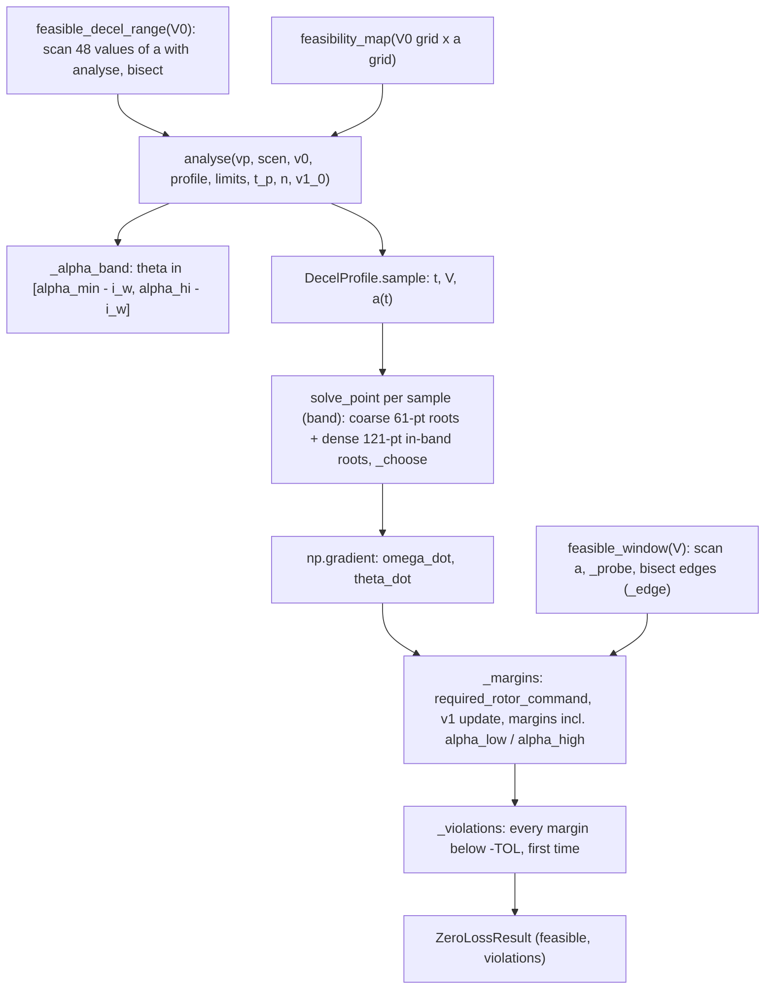

> B2 was removed from the code on 2026-10-27. Mentions of B2 below describe the code at the time of writing.

## analysis/zero_loss.py (Analysis A)

> [!abstract] What this file is
> Analysis A: a **quasi-steady feasibility scan** for holding altitude through a constant deceleration. At each speed it solves the force balance for the pitch, rotor thrust, rotor speed and throttle that keep $\gamma = 0$, then tests them against the hardware limits **and a band on the wing angle of attack**. It is algebra on samples, not a simulation: no controller, no integration, no attitude lag. Section 10A of the proposal; equations (10.2) and (10.3). Implemented from [[A_fix_spec]].

> [!note] What changed with the A fix (read this if you knew the previous version)
> - **Scope is idealised on purpose:** constant $a$ from a *free* entry speed $V_0$ down to `v_end` = 1 m/s, pusher off ($T_p = 0$), rotors **already spinning**. The entry step, the whole-segment verdict, `EntryState` and the jerk option are gone.
> - **Angle-of-attack band:** the wing may use $\alpha \in [\alpha_{min}, \alpha_{hi}]$ = 0° to the angle where $C_L = 0.8\,C_{L,max}$ (9.1°). Negative-$\alpha$ "feasible" results and the false island past the lift peak are gone.
> - **New output:** a *window* $[a_{lo}(V), a_{hi}(V)]$ per speed, and the range of constant $a$ that stays feasible over the whole path from each $V_0$.
> - **Every violated margin** is reported with its first time, not one "worst" name.
> - Numbers below that say *(PR)* are from the real configs; the rest of the section 5 numbers are my earlier hand-copied-vehicle scan (spec numbers), which agree with the PR to within about 0.02–0.025 m/s².

---
## 1. What question A answers, and where it sits

$$\text{A: with the pusher off and the rotors already spinning, can the hardware hold altitude through a constant } a \text{ from } V_0 \text{ to rest, with the wing inside } [\alpha_{min}, \alpha_{hi}]\text{?}$$

- It is the **$\varepsilon_h = 0$ corner** of the B1 problem (see [[collocation.py]]). B1 relaxes "exactly" and asks for the _smallest_ altitude excursion $\varepsilon_h^*$ the hardware can achieve, with energy and distance cost.
- So A says **where zero loss is impossible and what breaks first**; B1 says **how much loss is unavoidable**; D and C say **how much of that the ArduPilot-structured controller wastes** ([[ardupilot_like.py]]).
- The proposal's wording: A comes first because it tells the others whether the problem is limited by **hardware or by control**.

|role|how A is used|
|---|---|
|diagnostic|feasibility map over $(V_0, a)$ with every violated margin and its first time|
|geometry|`A_window`: the feasible deceleration window at each speed, and what bounds each edge|
|planning input|`A_max_feasible_decel`: smallest and largest constant $a$ over the whole path from $V_0$, with an `islands` flag|
|seed|B2 starts from A's schedule (`init_from_zero_loss`); it is built with `LEGACY_LIMITS` so it is bit-for-bit what it was before the fix|
|acceptance|B1 with constraints relaxed should reproduce A; **B1 still uses the symmetric $\lvert\alpha_w\rvert$ limit** (B-13), so compare only inside A's band|

It runs in the quick **basics** task with D, F, E and Q2 (`io/stages.py`, `task_basics` → `stage_a`). B1, B2 and C are the expensive tasks. Run time of stage A on the current config: 155 s before the fix, 216 s after *(PR)*.

---

## 2. The physics: one unknown, pitch

Prescribe $V(t)$ with $v_h = 0$, $\dot v_h = 0$ (so $\gamma = 0$, $\alpha_w = \theta + i_w$), no wind, pusher thrust $T_p$ fixed (0 in the study). The two translational equations of [[vehicle.py]] are then:

$$ \begin{aligned} \text{vertical: } & (T_r \cos\theta - H\sin\theta) + T_p\sin\theta + L - W = 0\\ \text{horizontal: } & (T_p - H)\cos\theta - T_r\sin\theta - D = -m a \end{aligned} $$

Eliminate $T_r$:

$$ R(\theta) = (T_p - H) + (m a - D)\cos\theta - (W - L)\sin\theta = 0 $$

$L$ and $D$ depend on $\theta$ through the wing angle of attack, so this is a scalar root-find in $\theta$ per sample.

**Closed form** (proposal 10.3), $T_p = 0$ and $H = 0$:

$$ \tan\theta = \frac{m a - D}{W - L},\qquad T_r = \sqrt{(m a - D)^2 + (W - L)^2} $$

Reading it: $T_r$ is the hypotenuse of two legs.

- vertical leg $T_r\cos\theta = W - L$: the weight the wing does not carry;
- horizontal leg $T_r\sin\theta = m a - D$: the braking that drag does not supply.

At low speed $L, D \to 0$ and this becomes $\tan\theta = a/g$, the ideal-pitch relation used by the controller ([[ardupilot_like.py]], `atan(a_cmd/G)`).

### 2.1 Why there is a band, and why the feasible set is a window

At $\gamma = 0$ the wing is fixed to the body, so **pitch and wing angle of attack are the same quantity** ($\alpha_w = \theta + i_w$, $i_w = 0$ here). Braking with rotor tilt needs pitch, and pitch is capped by the wing:

- **Lower end, $\alpha_{min} = 0°$.** The lift fit (CFD) covers 0–10° only. Below 0° the lift and drag are extrapolations, and the old code happily used them (the $a = 0$ reference had $\alpha = -5.6°$, $L = -29$ N). The band removes that. A separate lift floor is unnecessary: at $\alpha = 0$ the wing still lifts about 173 N, so $\alpha \ge 0$ already means $L > 0$.
- **Upper end, $\alpha_{hi}$ = where $C_L = $ `cl_frac` $\times C_{L,max}$** on the rising side, with `cl_frac` = 0.8 (proposal rule 8.6): $C_{L,max} = 1.444$, $\alpha_{0.8} = 9.1°$. `cl_frac` = 1.0 would be the lift peak (13.4°).

$R(\theta)$ has **several roots** (the lift curve folds over). The solver takes an in-band root with $T_r \ge 0$ if one exists (section 3.2); a root on the falling side of the lift curve is never chosen while an in-band one exists.

The feasible deceleration at one speed is then a **window**:

- **Lower edge, the drag floor.** At $\alpha = 0$ the wing still has about 29–31 N of drag, about 1.1 m/s² on 26.7 kg at 22.5 m/s. A gentler deceleration needs less drag, i.e. negative $\alpha$ or pusher thrust. With $\alpha \ge 0$ and the pusher off, it is unreachable. The edge falls with $V^2$ because drag does.
- **Upper edge, lift and drag are coupled.** More braking needs more pitch, more pitch is more $\alpha$, and more $\alpha$ is more lift, which takes load off the rotors and shrinks the vertical leg that carries the horizontal one.
  - At **22.5 m/s** the edge is where $T_r$ reaches 0: the wing alone carries the weight at $\alpha \approx 2.4°$ ($a \approx 1.32$); beyond it the rotors would have to push down (`thrust_sign`).
  - At **16–18 m/s** the edge (≈ 1.08) is a **fold**: the pair of low-$\theta$ roots merges and disappears, leaving only the stalled root, which is out of band (`alpha_high`).
  - At **12 m/s and below** the $\alpha$ ceiling itself sets the edge. At low speed $a \approx g\tan\alpha_{hi} = 9.81\tan 9.1° = 1.57$ minus what drag and lift take, and the window top is 1.28 at 12 m/s and 1.48 at 6 m/s (my reading, consistent with the scan).

> [!warning] "T_r starts near zero" is a special case
> The proposal's entry argument (constant $C_L$, $T_r/W = 1-(1-at/V_0)^2 \approx 2at/V_0$) needs both legs to vanish at $t = 0$. The vertical leg does (wing carries the weight). The horizontal leg vanishes only if $m a = D$, i.e. $a \approx D/m \approx 1.3$ m/s² at 22.5 m/s. For any other constant $a$ the pitch has to be different from cruise at $t = 0$, which A no longer hides behind an entry step: it just reports the schedule.

---

## 3. Code map

### 3.1 Containers

|name|role|defaults|
|---|---|---|
|`ActuatorLimits`|limits used by the margins|`delta_r_max` 0.95, `theta_max` 0.6 rad (**never binds**: $\theta = \alpha \le \alpha_{hi}$ at $\gamma = 0$), `vrs_limit` None (**unused** in the implemented version; the VRS addendum in `A_fix_spec.md` 3.7 would make it an optional margin), `alpha_min` 0.0 rad, `cl_frac` 0.8|
|`LEGACY_LIMITS`|`alpha_min=None, cl_frac=None`: the pre-fix behaviour (symmetric $\lvert\alpha\rvert \le \alpha_s$ check, full scan range)|used only by B2's start|
|`DecelProfile(a, v_end)`|constant-$a$ history|`v_end` = 1 m/s|
|`Window`|one contiguous feasible range at one speed|`a_lo`, `a_hi`, pitch and $T_r$ at both edges, `bind_lo`, `bind_hi` (every margin violated just outside)|
|`ZeroLossResult`|one path check|margins, `feasible`, `violations` (name → first time, earliest first)|

`DecelProfile.sample(v0, n)`: $V = V_0 - a t$ down to `v_end`, $t_{end} = (V_0 - v_{end})/a$. The band comes from settings: `A.alpha_min_deg` (0.0) and `A.cl_frac` (0.8) in `study.yaml`.

### 3.2 `solve_point(vp, rho, V, a, t_p, prev_theta, bal, band)`

1. `_roots`: scan $R(\theta)$ on 61 points over $\theta \in [-0.4, 1.3]$ rad and `brentq` on every sign change.
2. **With a band:** scan again on **121 points inside the band** (spacing about 0.08° for a 9° band) and merge new roots. The dense scan is there because a close root pair near a fold would otherwise be stepped over.
3. For each root: $L, D$ from `aero.forces`, then $T_r = (W - L - T_p\sin\theta + H\sin\theta)/\cos\theta$.
4. `_choose`, in priority order: in-band roots with $T_r \ge 0$; in-band roots with $T_r < 0$ (these fail `thrust_sign`); the out-of-band root nearest the band (it fails an $\alpha$ margin). Within a group, the root nearest the previous sample's $\theta$. With `band=None` (legacy) it is the old rule: nearest root among those with $T_r \ge 0$.
5. Invert the rotor map: `trim.rotor_speed_for_thrust(t_r, Vc, Ve, ...)` with $V_c = -V\sin\theta$, $V_e = V\cos\theta$ (see [[trim.py]]).
6. $H$ depends on $\omega$, which depends on $T_r$, which depends on $\theta$: repeat up to 30 times until $|H_{new} - H| < 10^{-9}$.
7. No root: a NaN point with `ok=False`, marked unsolved.

### 3.3 `analyse`

1. Compute the $\theta$ band (`_alpha_band`), sample the profile ($n = 120$ by default), `solve_point` each sample.
2. Rates: `np.gradient(om, t)` and `np.gradient(th, t)` directly. There is **no entry sample**, so the first rate is a one-sided difference of the schedule itself, not a smeared jump. (Under `LEGACY_LIMITS` the old construction, which prepends a sample and halves the first rate, is kept so B2's start does not move.)
3. `_margins`: `trim.required_rotor_command` per sample, advance the RC voltage $v_1$ with the exact discretised update (starts at `v1_0`, default 0), evaluate the margins.
4. `_violations`: every margin below $-10^{-9}$, with the time of its first violation.

The $v_1$ update uses $I_{bus} = n_r I_m + I_{av}$ (rotors only), $\tau = R_1 C_1$.

### 3.4 The margins

Positive means OK. An unsolved sample gets $-1$ in every margin.

|margin|formula|meaning|
|---|---|---|
|`pitch_solution`|+1 solved, −1 not|a root of $R(\theta)$ exists|
|`thrust_sign`|$T_r/(mg)$|rotors cannot reverse thrust|
|`throttle`|$(\delta_{max} - \delta)/\delta_{max}$|throttle ceiling 0.95|
|`current`|$(I_{lim} - I_m)/I_{lim}$|$I_m = 0$ if torque required ≤ 0|
|`voltage`|$(V_{bus} - V_{min})/V_{min}$|bus above cut-off|
|`torque_floor`|$Q_{req}/(K_t I_{lim})$|required motor torque ≥ 0 (ESC cannot brake)|
|`pitch`|$(\theta_{max} - \lvert\theta\rvert)/\theta_{max}$|0.6 rad; **not** the operational cap, but it cannot bind inside the band (θ ≤ 9.1°)|
|`pitch_rate`|$(q_{max} - \lvert\dot\theta\rvert)/q_{max}$|$q_{max}$ = 1.5 rad/s (TBD)|
|`alpha_low`|$(\alpha - \alpha_{min})/(\alpha_{hi} - \alpha_{min})$|wing not below the lift fit|
|`alpha_high`|$(\alpha_{hi} - \alpha)/(\alpha_{hi} - \alpha_{min})$|the 0.8 rule|
|`stall` (legacy only)|$(\alpha_s - \lvert\alpha_w\rvert)/\alpha_s$|replaced by the two $\alpha$ margins; $\alpha_s$ is the blend centre, not the lift peak|

`violations` replaces the single "worst margin at the first bad sample". `first_binding(result)` still returns the earliest `(name, time)` for the old shape, but it is the **first to go negative**, not necessarily the cause: read the whole dict.

### 3.5 Window, range and map

- `feasible_window(vp, scen, V, limits, t_p, a_max=3.0, da=0.02, bisect=9)`: pointwise scan of $a$ at one speed with a **steady rotor** ($\dot\omega = 0$, battery state 0), edges bisected against their infeasible neighbour. Returns a list of `Window` (empty = nothing feasible). It shows the geometry; it is **not** a path verdict.
- `closest_to_feasible`: when the window list is empty, the $a$ with the least-negative worst margin and the margins it violates (what to change to get a window).
- `feasible_decel_range(vp, scen, v0, ...)`: smallest and largest constant $a$ for which the **whole path** $V_0 \to$ `v_end` passes `analyse` (the authoritative check, including $\dot\omega$, battery state and pitch rate), plus an `islands` flag. It scans **48 values** on $[0.05, 4]$ (spacing 0.084 m/s²) and bisects each edge, so a feasible range narrower than 0.084 can still be missed. `None` = nothing feasible.
- `max_feasible_decel`: the upper end of that range (0 if none), kept as a wrapper.
- `feasibility_map`: `analyse` over a $(V_0, a)$ grid; returns `feasible` and `violations`.
- Driver `stage_a`: converts the EAS grid to TAS (`tas = eas·sqrt(RHO0/rho)`) and writes `A_feasibility` (with a `violated` string such as `thrust_sign@1.52;alpha_high@3.10`), `A_window` (one row per window, or one row with the closest-to-feasible violations and empty `a_lo`/`a_hi`), and `A_max_feasible_decel` (`min_feasible_decel_ms2`, `max_feasible_decel_ms2`, `islands`).

---

## 4. One verdict, no entry step

The previous version carried two verdicts, *whole* (rotors from rest, pitch from a level reference) and *pre-spun*. The whole verdict measured a pitch and rotor step from a state the aircraft is not in (the $a = 0$, pusher-off reference at −5.6°, $L = -29$ N, was not cruise), and its `pitch_rate` margin scaled with $1/dt_0$ (−1.19 at $n = 120$, −10.0 at $n = 600$ for $V_0 = 22.5$, $a = 3$): the sign was real, the size was a grid artefact. Both are gone.

What remains is the **pre-spun** question only: the rotors are taken as spinning at the first schedule value. That is not a flight state either, but it is a clean one, and it is the right idealisation for asking what the hardware and the wing can hold. What it leaves out is listed in section 7.

---

## 5. What the scan shows

### 5.1 At 22.5 m/s (pusher off, 1500 m density)

$V_0 = 22.5$ m/s was a speed known for sure (cruise), not a Position1 entry speed.

- **No constant-$a$ profile from 22.5 m/s is feasible** *(PR: "22.5: none")*. For $a \le 1.0$ the roots sit below 0° (the old results were $\theta$ = −5.0° at 0.2, −3.9° at 0.5, −1.4° at 1.0: negative lift, extrapolated), so `alpha_low`; for $a \ge 1.1$ the in-band root has $T_r < 0$ and fails `thrust_sign` (at 3.98 s for 1.1, 1.52 s for 1.2, earlier above).
- **The pointwise window at 22.5 m/s is 1.18 to 1.32 m/s²** *(PR; spec 1.20 to 1.32)*, about 0.14 wide. A constant $a$ inside it at $t = 0$ leaves it within a second or two, because the window moves as $V$ falls: at 20 m/s it is 0.94 to 1.14, at 18 m/s 0.76 to 1.08. Constant $a$ is the wrong profile family here.
- A profile that follows the window would take the aircraft from 22.5 to about 14 m/s (the 1g stall speed) in roughly 150 m at about 1 m/s² on average. That is an estimate, not an integrated trajectory.

### 5.2 Window by speed

|$V$ (m/s TAS)|$a_{lo}$|$a_{hi}$|what bounds the top|
|---|---|---|---|
|22.5|1.20 (PR 1.18)|1.32|$T_r = 0$ (`thrust_sign`)|
|21|1.04|1.20|—|
|20|0.94|1.14|fold (PR within 0.025)|
|19|0.86|1.12|—|
|18|0.76|1.08|fold|
|17|0.68|1.08|fold|
|16|0.60|1.08 (PR 1.09)|fold|
|15|0.54|1.10|—|
|14|0.46|1.16|—|
|12|0.34|1.28 (PR 1.28)|$\alpha_{hi}$ ceiling|
|10|0.24|1.36|$\alpha_{hi}$ ceiling|
|6|0.10|1.48|$\alpha_{hi}$ ceiling|

Edges are from the pointwise scan (spec numbers: hand-copied vehicle, $C_{D0}$ = 0.066, real-config run within 0.02–0.025). The lower edge slides down with $V^2$ (the drag floor); the upper edge is nearly flat at 1.08–1.16 between 14 and 18 m/s. "What bounds the top" is given only where I have checked it (the PR's note for 20 m/s, my scan for the rest); "—" means not checked, so read `bind_hi` in `A_window`.

### 5.3 The constant-$a$ range from each $V_0$

|$V_0$ (m/s TAS)|feasible constant $a$ (spec)|*(PR)*|
|---|---|---|
|22.5|none|none|
|20|0.94 to 1.08|0.93 to 1.08|
|18|0.76 to 1.08||
|17|0.68 to 1.08|0.68 to 1.08|
|16|0.60 to 1.08|0.60 to 1.09|
|14|0.46 to 1.16|0.46 to 1.18|

Why the ceiling is about 1.08 for any $V_0 \ge 16$: the path has to cross the 16–18 m/s part of the window, and its top there is ≈ 1.08. A path starting at 14 m/s begins above the narrowest part and gets 1.16–1.18.

**Headline:** with the pusher off and the wing held to the 0.8 rule, the maximum feasible constant deceleration is **about 1.1 m/s²** over most entry speeds. It is a property of this idealised case (the wing carries almost all the weight at 16–18 m/s, so there is little rotor thrust to tilt), not a hardware limit.

Spot checks *(PR)*: $V_0 = 17$: $a = 1.04$ feasible, $a = 1.12$ infeasible (`thrust_sign;alpha_high`); $V_0 = 16$, $a = 1.5$ infeasible; no feasible result has $\theta < 0$. With `cl_frac` = 1.0, $a_{hi}$ at 12 m/s widens from 1.28 to 1.49 and is unchanged at 16 m/s.

### 5.4 What binds, and the hardware margins

Inside the window the electrical hardware was not the limit in the old scan (worst margins at $a = 1$, $V_0 = 22.5$: throttle 0.37, current 0.51, voltage 0.43). **I have not seen the new `A_feasibility` table**, so that statement is from the old run; check the `violated` column: if any of `throttle`, `current`, `voltage` appear before `thrust_sign` or the $\alpha$ margins, it changes. Caveats in section 7.

---

## 6. What A is and is not telling you

**Take from it**

1. The pointwise window: at each speed the feasible deceleration is a band, bounded below by the wing's drag floor and above by lift–drag coupling (or the $\alpha$ ceiling at low speed).
2. The ceiling for constant-$a$ zero-loss braking is about 1.1 m/s² with the pusher off. Anything planned at 2–3 m/s² (the `Q_TRANS_DECEL` range) loses altitude on some part of the braking; B1 quantifies how much. This is a statement about the idealised case, not about any controller.
3. The rotors must be spinning at about hover speed (≈ 150–280 rad/s) when braking begins. That is why $V_{on}$ is a decision variable in B/C and why the real system has an **AIRBRAKE stage** (open question O-03 in [[ardupilot_open_questions]]) that A assumes, rather than models.
4. Feasibility can have islands; `A_max_feasible_decel.islands` says if it does.

**Do not take from it**

- Any distance, altitude loss, energy or `Q_TRANS_DECEL` value (those are D and B/C).
- The maximum feasible deceleration as a recommendation: Position1 does not fly a constant-$a$ profile (sqrt cascade, pitch ramp).
- The window as a trajectory: it assumes a steady rotor. The whole-path verdict from `analyse` / `feasible_decel_range` is the one that includes $\dot\omega$, battery state and pitch rate.
- `first_binding` as a cause: read `violations`.
- $\alpha_{hi}$ as a measured number: it rests on a **provisional $C_{L,max}$** (the CFD has no peak up to 15°; `vehicle.yaml` marks $\alpha_s$ PROVISIONAL).

---

## 7. What was in the old list, and where each item stands

|old item|status after the fix|
|---|---|
|7.1 Rotor spool-up, lead time|**Deferred.** Rotors are pre-spun in A. The spool law ($T_{spool}$ = 0.5 s, `MOT_SPIN_MIN` 0.15, O-06) applies where rotors start from shut-down, at AIRBRAKE entry; the lead-time output is for D and B1 later|
|7.2 Entry state (wrong reference)|**Removed.** There is no entry state; the entry speed is a free scan axis|
|7.3 Pitch limit not operational|**Not binding in A.** θ ≤ 9.1° inside the band, below either cap; `theta_max` left as is|
|7.4 Negative lift allowed|**Fixed** by `alpha_min` = 0 (and a lift floor is redundant). B1 still has the symmetric limit: B-13|
|7.5 Pusher electrical draw|**Not applicable** while the pusher is off|
|7.6 VRS margin declared, not checked|**Specified, not implemented.** `vrs_limit` is still never read and there is no VRS entry in the margins. `A_fix_spec.md` 3.7 adds (a) an always-on report of $V_c/v_h$ ($V_c = -V\sin\theta$, $v_h=\sqrt{T_r/(2\rho A_{tot})}$): minimum and time per run, value at each window edge; (b) an optional `vrs` margin at $-\kappa$ (`descent.kappa` = 0.23), off by default (`A.vrs_enforce`). Preview, hand-copied vehicle: ratio about 0 at $a_{lo}$ and −0.3 to −0.7 at $a_{hi}$ for 12 to 20 m/s; enforcing −0.23 removes the top 0.04 to 0.18 m/s² of each window (0.60 to 1.00 at 16 m/s instead of 0.60 to 1.08) and makes V0 = 17, a = 1.04 infeasible (min ratio −0.29)|
|7.7 Numerical issues|`first_binding` hiding other failures: **fixed** (`violations`). Rates: **fixed** (direct `np.gradient`, no entry jump). `v_end` = 1 m/s: **unchanged**|
|7.8 Scope and verification|Tests are added separately by the owner (the existing A tests were adapted so the suite stays green, 160 pass). Link to D's `a_rec` is made by hand. No attitude lag, wind, varying density: stay as limits of an idealised A|
|7.9 Entry speed vs `AIRSPEED_MIN` and the 0.8 rule|The 0.8 rule is now the $\alpha$ ceiling. The entry speed is free, so A needs no `AIRSPEED_MIN` convention (EAS or TAS stays an open point for Q2, D, E)|
|7.10 Stall margin lax / false islands|**Fixed.** Replaced by `alpha_low` / `alpha_high`; the root past the lift peak is never chosen while an in-band one exists|
|7.11 `steady_trim` fails below ≈ 16.8 m/s|**Still a bug** in `trim`, but A no longer calls it (no entry state)|
|7.12 Entry state at 16–17 m/s|**Moot** in A (see 7.2)|
|7.13 Reading at 16–17 m/s|**Withdrawn.** The old "any controller loses altitude" wording was too strong; read the window and range tables above|

**Still open or new**

- **`I_rot` and `q_max` are TBD** in `vehicle.yaml`; throttle, current, torque and pitch-rate margins depend on them.
- **VRS** (7.6): specified in `A_fix_spec.md` 3.7, not implemented. Open decision: report only (the spec's default) or enforce. $\kappa$ = 0.23 is from near-zero forward-speed data, the ratio diverges as $T_r \to 0$ near the upper window edge, and A runs at 12 to 22.5 m/s, so an axial-only criterion is probably over-conservative here. $\kappa$ is still to be confirmed against NASA/TP-2005-213477.
- **B1 has no $\alpha$ floor** (B-13): at a 3 m excursion limit S-01 used $\alpha_w$ down to −8.5° for 12% of the run (my replay), so B1's tight-excursion results rest on the extrapolated lift fit. `B1 relaxed = A` is only comparable inside A's band.
- **Provisional $C_{L,max}$** moves $\alpha_{hi}$ (and $V_{0.8}$): if the real value were 1.2, the 1500 m nominal-mass $V_{0.8}$ goes from 16.3 to about 17.9 m/s TAS.
- **AIRBRAKE exit with the wing still carrying the weight:** O-03 (read from `master`, not verified at the pinned tag) exits at about $\max(\text{AIRSPEED\_MIN} - 2,\ \text{Q\_ASSIST\_SPEED})$, 15 m/s for `AIRSPEED_MIN` = 17. A wing carrying the weight there is at $C_L = 1.36$, 94% of $C_{L,max}$, beyond the 0.8 rule; with the rotors holding hover it is not the same as flying unaided, but check what share of the weight the rotors carry there.
- **Reference tables for D** (kept from the old note, still valid for the 0.8 rule):

|angle|value|meaning|
|---|---|---|
|$\alpha_{0.8}$|9.1°|the 0.8 rule: the band's upper end|
|$\alpha_{peak}$|13.4°|where $C_L$ actually peaks (`cl_frac` = 1.0)|
|$\alpha_s$|15.7°|blend centre parameter, **not** a stall angle; $C_L(\alpha_s) = 1.046$, 72% of the peak|

|condition|$V_{0.8}$ TAS|$V_{0.8}$ EAS|
|---|---|---|
|nominal mass, 0 m|15.1|15.1|
|nominal mass, 1500 m|16.3|15.1|
|nominal mass, 5000 m|19.5|15.1|
|mass ×1.15, 1500 m|17.4|16.2|
|mass ×1.15, 5000 m|20.9|16.2|

($V_{0.8} = 1.12\,V_s$; $\propto\sqrt{m}$ in EAS, and TAS also $\propto 1/\sqrt{\rho}$.) At 17 m/s TAS the trim $\alpha$ is 7.9°, which leaves 1.2° to 9.1°.

(All hand calculations here, e.g. trim $\alpha$ at a given speed, are not code output.)

---

## 8. Quick reference

|item|where|
|---|---|
|force balance residual|`_Balance` (`resid`, `forces`, `scan`)|
|angle band|`_alpha_hi`, `_alpha_band`; settings `A.alpha_min_deg`, `A.cl_frac`|
|root scan and branch choice|`_roots`, `solve_point`, `_choose`|
|margins|`_margins`|
|every violation with first time|`_violations`, `ZeroLossResult.violations`, `first_binding`|
|one path|`analyse`|
|window at one speed|`feasible_window`, `closest_to_feasible`|
|constant-$a$ range from $V_0$|`feasible_decel_range`, `max_feasible_decel`|
|map|`feasibility_map`|
|pre-fix behaviour|`LEGACY_LIMITS` (B2's start)|
|driver|`io/stages.py`: `stage_a` → `A_feasibility`, `A_window`, `A_max_feasible_decel`|
|rotor inversion and throttle|`trim.rotor_speed_for_thrust`, `trim.required_rotor_command` ([[trim.py]])|
