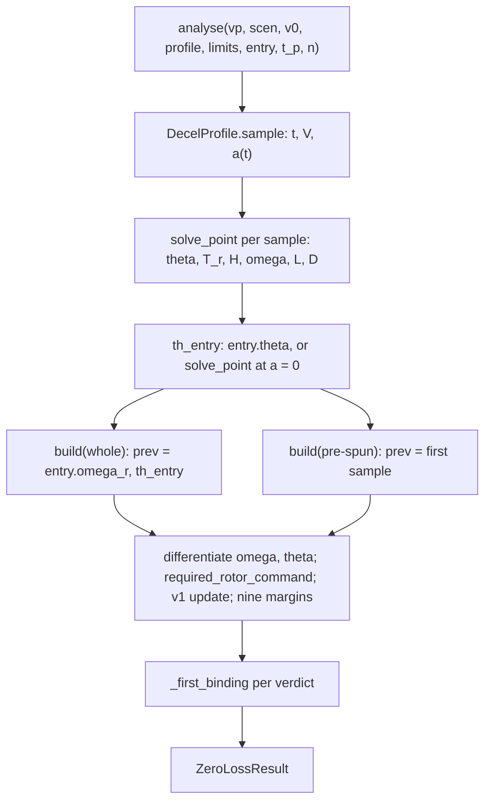

## analysis/zero_loss.py (Analysis A)

> [!abstract] What this file is Analysis A: the **zero-altitude-loss reference and feasibility check**. 
> For a prescribed airspeed history $V(t)$ it solves the force balance for the pitch, rotor thrust, rotor speed and throttle that hold altitude exactly, then tests those against the hardware limits. It is algebra on samples, not a simulation: no controller, no integration, no attitude lag. Section 10A of the proposal; equations (10.2) and (10.3).

---
## 1. What question A answers, and where it sits

$$\text{A: can the hardware hold altitude exactly through a deceleration } a \text{ from } V_0\text{?}$$
- It is the **$\varepsilon_h = 0$ corner** of the B1 problem (see [[collocation.py]]). B1 relaxes "exactly" and asks for the _smallest_ altitude excursion $\varepsilon_h^*$ the hardware can achieve, with energy and distance cost.
- So A says **where zero loss is impossible and what breaks first**; B1 says **how much loss is unavoidable**; D and C say **how much of that the ArduPilot-structured controller wastes** ([[ardupilot_like.py]]).
- The proposal's wording: A comes first because it tells the others whether the problem is limited by **hardware or by control**.

|role|how A is used|
|---|---|
|diagnostic|feasibility map over $(V_0, a)$ with the first binding constraint|
|seed|its schedule is B1's initial guess|
|acceptance|B1 with constraints relaxed must reproduce A; A must reproduce the analytic bounds (T-04 constant-deceleration, T-05 coast)|
|planning input|`A_max_feasible_decel` table (hardware ceiling for constant-$a$ zero-loss braking)|

It runs in the quick **basics** task with D, F, E and Q2 (`io/stages.py`, `task_basics` → `stage_a`). B1, B2 and C are the expensive tasks.

---

## 2. The physics: one unknown, pitch

Prescribe $V(t)$ with $v_h = 0$, $\dot v_h = 0$ (so $\gamma = 0$, $\alpha_w = \theta + i_w$), no wind, pusher thrust $T_p$ fixed. The two translational equations of [[vehicle.py]] are then:

$$ \begin{aligned} \text{vertical: } & (T_r \cos\theta - H\sin\theta) + T_p\sin\theta + L - W = 0\ \text{horizontal: } & (T_p - H)\cos\theta - T_r\sin\theta - D = -m a \end{aligned} $$

Eliminate $T_r$:

$$ R(\theta) = (T_p - H) + (m a - D)\cos\theta - (W - L)\sin\theta = 0 $$

$L$ and $D$ depend on $\theta$ through the wing angle of attack, so this is a scalar root-find in $\theta$ per sample.

**Closed form** (proposal 10.3), $T_p = 0$ and $H = 0$:

$$ \tan\theta = \frac{m a - D}{W - L},\qquad T_r = \sqrt{(m a - D)^2 + (W - L)^2} $$

Reading it: $T_r$ is the hypotenuse of two legs.

- vertical leg $T_r\cos\theta = W - L$: the weight the wing does not carry;
- horizontal leg $T_r\sin\theta = m a - D$: the braking that drag does not supply.

At low speed $L, D \to 0$ and this becomes $\tan\theta = a/g$, the ideal-pitch relation used by the controller ([[ardupilot_like.py]], `atan(a_cmd/G)`).

> [!warning] "T_r starts near zero" is a special case The proposal's entry argument (constant $C_L$, $T_r/W = 1-(1-at/V_0)^2 \approx 2at/V_0$) needs both legs to vanish at $t = 0$. 
> The vertical leg does (wing carries the weight). The horizontal leg vanishes only if $m a = D$, i.e. $a \approx D/m \approx 1.3$ m/s² at 22.5 m/s with the placeholder drag. For any other constant $a$ the pitch must change at $t=0$, which changes $L$ and $D$, and the rotors take up the difference at once.

---

## 3. Code map

### 3.1 Containers

|name|role|defaults|
|---|---|---|
|`ActuatorLimits`|limits used by the margins|`delta_r_max` 0.95, `theta_max` 0.6 rad (34°), `vrs_limit` None (**unused**)|
|`DecelProfile(a, jerk, v_end)`|prescribed history|`jerk=None`, `v_end` = 1 m/s|
|`EntryState(omega_r, theta, v1)`|state just before sample 0|`omega_r` 0, `theta` None, `v1` 0|

`DecelProfile.sample(v0, n)`:

- constant $a$: $V = V_0 - a t$ down to `v_end` (1 m/s, not 0), $t_{end} = (V_0 - v_{end})/a$;
- jerk-limited: $a(t) = \min(a, j t)$, $V = V_0 - \tfrac12 j t^2$ for $t \le a/j$, then linear; handles stopping while still ramping.

### 3.2 `solve_point(vp, rho, V, a, t_p, prev_theta, bal)`

1. `_roots`: scan $R(\theta)$ on 61 points over $\theta \in [-0.4, 1.3]$ rad, `brentq` on every sign change. $R$ can have several roots.
2. For each root: $L, D$ from `aero.forces`, then $T_r = (W - L - T_p\sin\theta + H\sin\theta)/\cos\theta$.
3. Keep roots with $T_r \ge 0$ (all roots if none qualify); pick the one **nearest the previous sample's $\theta$** (continuity along the schedule).
4. Invert the rotor map: `trim.rotor_speed_for_thrust(t_r, Vc, Ve, ...)` with $V_c = -V\sin\theta$, $V_e = V\cos\theta$ (see [[trim.py]]). Nose-up with forward speed gives _descent-like_ axial inflow.
5. $H$ depends on $\omega$, which depends on $T_r$, which depends on $\theta$: repeat up to 30 times until $|H_{new} - H| < 10^{-9}$.
6. No root: returns a NaN point with `ok=False`, marked unsolved.

### 3.3 `analyse`

1. Sample the profile ($n = 120$ by default), `solve_point` each sample.
2. `th_entry`: `entry.theta` if given, otherwise `solve_point` at **$a = 0$ with the pusher off** (see 5.1).
3. `build(om_prev, th_prev, t_prev)` is called twice (section 4): differentiate $\omega$ and $\theta$ with `np.gradient`, call `trim.required_rotor_command` per sample, advance the RC voltage $v_1$ with the exact discretised update, evaluate the margins.
4. `_first_binding` per verdict.

The $v_1$ update uses $I_{bus} = n_r I_m + I_{av}$ (rotors only), $\tau = R_1 C_1$.

### 3.4 The nine margins

Positive means OK. An unsolved sample gets $-1$ in every margin.

|margin|formula|meaning|
|---|---|---|
|`pitch_solution`|+1 solved, −1 not|a root of $R(\theta)$ exists|
|`thrust_sign`|$T_r/(mg)$|rotors cannot reverse thrust|
|`throttle`|$(\delta_{max} - \delta)/\delta_{max}$|throttle ceiling 0.95|
|`current`|$(I_{lim} - I_m)/I_{lim}$|$I_m = 0$ if torque required ≤ 0|
|`voltage`|$(V_{bus} - V_{min})/V_{min}$|bus above cut-off|
|`torque_floor`|$Q_{req}/(K_t I_{lim})$|required motor torque ≥ 0 (ESC cannot brake)|
|`pitch`|$(\theta_{max} - \lvert\theta\rvert)/\theta_{max}$|0.6 rad (34°), **not** the operational cap: `controller.yaml` has `Q_A_ANGLE_MAX` 30° and `PTCH_LIM_MAX_DEG` 35°, so the effective cap is 30° (the `BackTransitionParams` code default is 20°/25°)|
|`pitch_rate`|$(q_{max} - \lvert\dot\theta\rvert)/q_{max}$|finite difference, $q_{max}$ = 1.5 rad/s|
|`stall`|$(\alpha_s - \lvert\alpha_w\rvert)/\alpha_s$|symmetric in $\alpha$; $\alpha_s$ is the blend centre, not the lift peak (see 7.10)|

`_first_binding` returns the **earliest sample with any negative margin** and names the **worst margin at that sample**. That is not necessarily the cause.

### 3.5 Wrappers

- `max_feasible_decel`: largest constant $a$ with a feasible schedule. Feasibility is **not monotone** in $a$ (islands), so it scans 24 values on $[0.2, 8]$, takes the highest feasible, then bisects (9 iterations) against the next infeasible point. Islands narrower than about 0.34 m/s² can be missed.
- `feasibility_map`: runs `analyse` over a $(V_0, a)$ grid and returns both verdicts and the first binding constraint (pre-spun).
- Driver `stage_a`: converts EAS grid to TAS (`tas = eas·sqrt(RHO0/rho)`), writes `A_feasibility` and `A_max_feasible_decel` (pre-spun verdict).

---

## 4. The two verdicts: whole vs pre-spun

At the start of braking the schedule needs $\omega_0$ and $\theta_0$ immediately, while the real state is rotors at rest and cruise pitch. Two discontinuities:

|verdict|previous $\omega$|previous $\theta$|counts|
|---|---|---|---|
|**whole**|`entry.omega_r` (0)|`th_entry`|rotor jump **and** pitch jump|
|**pre-spun**|first schedule $\omega$|first schedule $\theta$|neither (the $V_{on}$ idea)|

> [!warning] Reading the docstring too literally The docstring mentions only the rotor jump. 
> The code also resets the previous **pitch** to the first sample, so the pre-spun verdict hides the pitch step as well. In my scan, every case where whole fails and pre-spun passes was a `pitch_rate` failure, not a rotor one.

**How the derivatives are formed.** `np.gradient` on `[prev, s0, s1, ...]` with times `[-dt0, 0, dt0, ...]` is a _central_ difference. For the first sample:

$$\dot x_0 = \frac{x_1 - x_{prev}}{2,dt_0}$$

A jump of size $\Delta$ is smeared into a ramp lasting $2,dt_0$, with slope $\Delta/(2dt_0)$.

> [!warning] Grid dependence The `pitch_rate` margin of the whole verdict scales with $1/dt_0$. 
> At $V_0 = 22.5$, $a = 3$: margin −1.19 with $n = 120$, −10.0 with $n = 600$ (ratio ≈ 5.0 = ratio of $dt_0$). The sign of the failure is real (a ≈ 23° pitch step cannot be tracked at 1.5 rad/s); the magnitude is an artefact of the grid.

---

## 5. What the run shows ($V_0 = 22.5$ m/s TAS)

### 5.1 The "level trim" entry reference is not cruise

|state|$\theta$|$T_r$|$L$|source|
|---|---|---|---|---|
|real cruise|+2.4°|0 (rotors off)|260 N (≈ W)|`trim.steady_trim`, pusher $T_p$ = 35 N|
|A's `th_entry` ($a = 0$, pusher off)|−5.6°|292 N (> W)|**−29 N**|`solve_point(..., a=0)`|

So the whole verdict measures the pitch step from a state in which the rotors cancel the drag and the wing pushes down. That is not a state the aircraft is in.

### 5.2 First sample for each constant $a$ ($W = 261.5$ N, $D/m \approx 1.3$)

|$a$ (m/s²)|$\theta_0$|$L$|$D$|$T_r$|$\omega_0$ (rad/s)|verdict (whole / pre-spun)|
|---|---|---|---|---|---|---|
|0.2|−5.0°|−5 N|29 N|268 N|283|OK / OK|
|0.5|−3.9°|34 N|29 N|228 N|261|OK / OK|
|1.0|−1.4°|123 N|30 N|139 N|203|OK / OK|
|1.2|+0.2°|180 N|32 N|81 N|156|fail `thrust_sign` at 1.5 s|
|1.4|16.0°|410 N|80 N|−154 N|0|fail `thrust_sign`|
|2.0|16.3°|357 N|82 N|−100 N|0|fail `thrust_sign`|
|3.0|17.1°|278 N|85 N|−18 N|0|fail `pitch_rate` / fail `stall`|

- **$a \lesssim 1.3$:** drag alone would over-brake. A lowers $\alpha$ to cut drag, which cuts lift, and the rotors take up the weight (139–268 N from the first sample).
- **$a \gtrsim 1.3$:** the only solution is at 16–17°, at stall ($\alpha_s$ = 15.7°). Lift exceeds weight and drag is large; the rotors would have to push down. `thrust_sign` rejects it.
- **Max feasible deceleration at 22.5 m/s is a little over 1 m/s²** (pusher off).

### 5.3 Other entry speeds (same scan, $n = 60$)

|$V_0$|feasible up to (pre-spun)|first failures|
|---|---|---|
|22.5|≈ 1.1|`thrust_sign` from 1.2–1.4|
|17|between 1.0 and 1.2|`thrust_sign` 1.2–1.6, `stall` from 2.0|
|12|between 2.0 and 2.5 (whole: 1.6 to 2.0)|`stall` from 2.5; whole fails `pitch_rate` at 2.0|

### 5.4 The hardware is not the binding constraint

Worst margins over the whole run at $a = 1$, $V_0 = 22.5$: throttle 0.37, current 0.51, voltage 0.43. What binds is **aerodynamic and structural** (`thrust_sign`, `stall`, `pitch_rate`), not the motor or battery. (Caveats in section 7: pusher draw ignored, $I_{rot}$ TBD, no spool.)

### 5.5 The rotor jump does not fail the torque check

At $a = 1$ the rotors must go $0 \to 203$ rad/s within one smeared step:

- $\dot\omega \approx 201/(2\cdot0.181) \approx 557$ rad/s²
- extra torque $I_{rot}\dot\omega = 0.0015 \times 557 \approx 0.84$ N·m, extra current ≈ 10.5 A

First-sample current margin 0.58 (whole) against 0.72 (pre-spun): about 31 A against 21 A, limit 75 A. The proposal's divergent-$\dot\omega$ argument gives $\dot\omega \approx 72/\sqrt{t}$ rad/s² against about $5.7/1.5\mathrm{e}{-3} \approx 3800$ rad/s² available: the divergent region lasts **under a millisecond** with these parameters. A rough current-limited spin-up from rest to ~280 rad/s is **≈ 0.1 s** (my estimate, not code output).

This is the core weakness of the rotor half of the check: it tests a physically too-fast rotor (section 7).

---

## 6. What A is and is not telling you

**Take from it**

1. The electrical hardware is not the limit; the aero/structure and "pusher off" assumption are.
2. Zero loss at the switch point is infeasible at the planned deceleration (≈ 2.5): some altitude loss at entry is unavoidable. B1 quantifies it.
3. The rotors must be spinning at about hover speed (≈ 150–280 rad/s) when braking begins. That is why $V_{on}$ is a decision variable in B/C, and it is the case for an **AIRBRAKE-like stage** (open question O-03 in [[ardupilot_open_questions]]) that the baseline does not model.
4. Feasibility has islands; each edge has a physical cause.

**Do not take from it**

- Any distance, altitude loss, energy or `Q_TRANS_DECEL` value (those are D and B/C).
- The maximum feasible deceleration as a recommendation: Position1 does not fly a constant-$a$ profile (sqrt cascade, pitch ramp).
- The whole-vs-pre-spun verdicts as they stand (grid-dependent, no spool, pitch reference artificial).
- The `first_binding` label as a cause.

---

## 7. What is missing and what to add

Ordered by how much it changes the answer.

### 7.1 Rotor spool-up (spool time and spin-up from rest) — missing

> [!danger] Why this blocks accurate assessment of large rotor speed rates A has **no spool lag** and no ESC slew. 
> The only rotor dynamics is $I_{rot}\dot\omega = Q_m - Q_i$ on a finite-differenced $\omega(t)$, with $I_{rot} = 1.5\times10^{-3}$ kg·m² (flagged TBD in `vehicle.yaml`). Under that, a rotor reaches hover speed from rest in about 0.1 s, so the entry jump looks free. ArduPilot spools rotors with `MOT_SPOOL_TIME` = 0.5 s (zero → min throttle, then min → full, linear in $dt/T_{spool}$) and `MOT_SPIN_MIN` = 0.15 (open question O-06, status PARTIAL, [[ardupilot_open_questions]]). The repo's `delta_min` = 0.1 is a placeholder.

What to add:

- **A throttle slew limit** in the schedule check: margin $(r_{max} - |\dot\delta|)/r_{max}$ with $r_{max} = 1/T_{spool}$, on the _throttle command_ $\delta(t)$ A already computes. B1 already has $|\dot\delta| \le r$ in (10.4); A should use the same bound.
- **Rotor-start lead time as an output.** Compute the time $t_{lead}$ the rotors need to go from rest (or from `SPIN_MIN`) to $\omega_0$ with the spool law, the motor current limit and the voltage; report $t_{lead}$ and the lead distance $V_0 t_{lead}$ per $(V_0, a)$. This replaces the smeared finite-difference $\dot\omega$ with a number independent of $n$ and directly comparable with when AIRBRAKE would have to start.
- **Sensitivity of $I_{rot}$.** Re-run with larger and smaller $I_{rot}$ (TBD): the verdict on the rotor jump depends strongly on it.
- **Spool-rate-limited pitch/thrust coupling.** With a 0.5 s spool, $T_r(t)$ lags $T_r^{req}(t)$ and the aircraft loses altitude. That loss is exactly what A cannot show but B1/D can.

### 7.2 Entry state — wrong reference

- Set `entry.theta` (and `omega_r` = 0) from `trim.steady_trim` (cruise: +2.4°, pusher on), not the pusher-off $a = 0$ solution (−5.6°, 292 N).
- Consider a jerk-limited profile so $a(0) = 0$ and the schedule starts near the entry state.

### 7.3 Pitch limit — not operational

- `theta_max` = 0.6 rad (34°) vs the operational cap. `controller.yaml` sets `Q_A_ANGLE_MAX` = 30° and `PTCH_LIM_MAX_DEG` = 35°, so the effective cap is $\min(30°, 35°) = 30°$ (the 20°/25° in `BackTransitionParams` are code defaults that the yaml overrides). The `T_bt` ramp and `Q_BCK_PIT_LIM` are also absent from A. At speed the stall check ($\alpha_s$ = 15.7°) is nominally tighter, but that check is itself lax (see 7.10); at **low speed** ($\tan\theta \approx a/g$) the 0.6 rad limit allows about $g\tan(0.6) = 6.7$ m/s² versus about $g\tan 30° = 5.7$ m/s² at the yaml cap (and 3.6 m/s² at the code-default 20°). (Geometry only; not run.) The gap between 34° and 30° is modest; the bigger omission in A is the ramp and `Q_BCK_PIT_LIM`.
- Add the operational limit as an option so low-speed results are comparable with what the autopilot can do.

### 7.4 Negative lift — allowed

- `aero.py` has no lower bound on $C_L$; the stall check is symmetric. A forbids negative rotor thrust (`thrust_sign`) but not negative wing lift. The $a = 0$ reference has $L = -29$ N and $a = 0.2$ has $L = -5$ N. The lift model is a CFD fit over 0–10°, so negative $\alpha$ is an extrapolation.
- Add `lift_floor = (L - L_min)/W`, $L_{min} = 0$ by default, or an `alpha_min`. From my numbers $L \ge 0$ removes only $a \lesssim 0.25$ at 22.5 m/s; $\alpha \ge 0$ leaves about $a = 1.07$ to $1.2$.
- Check whether B1 solutions use it: its constraint $|\alpha_w| \le \alpha_{lim}$ is symmetric too.

### 7.5 Pusher electrical draw

- `t_p` enters the force balance, but `required_rotor_command` is called with the pusher terms zero and the $v_1$ update uses rotor current plus $I_{av}$ only. Harmless at the default $T_p = 0$; optimistic for any windmilling or active pusher.
- Pass $\delta_{p,eff}$ and $\omega_p$ through; use `electrical_state`'s bus-quadratic if desired.

### 7.6 VRS margin — declared, not checked

- `ActuatorLimits.vrs_limit` ("None = report only") is never read in `zero_loss.py`, and the margin dict has no VRS entry, although proposal 10A lists a vortex-ring check. Pitching nose-up at speed puts the rotors in descent-like inflow.
- The rotor model has $C_T$ constant and edgewise terms removed, so VRS would have to be a ratio check (`vrs_ratio`) rather than a thrust effect.

### 7.7 Numerical issues

- **Grid dependence:** report derivative-based margins on a fixed time scale, or compute the entry jump analytically (as $t_{lead}$) rather than by differencing.
- **`first_binding`:** also return the _set_ of margins that fail at the first violating sample, and the first sample at which each margin fails, so the cause is not hidden.
- **Profile end:** `v_end` = 1 m/s means the final approach to rest is never tested.

### 7.8 Scope and verification

- **No attitude lag:** the proposal intends a replay of A's schedule in `simulate()` with the attitude surrogate (6.12) to measure the pitch-lag effect. I did not see that implemented in the files I read.
- **No wind, constant density, constant-$a$ profile.**
- **Tests:** I found no `zero_loss` test in the uploaded `tests/unit/` (`test_dynamics.py`, `test_physics.py` only). The acceptance targets T-04 and T-05 and "B1 relaxed = A" need tests.
- **Link to D:** nothing I saw compares D's recommended `a_rec` against A's feasible ceiling at the relevant speeds. That comparison would be the natural way to turn A into a hardware sanity check on the recommendation.

### 7.9 Entry speed: respect `AIRSPEED_MIN` and the 0.8 rule

The 22.5 m/s used above was a speed known for sure, not a Position1 entry speed. The entry speed should come from `AIRSPEED_MIN` and the proposal's rule (8.6): the wing may use at most $0.8,C_{L,max}$.

With the model's $C_{L,max} = 1.444$:

|quantity|value|
|---|---|
|allowed $C_L$|$0.8 \times 1.444 = 1.155$|
|**allowed angle of attack** $\alpha_{0.8}$|**9.1°** (level flight: $\theta = \alpha$, $i_w = 0$)|
|lowest speed with $L = W$ at that $C_L$ ($V_{0.8} = 1.12,V_s$)|16.3 m/s TAS = 15.1 m/s EAS (1500 m, nominal mass)|

**Suggested entry speed: 17 m/s TAS** (`AIRSPEED_MIN`, 15.8 m/s EAS, which is the "16 EAS" of the other config files at this density).

|entry $V_0$ (TAS, 1500 m)|EAS|$C_L/C_{L,max}$|trim $\alpha$|room to 9.1°|room to lift peak|
|---|---|---|---|---|---|
|16.3|15.1|0.80|9.0°|0.1°|4.4°|
|**17.0**|**15.8**|**0.73**|**7.9°**|**1.2°**|**5.5°**|
|18.0|16.7|0.65|6.5°|2.6°|6.9°|

At 17 TAS the rule is met but only 1.2° of pitch-up is available before it is broken; 18 TAS gives about 2.6° if braking headroom is wanted.

**The rule moves with mass and altitude** ($V_{0.8,EAS} \propto \sqrt{m}$, TAS also $\propto 1/\sqrt{\rho}$):

|condition|$V_{0.8}$ TAS|$V_{0.8}$ EAS|
|---|---|---|
|nominal mass, 0 m|15.1|15.1|
|nominal mass, 1500 m|16.3|15.1|
|nominal mass, 5000 m|19.5|15.1|
|mass ×1.15, 1500 m|17.4|16.2|
|mass ×1.15, 5000 m|20.9|16.2|

So `AIRSPEED_MIN` = 17 TAS passes at nominal mass at 1500 m but not with +15% mass at 1500 m, nor at 5000 m. Define the entry per scenario as $V_0 = \max(\text{AIRSPEED\_MIN},,V_{0.8}(m,\rho))$, set in EAS and converted to TAS with the scenario density (`stage_a` already converts EAS to TAS, ×1.086 at 1500 m; 16 EAS is 17.2 TAS, 16 TAS is a different case).

> [!warning] The number is only as good as $C_{L,max}$ `vehicle.yaml` marks $\alpha_s$ as PROVISIONAL
> $C_{L,max}$ was set to about 1.5 by hand and the CFD has no peak up to 15°. $V_{0.8} \propto 1/\sqrt{C_{L,max}}$: if the real value were 1.2, the 1500 m nominal-mass speed would rise from 16.3 to about 17.9 m/s TAS. Treat 17 TAS as a placeholder until CFD at 16–24° exists.

### 7.10 Stall margin: lax, and it creates false feasible islands

The three angles are easy to mix up:

|angle|value|meaning|
|---|---|---|
|$\alpha_{0.8}$|9.1°|the 0.8 rule: the one to enforce|
|$\alpha_{peak}$|13.4°|where $C_L$ actually peaks (a coarser grid gave 13.2°)|
|$\alpha_s$|15.7°|blend centre parameter, **not** a stall angle; $C_L(\alpha_s) = 1.046$, 72% of the peak|

The current `stall` margin passes anything below 15.7°, i.e. including $\alpha$ between 13.4° and 15.7° where lift is already falling.

Effect at lower entry speeds (same scan, pusher off, pre-spun verdict):

|entry $V_0$ (TAS)|$C_L/C_{L,max}$|$a = 1.0$|$a = 1.2$|$a = 1.5$|`max_feasible_decel`|
|---|---|---|---|---|---|
|22.5|0.42|OK|fails|fails|about 1.1|
|17.2|0.72|OK|fails|fails|1.08|
|16.0|0.83|OK|fails|**OK**|**1.83**|
|15.0|0.94|OK|fails|**OK**|**1.95**|

The $a = 1.5$ pass at 16 TAS has $\theta_0 = 15.3°$, beyond the lift peak, with $L/W = 0.99$ and $T_r = 3.7$ N: the wing carries the weight on the falling side of the lift curve with large drag, and the rotors are idle. It passes by 0.4°. The jump of `max_feasible_decel` to 1.83–1.95 is this artefact, not capability.

Fix: replace the `stall` margin with $(C_{L,0.8} - C_L)/C_{L,0.8}$ (equivalently $|\alpha| \le \alpha_{0.8}$, positive side) using the proposal's 0.8 rule. From the scan the headline should return to about 1.0–1.1 m/s² at all these speeds.

### 7.11 `trim.steady_trim` fails below about 16.8 m/s

`steady_trim` brackets $\alpha$ on $[-0.1,\ \alpha_s - i_w]$ and needs a sign change. At $\alpha_s$ the lift has already collapsed ($C_L = 1.046$), so at 16 TAS the residual there is −21 N, and the trim at $\alpha \approx 9.6°$ (inside the interval) is rejected with "wing cannot carry the weight". At 17.2 TAS it works.

- Affected: `steady_trim` at 15–16.8 TAS, `runs.cruise_entry_state`, the entry state for C; `glide_trim` has the same bracket pattern (not tested).
- Fix: put the upper bracket end at the $C_L$ peak ($\alpha \approx 13.4°$) instead of $\alpha_s$. Needed regardless of A once any entry speed below about 16.8 m/s TAS is used.
- Note that `analyse` does not call `steady_trim` (its entry reference comes from `solve_point`), so A itself is unaffected, but the corrected entry state from 7.2 depends on it.

### 7.12 Entry state at 16–17 m/s is not cruise

Open question O-03 says Position1 follows AIRBRAKE, exiting at about $\max(\text{AIRSPEED\_MIN} - 2,\ \text{Q\_ASSIST\_SPEED})$ with the rotors already spooled and holding hover. At that point:

- The rotors are spinning, so the **pre-spun verdict is the relevant one**; the whole-segment verdict (rotors from rest) mostly stops mattering.
- Set `EntryState(omega_r, theta, v1)` explicitly from what the hover-hold would give instead of defining "pre-spun" as "equal to the first sample".
- The 0.5 s spool then matters less for the check and more for **how early AIRBRAKE must start** (the lead-time output in 7.1).
- The pusher is TECS-driven in AIRBRAKE, so $T_p = 0$ is not the entry state either (see 7.5).

> [!warning] Check against the 0.8 rule 
> If `AIRSPEED_MIN` = 17 TAS and the exit threshold is `AIRSPEED_MIN` − 2 = 15 TAS (O-03, read from `master`, not verified at the pinned tag), a wing still carrying the weight there is at $C_L = 1.36$, 94% of $C_{L,max}$, beyond the 0.8 rule. At that point the rotors are holding hover, so it is not the same as flying at 15 m/s unaided; but it is worth checking what share of the weight the rotors carry at AIRBRAKE exit.

### 7.13 Reading the result at about 16–17 m/s

Zero-loss braking is feasible only if the deceleration is not much above what the wing's drag gives at its trim attitude (about 1 m/s² here, versus 1.3 at 22.5). Below that, the aircraft lowers $\alpha$ and the rotors take the weight; above it, it would have to pitch toward the lift peak, which the 0.8 rule forbids. Any `Q_TRANS_DECEL` of 2–3 therefore loses altitude at Position1 entry on any controller; B1 and D quantify how much.

(Numbers in 7.9–7.13 use the same assumptions as the rest of the note: `vehicle.yaml` values copied by hand, SoC 0.8, pusher off. The hand calculations, e.g. trim $\alpha$ at 16 TAS, are not code output.)

---

## 8. Quick reference

|item|where|
|---|---|
|force balance residual|`_Balance` (`resid`, `forces`, `scan`)|
|root scan and branch choice|`_roots`, `solve_point`|
|entry reference|`analyse`: `th_entry`|
|two verdicts|`build(...)`; `whole`, `spun`|
|margins|`m = {...}` in `build`|
|ceiling scan|`max_feasible_decel`|
|map|`feasibility_map`|
|driver|`io/stages.py`: `stage_a`|
|rotor inversion and throttle|`trim.rotor_speed_for_thrust`, `trim.required_rotor_command` ([[trim.py]])|